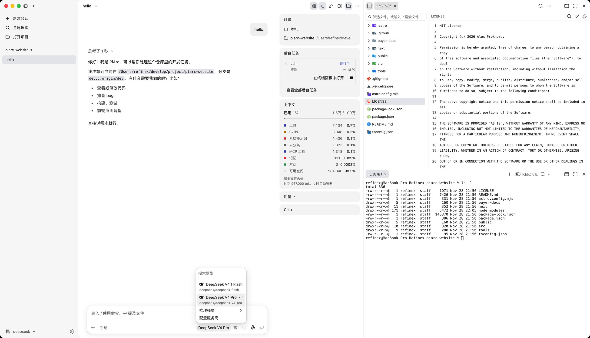
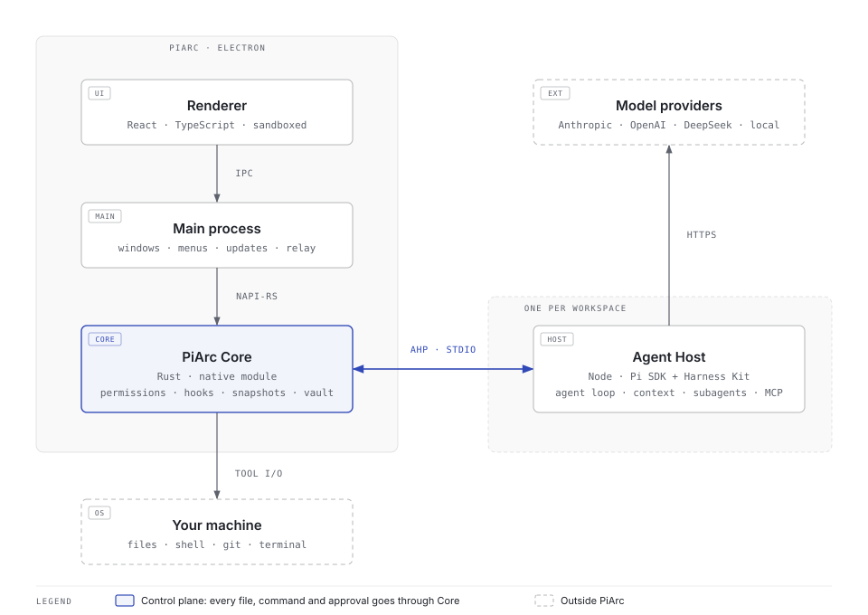

<div align="center">

<picture>
  <source media="(prefers-color-scheme: dark)" srcset=".github/assets/wordmark-dark.svg">
  
</picture>

**A desktop coding agent for macOS and Windows, built on [Pi](https://github.com/earendil-works/pi).**

A Claude Code–grade agent harness, any model provider, and one fast native workbench.

[](https://github.com/Refinex-Space/PiArc/actions/workflows/ci.yml)
[](https://github.com/Refinex-Space/PiArc/releases/latest)
[](#download)
[](LICENSE)

[Download](#download) · [Features](#features) · [Getting started](#getting-started) · [Build from source](#build-from-source) · [Docs](#documentation) · [简体中文](README.zh-CN.md)

</div>

<br>

<p align="center">
  
</p>

## Why PiArc

- **The harness, not just a chat.** Strict file-editing invariants, permission modes and rules, hooks, subagents, plan mode, checkpoints and rewind, context engineering, skills, MCP and a sandbox: the agent behaves the same, and safely, on every model.
- **Your models, your choice.** Anthropic, OpenAI, Gemini, DeepSeek, Kimi, Qwen, GLM, MiniMax, OpenRouter, any OpenAI- or Anthropic-compatible endpoint, or a model on your own machine. Sign in with a subscription where the provider offers one.
- **A real desktop app.** One Electron + React interface with the agent control plane in a Rust core, so sessions, terminals and diffs stay responsive. macOS and Windows ship from the same code.

## Features

<table>
<tr>
<td width="50%" valign="top">

#### Agent

- Read, edit and write with read-before-write, conflict detection and encoding preserved
- Bash and PowerShell with process-tree cleanup, timeouts and background tasks
- Subagents on any model, e.g. cheap exploration while the main session uses a stronger one
- Plan mode, task lists, questions, and suggested next steps
- Automatic compaction with a live context gauge
- Skills, slash commands, output styles, plugins and Pi packages
- MCP servers shared per workspace, with OAuth and on-demand tool loading

</td>
<td width="50%" valign="top">

#### Workbench

- Parallel sessions, each optionally in its own git worktree
- A terminal powered by libghostty, readable by the agent when you share it
- A Git tool: stage hunks, generated commit messages, history, merges and rebases, GitHub pull requests through your own `gh`
- A built-in browser to preview your app, which the agent can drive behind approvals
- A file browser, global search, a side chat, usage and cost per model
- Offline voice input for Chinese, English and mixed technical speech
- English and Simplified Chinese, light and dark, keyboard-first and screen-reader friendly

</td>
</tr>
<tr>
<td width="50%" valign="top">

#### Control and safety

- Structured approvals with diff previews, per-session and saved rules, and an audit trail
- Auto review: a reviewer model you pick answers routine approvals and hands the rest back to you
- Deterministic rewind from pre-write snapshots, per file and per hunk
- A command sandbox on macOS, with a network allowlist
- Credentials in an encrypted vault, never in environment variables or config files
- Managed settings for teams

</td>
<td width="50%" valign="top">

#### Works with what you have

- Reads your Claude Code setup as-is: `CLAUDE.md` / `AGENTS.md`, permission rules, hooks, `.claude/agents`, skills, commands and `.mcp.json`
- Never writes to `.claude/`
- Imports Claude Code's auto memory into PiArc's own
- No telemetry: PiArc connects only to the providers and services you configure ([outbound connections](docs/security/egress.md))

</td>
</tr>
</table>

## Download

Get the latest version from the [Releases](https://github.com/Refinex-Space/PiArc/releases/latest) page.

| Platform | Package | Updates |
|---|---|---|
| macOS 13 or later, Apple silicon | `.dmg` (arm64) | Announced in the app, installed manually |
| macOS 13 or later, Intel | `.dmg` (x64) | Announced in the app, installed manually |
| Windows 11 | Setup `.exe` (x64) | Automatic |

Windows 10 runs PiArc but is not part of the test matrix.

Each release publishes a manifest of SHA-256 checksums signed with the project's key; the app checks it before updating.

<details>
<summary><strong>First launch: approving an unsigned app</strong></summary>

<br>

PiArc is free and open source, and its builds are not signed or notarized by Apple or Microsoft ([ADR-0018](docs/adr/0018-unsigned-distribution.md)). Approve it once:

- **macOS**: move PiArc to Applications and open it. When macOS refuses, go to **System Settings → Privacy & Security** and choose **Open Anyway**. If the button does not appear, run `xattr -dr com.apple.quarantine /Applications/PiArc.app`, which lifts the download quarantine for PiArc only. After an update macOS may ask once more to allow keychain access.
- **Windows**: when SmartScreen appears, choose **More info → Run anyway**. PCs with Smart App Control turned on block unsigned apps.

</details>

## Getting started

1. **Connect a model.** The first launch walks you through it: pick a provider, paste a key, and PiArc sends one tiny request to test it. You can also sign in with a subscription (ChatGPT, GitHub Copilot and others), or point it at a custom or local endpoint. More providers live in **Settings → Models & providers**.
2. **Open a project.** Choose a folder. The first time, PiArc asks whether you trust the project before it runs any of the project's hooks, MCP servers or allow rules.
3. **Describe the task.** Type, or dictate, what you want. Approve tool calls as they come, switch to Accept edits or Auto review when you are comfortable, and rewind any turn you do not like.

## How it works

<p align="center">
  <picture>
    <source media="(prefers-color-scheme: dark)" srcset=".github/assets/architecture-dark.svg">
    
  </picture>
</p>

The agent never touches your files or processes directly: every read, write and command goes through Core, which applies the permission rules, takes snapshots and runs hooks. The [architecture document](docs/architecture/ARCHITECTURE.md) and the [decision records](docs/adr/README.md) explain why (in Chinese).

## Build from source

<details>
<summary><strong>Prerequisites</strong></summary>

<br>

| | macOS | Windows |
|---|---|---|
| Node.js | 24 (`.nvmrc`) | 24 (`.nvmrc`) |
| Rust | [rustup](https://rustup.rs); `rust-toolchain.toml` pins the version | same |
| Native toolchain | Xcode Command Line Tools (full Xcode for release packages) | Visual Studio Build Tools with MSVC and the Windows SDK |
| Other | | Git for Windows; .NET 8 SDK for the installer |

The first build downloads the libghostty-vt prebuilt and the bundled node, rg and fd, and checks their hashes.

</details>

```bash
npm ci --ignore-scripts                 # dependencies, exactly as CI installs them
node node_modules/electron/install.js   # the Electron binary
npm run build:core                      # PiArc Core, development build
npm run build:agent-host                # the Agent Host bundle
npm run start -w @piarc/desktop         # run the app with hot reload
```

Rebuild Core after changing Rust code and the Agent Host after changing `agent-host/`. To check everything CI checks, run `node scripts/dev/install-tools.mjs` once and then `npm run verify`.

Packages:

```bash
# macOS: DMG and ZIP in apps/desktop/out/release/make/
npm run package:desktop -- --flavor release --arch arm64 --make

# Windows: installer in apps/desktop/out/release/velopack/win32-x64/
npm run package:desktop -- --flavor release --arch x64
node scripts/release/pack-windows.mjs --arch x64 --flavor release --versions <version>
```

[CONTRIBUTING.md](CONTRIBUTING.md) covers the repository layout, tests and conventions; [AGENTS.md](AGENTS.md) lists every command.

## Documentation

| | |
|---|---|
| [Architecture](docs/architecture/ARCHITECTURE.md) | The design baseline: processes, protocols, harness, security, performance budgets |
| [Decision records](docs/adr/README.md) | Every architectural decision and why it was made |
| [Requirements](docs/product/REQUIREMENTS.md) · [Capabilities](docs/product/capabilities.md) | What PiArc does, and which tests prove each capability |
| [Hooks](docs/product/hooks.md) | Hooks in PiArc and how they differ from Claude Code |
| [Security](docs/security/threat-coverage.md) | Threat model coverage, the Electron checklist and outbound connections |
| [Engineering](docs/engineering/coding-standards.md) | Coding, testing, accessibility and visual design guidelines |

Design documents are written in Chinese; code, comments and commit messages are in English.

## Contributing

Bug reports, ideas and pull requests are welcome. Read [CONTRIBUTING.md](CONTRIBUTING.md) before you start, and please follow the [Code of Conduct](CODE_OF_CONDUCT.md). Report security issues privately as described in [SECURITY.md](SECURITY.md).

## License

PiArc is released under the [MIT License](LICENSE). Third-party components keep their own licenses, listed in [`third-party/`](third-party/).

## Acknowledgements

PiArc stands on [Pi](https://github.com/earendil-works/pi) by Mario Zechner and contributors, [Ghostty](https://ghostty.org)'s libghostty for the terminal, [sherpa-onnx](https://github.com/k2-fsa/sherpa-onnx) for voice input, and [LobeHub Icons](https://github.com/lobehub/lobe-icons) for provider marks.

PiArc is an independent project, not affiliated with or endorsed by Anthropic. "Claude" and "Claude Code" are trademarks of Anthropic. PiArc does not offer Claude.ai subscription login, and it is written clean-room ([ADR-0006](docs/adr/0006-compliance-and-clean-room.md)).
