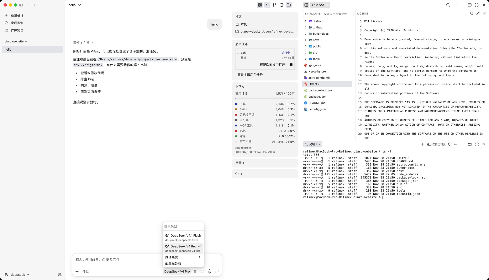
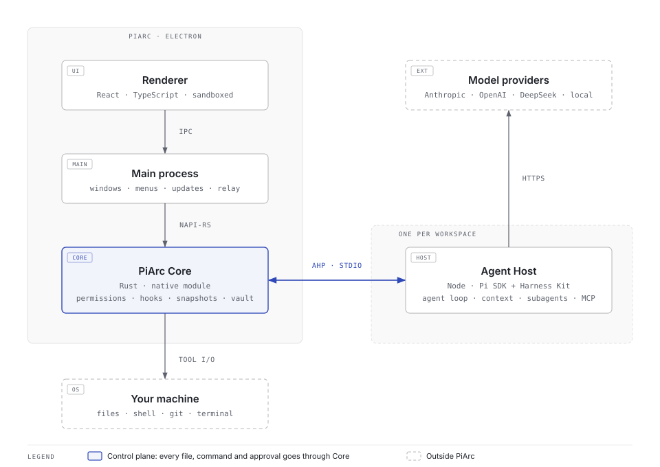

<div align="center">

<h1>
  
  PiArc
</h1>

**macOS 与 Windows 上的桌面编码智能体，基于 [Pi](https://github.com/earendil-works/pi) 构建。**

Claude Code 级别的智能体编排，任意模型服务商，一个快速的原生工作台。

[](https://github.com/Refinex-Space/PiArc/actions/workflows/ci.yml)
[](https://github.com/Refinex-Space/PiArc/releases/latest)
[](#下载)
[](LICENSE)

[下载](#下载) · [功能](#功能) · [快速上手](#快速上手) · [从源码构建](#从源码构建) · [文档](#文档) · [English](README.md)

</div>

<br>

<p align="center">
  
</p>

## 为什么是 PiArc

- **完整的编排，而不只是聊天。** 严格的文件编辑不变量、权限模式与规则、hooks、子 agent、计划模式、检查点与回退、上下文工程、skills、MCP 与沙箱：换任何模型，智能体的行为都一致、都安全。
- **模型由你选。** Anthropic、OpenAI、Gemini、DeepSeek、Kimi、通义千问、智谱 GLM、MiniMax、OpenRouter，任意 OpenAI 或 Anthropic 兼容端点，或者跑在你本机的模型。服务商提供订阅登录的，也可以直接登录。
- **真正的桌面应用。** 一套 Electron + React 界面，智能体的控制面在 Rust Core 里，会话、终端与 diff 都保持流畅。macOS 与 Windows 出自同一份代码。

## 功能

<table>
<tr>
<td width="50%" valign="top">

#### 智能体

- 读、改、写文件：先读后改、检测外部修改、保持编码与换行
- Bash 与 PowerShell：结束整棵进程树、超时、后台任务
- 子 agent 可用任意模型，比如探索交给便宜的快模型，主会话用更强的模型
- 计划模式、任务清单、提问表单与下一步建议
- 自动压缩，实时显示上下文用量
- Skills、斜杠命令、输出风格、插件与 Pi 包
- 每个工作区共享一份 MCP 连接，支持 OAuth 与按需加载工具

</td>
<td width="50%" valign="top">

#### 工作台

- 多会话并行，每个会话可以放进独立的 git worktree
- 基于 libghostty 的终端，你共享后智能体也能读取
- Git 工具：按块暂存、生成提交信息、历史、合并与变基，经你自己的 `gh` 处理 GitHub 拉取请求
- 内置浏览器预览应用，智能体在审批之下也能操作它
- 文件浏览、全局搜索、侧边对话、按模型统计用量与费用
- 离线语音输入，支持中文、英文与中英混合的技术词汇
- 中英文界面、明暗主题，键盘优先，适配读屏

</td>
</tr>
<tr>
<td width="50%" valign="top">

#### 掌控与安全

- 结构化审批卡：diff 预览、本会话与持久的规则、审计记录
- 自动审查：由你选定的审查模型代答常规审批，拿不准的交还给你
- 基于写入前快照的确定性回退，可按文件、按块丢弃
- macOS 上的命令沙箱与网络白名单
- 凭据存放在加密保险箱，不进环境变量，也不进配置文件
- 面向团队的托管设置

</td>
<td width="50%" valign="top">

#### 沿用你现有的配置

- 直接读取 Claude Code 的配置：`CLAUDE.md` / `AGENTS.md`、权限规则、hooks、`.claude/agents`、skills、命令与 `.mcp.json`
- 从不写入 `.claude/`
- 可把 Claude Code 的自动记忆导入 PiArc
- 没有遥测：只连接你配置的服务商与服务（[外连清单](docs/security/egress.md)）

</td>
</tr>
</table>

## 下载

在 [Releases](https://github.com/Refinex-Space/PiArc/releases/latest) 页面下载最新版本。

| 平台 | 安装包 | 更新方式 |
|---|---|---|
| macOS 13 及以上，Apple 芯片 | `.dmg`（arm64） | 应用内提示，手动安装 |
| macOS 13 及以上，Intel | `.dmg`（x64） | 应用内提示，手动安装 |
| Windows 11 | 安装程序 `.exe`（x64） | 自动更新 |

Windows 10 可以运行 PiArc，但不在测试矩阵中。

每个版本都附带用项目密钥签名的 SHA-256 校验清单，应用在更新前会核对它。

<details>
<summary><strong>首次启动：放行未签名的应用</strong></summary>

<br>

PiArc 免费开源，安装包没有经过 Apple 或 Microsoft 的签名与公证（[ADR-0018](docs/adr/0018-unsigned-distribution.md)）。第一次需要手动放行：

- **macOS**：把 PiArc 拖进"应用程序"后打开。系统拒绝时，到 **系统设置 → 隐私与安全性**，选 **仍要打开**。如果没有这个按钮，运行 `xattr -dr com.apple.quarantine /Applications/PiArc.app`，它只解除 PiArc 的下载隔离。更新后 macOS 可能再问一次是否允许访问钥匙串。
- **Windows**：出现 SmartScreen 时，选 **更多信息 → 仍要运行**。开启了"智能应用控制"的电脑会阻止未签名的应用。

</details>

## 快速上手

1. **连接模型。** 第一次启动会带你完成：选一个服务商、粘贴密钥，PiArc 发一个很小的请求测试连接。也可以用订阅账号登录（ChatGPT、GitHub Copilot 等），或者填自定义、本地端点。更多服务商在 **设置 → 模型与服务商**。
2. **打开项目。** 选一个文件夹。第一次打开时，PiArc 会先问你是否信任这个项目，然后才运行项目里的 hooks、MCP server 与允许规则。
3. **描述任务。** 输入或说出你想做的事。逐个审批工具调用，熟悉后切换到"自动接受编辑"或"自动审查"；不满意的回合可以回退。

## 工作原理

<p align="center">
  <picture>
    <source media="(prefers-color-scheme: dark)" srcset=".github/assets/architecture-dark.svg">
    
  </picture>
</p>

智能体从不直接接触你的文件与进程：每一次读、写和命令都经过 Core，由 Core 套用权限规则、保存快照、运行 hooks。原因见[架构设计](docs/architecture/ARCHITECTURE.md)与[架构决策记录](docs/adr/README.md)。

## 从源码构建

<details>
<summary><strong>环境要求</strong></summary>

<br>

| | macOS | Windows |
|---|---|---|
| Node.js | 24（`.nvmrc`） | 24（`.nvmrc`） |
| Rust | [rustup](https://rustup.rs)；`rust-toolchain.toml` 锁定版本 | 同左 |
| 原生工具链 | Xcode Command Line Tools（打发布包需要完整 Xcode） | Visual Studio Build Tools（MSVC 与 Windows SDK） |
| 其他 | | Git for Windows；打安装包需要 .NET 8 SDK |

第一次构建会下载 libghostty-vt 预编译产物与内置的 node、rg、fd，并校验哈希。

</details>

```bash
npm ci --ignore-scripts                 # 按 lockfile 安装依赖，与 CI 相同
node node_modules/electron/install.js   # 下载 Electron 二进制
npm run build:core                      # PiArc Core 开发构建
npm run build:agent-host                # Agent Host bundle
npm run start -w @piarc/desktop         # 启动应用，支持热重载
```

改了 Rust 代码后重新构建 Core，改了 `agent-host/` 后重新构建 Agent Host。要跑一遍 CI 的全部检查，先运行一次 `node scripts/dev/install-tools.mjs`，再运行 `npm run verify`。

打包：

```bash
# macOS：DMG 与 ZIP 在 apps/desktop/out/release/make/
npm run package:desktop -- --flavor release --arch arm64 --make

# Windows：安装程序在 apps/desktop/out/release/velopack/win32-x64/
npm run package:desktop -- --flavor release --arch x64
node scripts/release/pack-windows.mjs --arch x64 --flavor release --versions <版本号>
```

仓库结构、测试与约定见 [CONTRIBUTING.md](CONTRIBUTING.md)，全部命令见 [AGENTS.md](AGENTS.md)。

## 文档

| | |
|---|---|
| [架构设计](docs/architecture/ARCHITECTURE.md) | 设计基线：进程、协议、编排、安全与性能预算 |
| [架构决策记录](docs/adr/README.md) | 每一项架构决策及其理由 |
| [需求](docs/product/REQUIREMENTS.md) · [能力清单](docs/product/capabilities.md) | PiArc 做什么，以及每项能力由哪些测试证明 |
| [Hooks](docs/product/hooks.md) | PiArc 的 hooks 及其与 Claude Code 的差异 |
| [安全](docs/security/threat-coverage.md) | 威胁模型覆盖、Electron 安全清单与外连清单 |
| [工程规范](docs/engineering/coding-standards.md) | 编码、测试、无障碍与视觉规范 |

## 参与贡献

欢迎提交问题、想法与 Pull Request。开始之前请阅读 [CONTRIBUTING.md](CONTRIBUTING.md)，并遵守[行为准则](CODE_OF_CONDUCT.md)。安全问题请按 [SECURITY.md](SECURITY.md) 私下报告。

## 许可证

PiArc 以 [MIT 许可证](LICENSE)发布。第三方组件保留各自的许可证，见 [`third-party/`](third-party/)。

## 致谢

PiArc 建立在 Mario Zechner 与贡献者们的 [Pi](https://github.com/earendil-works/pi) 之上；终端用到 [Ghostty](https://ghostty.org) 的 libghostty，语音输入用到 [sherpa-onnx](https://github.com/k2-fsa/sherpa-onnx)，服务商标记来自 [LobeHub Icons](https://github.com/lobehub/lobe-icons)。

PiArc 是独立项目，与 Anthropic 没有隶属或背书关系。"Claude"与"Claude Code"是 Anthropic 的商标。PiArc 不提供 Claude.ai 订阅登录，并以 clean-room 方式编写（[ADR-0006](docs/adr/0006-compliance-and-clean-room.md)）。
