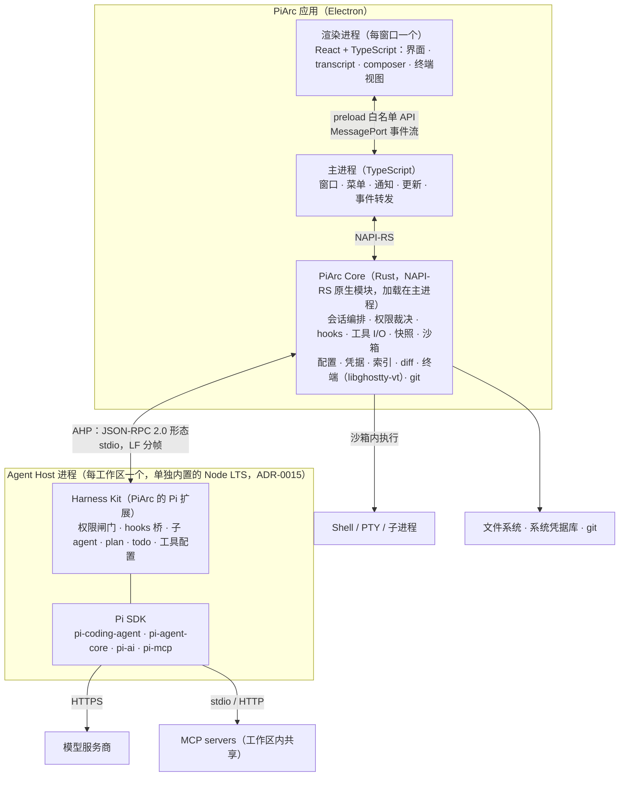
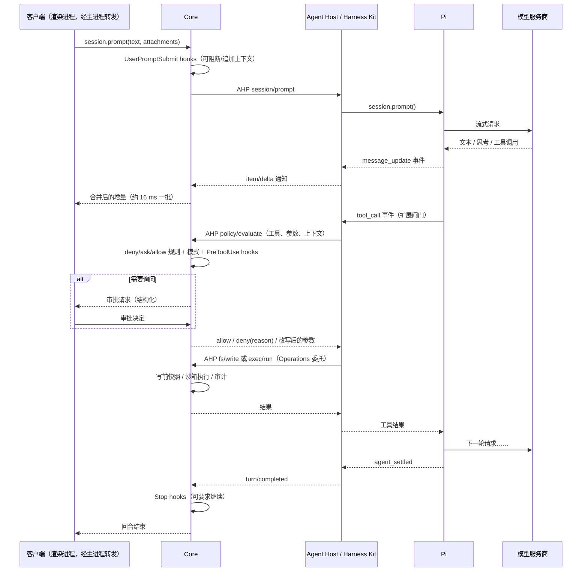

# PiArc 架构设计文档

| 项 | 内容 |
|---|---|
| 版本 | 2.26（2026-11-19） |
| 状态 | 已接受。后续修改遵循第 18 章的维护规则 |
| 适用范围 | macOS 与 Windows，同一代码库；每个里程碑 macOS 先达标，Windows 最多滞后一个里程碑 |
| 配套文档 | [需求规格](../product/REQUIREMENTS.md)、[架构决策记录](../adr/README.md)、[调研资料](../research/) |

PiArc 是一个专业的 AI 编码 Agent 桌面应用：以 [Pi](https://github.com/earendil-works/pi) 为 Agent 底座，提供 Claude Code 级别的 Harness 编排能力。客户端用 Electron + React 实现，macOS 与 Windows 共用一套代码；业务逻辑在 Rust 编写的 PiArc Core 与基于 Pi SDK 的 Agent Host 中（ADR-0013）。

本文是 PiArc 的设计北极星。任何与本文冲突的实现，要么修正实现，要么先通过 ADR 修改本文。

---

## 1. 目标、原则与边界

### 1.1 产品定位

一句话：**Claude Code 的 Harness 专业度 + Pi 的多模型能力 + 流畅稳定的桌面体验（macOS 与 Windows）。**

| 维度 | Claude Desktop（Code 标签页） | PiArc |
|---|---|---|
| 模型 | Anthropic 模型（可经云厂商或网关） | Pi 支持的全部服务商：Anthropic、OpenAI、Google、DeepSeek、Kimi、Qwen、GLM、OpenRouter、本地模型等 |
| Harness | Claude Code 引擎 | 在 Pi 之上实现同等能力，并兼容 Claude Code 配置格式 |
| 客户端技术 | Electron + React + 原生模块（本机实测 5.1231.2：Electron 45.2.1） | 同类：Electron + React，Rust Core 以原生模块加载。客户端技术不是差异点 |
| 资源占用 | 社区大量报告内存增长、流式卡顿、每会话复制 MCP 进程 | 每工作区一个 Agent Host、MCP 按工作区共享；以可量化的性能预算作为发布门槛（第 11 章） |

### 1.2 设计目标

| 编号 | 目标 | 衡量方式 |
|---|---|---|
| G1 | Harness 能力对标 Claude Code：工具、权限、hooks、子 agent、plan、todo、上下文工程、checkpoint、skills、MCP、沙箱 | 第 6 章能力矩阵逐项达标；L3 行为对齐测试（第 12 章） |
| G2 | 多模型一等公民：Harness 能力不绑定某一家服务商，按模型能力自动降级 | 同一组场景测试在至少 3 家服务商上通过 |
| G3 | 流畅稳定：启动快、长会话流畅、内存可控、系统集成完整 | 第 11 章性能预算进入 CI |
| G4 | 安全默认：默认询问、项目信任、可选 OS 沙箱、凭据加密存储（主密钥在系统凭据库）、渲染进程隔离 | 第 10 章威胁模型逐条有对策和测试 |
| G5 | 双平台同步：一套代码覆盖 macOS 与 Windows，平台差异收敛在 Core 的平台适配层和主进程的系统集成层 | 两个平台的 CI 都跑 L0–L2 与 L4；里程碑退出标准按平台分别验收 |
| G6 | 跟随上游：Pi 升级成本可控 | 每次 Pi 升级的改动量与回归结果有记录（第 5.7 节） |

### 1.3 架构原则

这些原则用于裁决设计分歧。排在前面的优先。

1. **合规与安全优先于功能。** 不做 Claude 订阅登录，不复制专有代码与提示词，权限检查失败即拒绝（ADR-0006、ADR-0004）。渲染进程显示模型输出和仓库内容，按不受信任对待（第 10.3 节）。
2. **厚核心、薄客户端。** 业务逻辑一律放进 Rust Core 或 Agent Host；Electron 主进程只做系统集成与转发，渲染进程只做呈现和输入（ADR-0013）。
3. **控制面与执行面分离。** 权限、hooks、沙箱、快照、凭据由 Core 裁决；agent 循环、模型调用、上下文组装在 Pi（ADR-0004）。
4. **不 fork Pi。** 通过 SDK 和扩展集成，只依赖公开导出；必须修改时先找上游（ADR-0002）。
5. **兼容优先于发明。** 能沿用 Claude Code 配置格式、Agent Skills 标准、MCP 规范的地方不自造格式（ADR-0005）。
6. **协议先行、可测试。** 每条跨进程、跨语言边界都有版本化 schema、契约测试和可录制回放的事件流（ADR-0009）。
7. **性能是功能。** 性能预算与功能验收同等对待，超预算不发布。
8. **如实呈现。** UI 不猜测语义（成败、状态都由 Core 给出），不支持的能力明确告知，不静默降级。

### 1.4 非目标（第一版）

- 不做 Chat/Cowork 式的通用知识工作助手，聚焦编码场景；
- 不做云端托管会话、Remote Control、手机端；
- 不做 IDE 插件与行内代码补全；
- 不做插件市场的托管服务（支持安装已有的 Claude Code 插件和 Pi 包，不自建市场后端）；
- 不上 Mac App Store 和 Microsoft Store，不做平台代码签名与公证（ADR-0018）；
- 不做 Linux 版。Electron 与 Core 在架构上不排除 Linux，第一版不投入。

---

## 2. 调研结论摘要

完整资料见 [`docs/research/`](../research/)。这里只列直接影响架构的结论。

### 2.1 Claude Code / Claude Desktop（官方文档，2026-11-14 快照）

- Claude Code 2.1.325 是一个"多表面、同一引擎"的 Harness，Desktop 的 Code 标签页内嵌同版本引擎。
- 权限 6 种模式（default/Manual、acceptEdits、plan、auto、dontAsk、bypassPermissions），规则按 deny → ask → allow 求值；auto 模式由分类器模型代替人审批，自 2.1.283 起为终端默认。
- Hooks 33 个事件、5 种 handler（command / http / mcp_tool / prompt / agent），exit code 2 与 JSON 输出两套决策协议。
- 子 agent 默认后台运行，最多嵌套 3 层、并发 20；fork 模式共享父会话缓存。
- Skills 遵循 Agent Skills 开放标准，三层渐进加载；自定义命令已并入 skills。
- MCP 工具默认延迟加载（tool search）。
- checkpoint 只跟踪编辑工具的改动，保留最近 100 个，30 天清理。
- **合规红线**：第三方应用不得提供 Claude.ai 登录或使用订阅凭证。
- **API 约束**：preserved thinking 要求历史只追加、system 与工具集稳定；prompt cache 要求稳定前缀；切换模型会让缓存全部失效。

### 2.2 Pi v1.4.0（源码，带文件:行号证据）

- 主链路是 pi-ai → pi-agent-core → pi-coding-agent，加 pi-mcp、pi-codemode。chord、durable、env 是另一套实验栈，不进 PiArc 主路径。
- SDK 能直接托管会话；`ModelRuntime` 支持注入凭据存储和交互式登录回调。
- 扩展 API 覆盖 Harness 所需的挂载点：`tool_call` 可阻断/改写（handler 抛异常即阻断）、`tool_result` 可改写、`before_agent_start` 可改 prompt 段、`turn_end`/`agent_before_settle` 可续跑、`session_before_compact` 可接管压缩、工具支持 `direct/deferred/codemode/hidden` 暴露方式。
- 内置工具的 I/O 都通过可替换的 `*Operations` 接口执行。
- 会话是 append-only JSONL 树，天然支持分支与回退。
- 缺口：无权限系统、无配置式 hooks、无子 agent/plan/todo（官方示例有原型）、无文件快照、无沙箱、凭据明文、RPC 单会话且无版本握手。
- 发布很快：2026-06 以来 coding-agent 51 个版本中 9 个带不兼容变更。
- pi-ai 的 Claude 订阅 OAuth 会伪装成 Claude Code，PiArc 必须屏蔽。

### 2.3 参考实现的启示

- **claw-code**（Rust 复刻）：窄 trait 隔离 I/O、显式权限阶梯、中断时补齐工具结果、invocation 对账、parity 场景测试值得借鉴；它的问题（上帝文件、定义了却没接线、mock 不校验请求、文档与代码漂移）要主动规避。
- **OpenClaudeDesktop**（Claude Desktop 界面复刻）：UI 与内核之间用 Codex app-server v2 风格的 thread/turn/item 协议；主进程维护带 epoch/revision 的审批账本；任务清单和"下一步"框由宿主注入的工具驱动，而不是内核原生能力；按能力声明降级而不是按内核名字分支。
- **open-claude-ui**（设计系统还原）：六层令牌模型；流式贴底、拖拽死区、输入法守卫、思考块在生成中强制展开等交互阈值可以迁移；品牌视觉不能迁移。

### 2.4 客户端技术栈

详见 `docs/research/electron-stack.md` 与 `docs/research/terminal-libghostty.md`。原生方案的调研（`native-stack.md`）作为决策背景保留。

- **同类产品**：Claude Desktop 5.1231.2 是 Electron 45.2.1（内置 Node v24.22.1，整包 621 MB），关闭了 `RunAsNode` fuse、开启了 ASAR 完整性校验，用 Electron 内置的更新器，原生能力走 NAPI-RS 模块，自家 helper 用 `sandbox-exec` 包装启动（本机实测与推断）。Codex App、Cursor 也是 Electron；Cursor 另外单独带了一份 Node 给 MCP 子进程用。Raycast v2 改为原生壳 + 系统 WebView + React。
- **Electron**：当前稳定版 45（45.3.x，Chromium 156，Node 24.22.x）；官方只支持最新 3 个大版本，8 周一个大版本；最低 macOS 13、Windows 10；没有 Liquid Glass API，只有 vibrancy。
- **Agent Host 运行时**：`utilityProcess` 不能套沙箱、不支持 stdin；用 `ELECTRON_RUN_AS_NODE` 必须保留高风险 fuse；Electron 不带 npm/npx。因此继续单独内置 Node（ADR-0015）。
- **Core 绑定**：NAPI-RS 3.x，Node-API ABI 稳定，升级 Electron 一般不用重编（ADR-0014）。
- **终端**：libghostty-vt 1.0.1（MIT）提供终端状态、render state、编码、选区、搜索、formatter、snapshot，不做渲染；ghostty-web 尚未迁到 1.0，输入法与 CSP 问题未解决（ADR-0017）。
- **Windows**：Claude Code 在原生 Windows 上不提供沙箱；EV 证书已不能直接消除 SmartScreen 警告；Azure Artifact Signing 的主体资格有地域限制。PiArc 最终选择不做平台代码签名（ADR-0018）。
- **前端**：React 19.3、Vite 8.3；`@tanstack/react-virtual` 有面向聊天的底部锚定与"在底部时跟随"能力。
- Mac App Store 与 Microsoft Store 都与 Agent 能力冲突，两个平台都直接分发。

---

## 3. 总体架构

### 3.1 分层



| 层 | 进程 | 语言 | 状态归属 |
|---|---|---|---|
| 客户端：渲染进程 | 每窗口一个 | TypeScript（React） | 只持有呈现状态（面板布局、滚动位置、展开/折叠）。业务状态都是 Core 推送来的快照或增量。 |
| 客户端：主进程 | 应用主进程 | TypeScript | 窗口与系统集成状态；不持有业务状态，只转发 Core 事件。 |
| Core | 应用主进程内（原生模块，自有线程池） | Rust | 应用级事实来源：工作区、会话索引、审批账本、权限规则、hooks 配置、后台任务、终端、快照、凭据。 |
| Agent Host | 子进程，每工作区一个 | TypeScript（Node） | 运行中会话的内存状态（Pi `AgentSession`）。持久化由 Pi 写 JSONL。 |

### 3.2 一次用户输入的完整流程



要点：

- 回合是否结束以 Pi 的 `agent_settled` 为准；`agent_end` 之后仍可能有重试、溢出恢复、排队消息。
- 工具调用的预检在 Pi 中是串行的，所以审批请求不会并发弹出；通过预检的只读工具可以并发执行。
- Core 的任何一步失败（超时、不可达、解析失败），Harness Kit 都按拒绝处理。

### 3.3 进程模型

| 进程 | 数量 | 生命周期 | 说明 |
|---|---|---|---|
| 主进程（含 Core） | 1 | 用户启动/退出 | 关闭最后一个窗口时应用不退出（macOS 菜单栏 / Windows 托盘常驻），后台会话继续运行。单实例：再次启动时把参数（文件夹、`piarc://` 链接）交给已运行的实例。 |
| 渲染进程 | 每窗口 1 个 | 窗口打开/关闭 | 崩溃或重载不影响会话：重新订阅后由 Core 补发快照。 |
| Chromium 辅助进程 | GPU、网络服务等 | Electron 管理 | 计入内存预算（第 11 章）。 |
| Agent Host | 每个已打开工作区 1 个 | Core 按需启动与预热；工作区内全部会话空闲超过阈值（默认 30 分钟）后回收；崩溃自动重启并恢复会话 | 一个进程承载该工作区的所有会话；子 agent 在进程内运行（ADR-0010）。 |
| MCP server | 每工作区每 server 1 个 | Agent Host 中的共享连接池按需启动、空闲回收 | 不随会话数复制。 |
| Shell / PTY | 按需 | Core 的任务管理器负责，进程组（macOS）/ Job Object（Windows）级别终止 | 前台命令、后台命令、终端面板都由 Core 统一管理。 |
| hooks 命令 | 按需 | Core 执行，带超时，杀整棵进程树 | 在沙箱外运行（与 Claude Code 一致），受项目信任约束。 |

AHP 从第一天起按会话多路复用，退回"每会话一个进程"不需要改协议。

### 3.4 仓库结构

```
PiArc/
├── apps/
│   └── desktop/               # Electron 应用（第 8 章）
│       ├── src/main/          # 主进程：窗口、菜单、托盘、通知、更新、Core 加载与事件转发
│       ├── src/preload/       # contextBridge 白名单 API
│       ├── src/renderer/      # React 界面与 Web Worker
│       ├── src/shared/        # 三方共用的 IPC 契约（通道名与 window.piarc 类型），不含 DOM 与 Node
│       └── native/            # 平台专属原生模块（按需）
├── crates/                    # Rust workspace（第 7 章），含 NAPI-RS 绑定 piarc-napi
├── agent-host/                # TypeScript：Agent Host 与 Harness Kit（第 5、6 章）
├── packages/
│   ├── protocol/              # 由 piarc-protocol 的 JSON Schema 生成的 TS 类型，Agent Host 与客户端共用
│   └── testkit/               # 仅测试：用 pi-ai 驱动严格 mock provider
├── design/tokens/             # 设计令牌单一来源（JSON），生成 CSS 变量与 TS 常量（T18 建立）
├── design/brand/              # 应用图标与标记的单一来源（.svg/.icns/.ico/.png），来源与许可证见其 README
├── third-party/               # 不经包管理器进入产物的第三方代码与二进制：来源登记、锁定文件、许可证全文
├── docs/
│   ├── architecture/          # 本文
│   ├── adr/                   # 架构决策记录
│   ├── product/               # 需求规格
│   └── research/              # 调研资料与参考源清单
├── scripts/                   # 跨平台脚本（Node 或 Python）
├── tests/contracts/           # L1 契约样本、反例与帧编解码共享用例（第 12 章）
├── tests/scenarios/           # 数据驱动的 Harness 场景（第 12 章，T15 建立）
└── reference/                 # 本地参考仓库副本（gitignore）
```

---

## 4. 关键决策一览

| ADR | 决策 | 一句话理由 |
|---|---|---|
| [0013](../adr/0013-electron-desktop-client.md) | Electron + React 客户端，三层结构不变，macOS 与 Windows 同一代码库 | 双平台同步推进；Pi 本来就要带 JS 运行时；消除原生富文本渲染风险 |
| [0002](../adr/0002-pi-integration-via-sdk-host.md) | 基于 Pi SDK 自研 Agent Host | 官方 RPC 缺多会话、版本握手、结构化审批；SDK 让上游不兼容变更在编译期暴露 |
| [0004](../adr/0004-harness-control-plane-in-core.md) | 策略在 Core、循环在 Pi、I/O 下沉 Core | 安全边界不能落在无隔离的扩展上；快照与沙箱需要统一入口 |
| [0020](../adr/0020-tool-layer-composition.md) | 工具层：Pi 的工具代码加 Core 的 I/O（read/write/edit 用替身路径，bash/find 用 Operations，grep 自写；bash 由 ADR-0028 改为自写） | Pi 1.5.2 的 Operations 不覆盖路径探测与 ripgrep；保留 Pi 的工具逻辑又做到零绕过 |
| [0021](../adr/0021-credential-vault-and-pi-adapter.md) | 凭据保险箱 v1 格式；Core 是唯一写入方，变更推送给所有 Agent Host，读改写在 Core 的键锁内进行；Agent Host 以 pi-ai 的 `CredentialStore` 适配 | 磁盘无明文；两个 Agent Host 同时刷新同一 token 只刷新一次 |
| [0022](../adr/0022-transcript-rendering-libraries.md) | transcript 用 @tanstack/react-virtual、marked 词法器、shiki JavaScript 正则引擎 | 同组测量下流式不掉帧、冷加载快一倍；解析器输出语法树且快；高亮不放宽 CSP |
| [0005](../adr/0005-claude-code-config-compatibility.md) | 只读兼容 Claude Code 配置 | 用户零成本迁移，又不污染其 Claude Code 配置 |
| [0006](../adr/0006-compliance-and-clean-room.md) | 禁用 Claude 订阅登录、clean-room、自有品牌 | 不把商业模式建在违反条款的基础上 |
| [0009](../adr/0009-agent-host-protocol.md) | 自有协议 AHP | 双向请求、版本握手、事件回放、调用对账 |
| [0010](../adr/0010-process-model.md) | 每工作区一个 Agent Host | 控制多会话内存，MCP 按工作区共享 |
| [0011](../adr/0011-session-storage.md) | Pi JSONL 为事实来源 + SQLite 索引 + 内容寻址快照 | 跟随上游格式，索引可重建 |
| [0027](../adr/0027-file-tool-invariants.md) | 文件状态表与写入（先读后改、外部修改、编码与换行、原子替换、diff）在 Core；匹配沿用 Pi 的 edit，加 `replaceAll`；Read 的行号、存根、PDF 与 notebook 在工具层；结果预算（单个 50K、单条消息 200K）在 Harness Kit；越界与受保护路径由 `piarc-fs` 标记、Core 裁决 | 只有 Core 能对真实文件做检查与原子写入，只有 Agent Host 的钩子看得到每个工具与整条回复的结果 |
| [0028](../adr/0028-shell-command-execution.md) | 命令的进程树终止、超时、cwd 跟踪、输出预算与落盘、语义退出码、登录 shell 环境都在 Core（`exec/run` 返回结构化结果）；Bash 与 PowerShell 为 PiArc 自写工具，按 `exec/shells` 决定工具集 | Pi 的 bash 工具自己截断输出（末尾 2,000 行）、非 0 一律失败、超时无默认，`BashOperations` 改不了；进程只有 Core 能管 |
| [0029](../adr/0029-client-shell-foundations.md) | 设计令牌单一来源（`design/tokens/`，生成 CSS 与 TS，verify 检查漂移、对比度与品牌）；客户端偏好写在用户级 `settings.json`、Core 为唯一写入方；intl-messageformat；快捷键注册表；有未确认新增项时项目不受信任；信任变化的重启在决定应答前生效；会话标题、置顶、归档、删除由 Core 管 | 第 8 章只写了规则；I63 的闸门空白；信任决定后立即建会话会落到正在关闭的旧进程上 |
| [0030](../adr/0030-transcript-and-composer.md) | 滚动历史与实时事件使用同一份行模型。输入附带提及区间、会话附件引用及可选幂等键，历史用 Pi 自定义条目恢复胶囊。归档保留附件 | 保存用户看到的输入，支持重发和恢复，并保持 AHP 帧大小有界 |
| [0031](../adr/0031-basic-permissions.md) | Core 绑定审批和实际 I/O，客户端以会话快照呈现请求 | 保证同一审批只能答复一次，并使重连后的模型看到拒绝理由 |
| [0026](../adr/0026-turns-queue-and-interrupted-transcript.md) | 一个输入一个回合：steer 交给 Pi，follow-up 由 Agent Host 在回合后启动；排队表带 id；中断后补写"已中断"结果与中断标记；重试只在 Pi 的 agent 循环；seq 缺口用回放缓冲补齐 | Pi 1.5.2 的 follow-up 不分回合、队列没有 id、中断后留下相邻 user 消息 |
| [0025](../adr/0025-core-state-and-project-trust.md) | `ready` 前固定 `userData` 与 `sessionData`；SQLite 只经编号迁移演进；信任按主 checkout 存、撤销即删除并重启 Agent Host；Pi 的项目信任经资源加载器的 `resolveProjectTrust` 钩子由 Core 回答 | 数据库与信任的语义发布后难改；钩子是 Pi SDK 路径唯一的信任挂点 |
| [0014](../adr/0014-core-binding-napi-rs.md) | Rust Core 以 NAPI-RS 原生模块加载在主进程 | Node-API ABI 稳定；粗粒度接口与合并事件流 |
| [0019](../adr/0019-event-batches-copied-not-transferred.md) | 事件批次经主进程转发时复制，不转移 `ArrayBuffer` | Electron 主进程只能转移端口；实测 8 MiB 批次复制转发约 2 ms |
| [0015](../adr/0015-agent-host-runtime-bundled-node.md) | Agent Host 继续单独内置 Node LTS | 要套 Seatbelt、走 stdio、给 npx 用，Electron 自带的 Node 都做不到 |
| [0018](../adr/0018-unsigned-distribution.md) | Electron Forge 打包；macOS 只做 ad-hoc 签名、Windows 不签名；发布清单用项目密钥签名；不上应用商店 | 免费开源、零成本；用发布清单签名保住更新的完整性 |
| [0024](../adr/0024-release-manifest-format.md) | 发布清单 `piarc-release-manifest/1`：产物名、大小、SHA-256，minisign 预哈希签名；Core 的 `release` 模块先验签后校验文件，没有内置公钥时一律拒绝 | 两个平台共用一份签名清单；签名覆盖版本号与产物列表，防混搭 |
| [0017](../adr/0017-terminal-libghostty-vt.md) | 终端状态由 Core 中的 libghostty-vt 持有，渲染层可替换 | agent 读屏与用户所见一致；IPC 流量与输出量无关 |
| [0023](../adr/0023-terminal-frames-as-pull-replies.md) | 终端帧作为拉取请求的返回值送达渲染进程，不经事件 MessagePort | 按键之后 MessagePort 消息被推迟到下一帧之后处理；改为回复后回显额外延迟 p95 从 16.2 ms 降到 0.77 ms |

已被取代的决策（原文保留在 `docs/adr/`）：0001、0007 → 0013；0008 → 0014；0003 → 0015；0012 → 0016 → 0018。ADR-0015 第 5 条（签名）被 ADR-0018 修订；ADR-0014 第 4 条（大块数据转移）被 ADR-0019 修订；ADR-0017 第 3 条中帧的送达方式（经 MessagePort）被 ADR-0023 修订。

---

## 5. Agent Host 设计（Pi 集成）

### 5.1 职责

Agent Host（`agent-host/`，包名 `@piarc/agent-host`）是一个 Node 程序，做三件事：

1. 用 Pi SDK 托管一个工作区内的多个会话；
2. 加载 Harness Kit（PiArc 的 Pi 扩展集合）；
3. 通过 AHP 与 Core 通信：接收会话命令、上报事件、向 Core 发起权限/hooks/I-O/凭据请求。

它**不**负责：权限规则存储与裁决、hooks 进程执行、文件快照、沙箱、PTY、凭据持久化、会话索引。这些都在 Core。

### 5.2 内部结构

```
agent-host/
├── src/
│   ├── main.ts                # 入口：stdio 接管、固定 Pi 的 agent 目录、信号处理
│   ├── host.ts                # 握手、请求分派、有序退出（与进程无关，测试可直接运行）
│   ├── protocol/              # AHP 连接、出站队列（背压与增量合并）、错误与参数校验；类型来自 piarc-protocol 生成的 @piarc/protocol，不手写
│   ├── runtime/
│   │   ├── workspace.ts       # 工作区级共享：ModelRuntime、凭据存储、MCP 连接池、资源加载
│   │   ├── session-registry.ts# sessionId → AgentSession；创建/恢复/fork/回收
│   │   ├── projector.ts       # Pi 事件 → AHP thread/turn/item 事件投影
│   │   └── core-bridge.ts     # 向 Core 发请求（policy、hooks、fs、exec、secrets），统一超时与失败即拒绝
│   ├── harness/               # Harness Kit：每个能力一个扩展工厂（第 6 章）
│   ├── tools/                 # 工具配置（Tool Profile）与 Operations 委托实现
│   └── providers/             # 服务商策略：屏蔽 Claude 订阅 OAuth、模型能力表
├── patches/                   # 对 Pi 的临时补丁（目标为零），每个补丁附上游 issue 链接
└── test/
```

### 5.3 会话托管与事件投影

- 每个会话对应一个 Pi `AgentSession`，由 `createAgentSession()` 创建，传入：工作区共享的 `ModelRuntime`、文件型 `SessionManager`（会话目录在 PiArc 应用支持目录下）、`DefaultResourceLoader`（`extensionFactories` 注入 Harness Kit，`agentDir` 指向 PiArc 自己的目录），以及第 6.1 节的工具配置。
- 会话替换类操作（新建、切换、fork）用 `AgentSessionRuntime`，替换后重新绑定事件订阅。
- **投影规则**：Pi 的 `AgentSessionEvent` 投影成 AHP 的 `turn/*` 与 `item/*`：

| Pi 事件 | AHP 事件 | 说明 |
|---|---|---|
| `agent_start`（一次 prompt 的首个） | `turn/started` | 一个用户输入对应一个 turn |
| `agent_settled` | `turn/completed` | 不用 `agent_end`；附带用量汇总 |
| `message_update`（`text_delta` / `thinking_delta`） | `item/agentMessage/delta`、`item/reasoning/delta` | itemId = `messageId#contentIndex`，保证稳定 |
| `tool_execution_start/update/end` | `item/started`、`item/updated`、`item/completed` | 按工具映射到 item 类型：`commandExecution`、`fileChange`（带结构化 diff）、`mcpToolCall`、`subagent`、`webFetch`、`dynamicToolCall` |
| `compaction_start/end` | `item/contextCompaction` | `contextCompaction` 类型条目的 `item/started` 与 `item/completed`，带原因与压缩前后 token 数 |
| `auto_retry_*` | `turn/retrying` | 带 attempt / maxAttempts / delayMs |
| `queue_update` | `session/queueChanged` | Agent Host 给每个排队项分配 id，支持编辑、删除、重排 |
| `entry_appended`（Harness Kit 写入的自定义 entry） | 对应的 Harness 事件 | 例如 todo 更新、plan 提交 |

- 所有 item 的状态统一为 `inProgress / completed / failed / declined / interrupted`。成败由 Agent Host 按语义判断（例如 `grep` 无匹配、`diff` 有差异时退出码为 1，仍算成功），UI 不自行推断。
- T06 已实现的部分（T14 补全其余行）：
  - 会话注册表每个会话持有一个 `AgentSessionRuntime`（关闭时它发出 `session_shutdown`，扩展据此断开 MCP 等资源），会话间共享工作区的 `ModelRuntime`；创建会话前经 `trust/get` 询问 Core，结果作为 Pi 的 `projectTrusted`。
  - 投影：一次提示词的首个 `agent_start` → `turn/started`；`text_start/delta/end` → `item/started`、`item/agentMessage/delta`、`item/completed`；`tool_execution_start/end` → `dynamicToolCall` 条目；`agent_settled` → `turn/completed`（被中断为 `interrupted`，最后一条 assistant 消息出错为 `failed` 并带 `errorMessage`）。`messageId` 由投影器在 assistant 消息开始流式时生成：Pi 的 entry id 要等消息落盘才有。
  - 文本增量末尾的高代理项留到下一个增量再发，无法配对的代理项替换为 U+FFFD：发往 Core 的字符串都是合法 UTF-16。
  - 所有帧经出站队列写 stdout：`write()` 返回 false 后等 `drain`；等待中同一条目的文本增量合并成一帧；`seq` 在写出时按会话分配，合并不产生缺口；积压超过 64 MiB 时以退出码 70 退出，由 Core 重启。
  - `session/prompt` 先回复 `turnId` 再开始回合，Core 总是先知道 `turnId`，再收到该回合的通知。

- T14 落地（ADR-0026），投影规则的唯一实现是 `agent-host/src/runtime/projector.ts`（live）与 `history.ts`（会话文件的当前分支，`session/history`），两者共用 `items.ts` 的条目构造：
  - 用户消息（提示词、送达的 steer）投影为 `userMessage` 条目；`thinking_*` 投影为 `reasoning` 条目与 `item/reasoning/delta`；`tool_execution_update` 投影为 `item/updated`（出站队列中只保留同一条目最新的一条）；`auto_retry_end` 不单独投影，最终失败由 `turn/completed` 体现；Harness Kit 写入的 `piarc.*` 自定义 entry 投影为 `harness/entry`；`turn/completed` 带本回合各次回复的用量之和。
  - 规范名到条目类型：`Bash`/`PowerShell` → `commandExecution`，`Write`/`Edit`/`NotebookEdit` → `fileChange`，`mcp__<server>__<tool>` → `mcpToolCall`，`Agent` → `subagent`，`WebFetch` → `webFetch`，其余 → `dynamicToolCall`。条目里的工具输出最多保留末尾 64 K 个 UTF-16 码元，参数超过 256 K 字符或嵌套超过 64 层时以说明代替（I09）。
  - 状态：工具的成败取工具层结果（`isError`），中断请求之后失败的调用为 `interrupted`，策略闸门拒绝的调用为 `declined`（T20 调用 `Projector.markDeclined`）；回合中断时，仍在执行与未开始执行的调用都补发 `interrupted`。
  - 排队：Agent Host 的排队表（`queue.ts`）给每项 id；steer 立即交给 Pi，follow-up 在回合完成后作为新回合启动；编辑、删除、重排 steer 时清空并按新顺序重新交给 Pi；`session/abort` 把排队项交回 Core。
  - 投影的 golden 测试回放从真实 Agent Host 录制的 Pi 事件序列（`agent-host/test/golden/`），覆盖上表每一行、六种工具条目与五种状态；mock 产生不了的三类（thinking、Harness entry、被拒的调用）用同形状的构造事件。

### 5.4 凭据与登录

- `ModelRuntime.create({ credentials })` 注入 PiArc 的 `CredentialStore`：读取来自 Core（凭据保险箱，第 9.1 节），写入经 AHP 交给 Core 持久化。Agent Host 启动时向 Core 一次性取回凭据放在内存中，写操作先更新内存、再异步回写 Core。
- T08 落地（S5，ADR-0021）：Pi 1.5.2 的这个注入点是 pi-ai 的异步 `CredentialStore`（`read`、`list`、`modify`、`delete`），同步的 `AuthStorageBackend.withLock` 只属于 coding-agent 的 `auth.json` 后端，PiArc 不使用，风险 R11 在此不出现。适配层 `agent-host/src/runtime/credentials.ts`：启动时 `secrets/getAll`，读从内存返回；`modify`、`delete` 按 provider 串行，在 Core 的键锁（`secrets/lock`，锁 `provider/<id>` 与 `oauth/<id>`）内运行，先改内存再 `secrets/set`/`secrets/delete`，Core 存好后才完成；写回或取回失败时拒绝，pi-ai 让该次模型请求失败，会话以 `turn/completed` 的 `failed` 报出，不回退到明文或环境变量。其他 Agent Host 的写入经 `secrets/changed` 推送，按 `revision` 丢弃过期通知。pi-ai 在 `modify` 内刷新 OAuth（剩余不到 5 分钟），两个 Agent Host 同时刷新时第二个在锁内看到新 token，不再刷新。
- 凭据只经 AHP 传递，不放进环境变量（Agent Host 启动的子进程会继承环境变量）。
- OAuth 与设备码登录调用 `ModelRuntime.login(provider, type, interaction)`，`interaction` 的回调（授权 URL、设备码、输入提示）转成 AHP 请求，由客户端呈现：授权页在系统浏览器中打开，回调经本地回环端口或 `piarc://` 深链接返回，不在应用窗口内加载第三方登录页。
- **Anthropic 的订阅 OAuth 登录方式在 Agent Host 中被屏蔽**（ADR-0006）；CI 中有测试断言可用登录方式列表不包含它。

### 5.5 Pi 配置隔离

- Pi 的 agent 目录指向 PiArc 数据目录下的 `pi/`（经 SDK `agentDir`，目录位置见第 9.1 节），与用户本机 `~/.pi/agent` 隔离；设置界面提供一次性导入（模型配置、skills、prompts）。
- 关闭 Pi 的版本检查与自更新；`PI_OFFLINE` 只在需要时开启（它也会关闭模型目录刷新）。模型目录刷新是否走网络由 PiArc 设置控制。
- Pi 的项目信任（`project_trust`）由 Harness Kit 接管：信任决定来自 Core（第 10.2 节），不使用 Pi 的 `trust.json`。T06 起 Agent Host 创建会话前经 `trust/get` 询问 Core，失败按不信任处理。T13 落地（ADR-0025）：Pi 1.5.2 的 `project_trust` 扩展事件与 `trust.json` 只在 CLI 路径使用；Agent Host 以 `projectTrusted: false` 创建会话的 `SettingsManager`，经资源加载器的 `resolveProjectTrust` 钩子用 `trust/get` 回答（`agent-host/src/harness/project-trust.ts`），未信任时 `.pi/extensions/`、`.pi/settings.json`、`.pi/mcp.json`、项目 skills 与 prompts 都不加载；超时、错误、结果无法解析一律不信任。
- Pi 的部分默认路径（MCP 扩展的 `mcp.json`、`mcp.log`、`mcp-auth.json`，默认会话目录）读进程级的 `getAgentDir()`，不看 SDK 的 `agentDir`。Agent Host 启动时把 `PI_CODING_AGENT_DIR` 设为 PiArc 的 `pi/` 目录，会话注册表校验两者一致。
- 凭据经适配层存放在 Core 的保险箱（第 5.4 节，T08）；关闭 Pi 自带的上下文文件加载（`noContextFiles`），项目上下文由 PiArc 组装（第 6.6 节）。

T21（ADR-0032）把非密钥配置保存在用户级设置中，由 Core 生成自定义端点的 `pi/models.json`。没有工作区时也能打开设置，设置操作经临时 Host 的 ModelRuntime 更新保险箱。工作区 Host 在目录刷新时读取这些定义，联网开关只控制 Pi 目录刷新。Core 为 `pi/settings.json` 补全缺失的 `cacheWarming: "off"` 与 `images.autoResize: true`；Read 遵循后者。

### 5.6 运行时与打包

运行时决策见 ADR-0015：Agent Host 用单独内置的 Node LTS，由 Core 直接启动，不经过 Electron。

- 构建：esbuild 把 Agent Host 打成单个 bundle（目标与 Pi 一致：node22.19+），外部依赖只保留 Pi 要求的原生/wasm 资源（photon、quickjs wasm 等）。T06 的 `npm run build:agent-host` 输出 `agent-host/dist/bundle/agent-host.mjs` 与 `pi-assets/package.json`（Pi 从中读版本与配置目录名，经 `PI_PACKAGE_DIR` 指定）；外部依赖为 `@silvia-odwyer/photon-node`（wasm）与四个可选原生加速包，清单见 `agent-host/CLAUDE.md`。Bedrock 的懒加载适配已随 T21 打入，codemode worker、图片缩放 worker 与 OAuth 的懒加载模块尚未打包，接入对应功能时补上。
- 应用内布局（macOS；Windows 在安装目录的 `resources\` 下是同样的结构）：

```
PiArc.app/Contents/
├── MacOS/PiArc                 # Electron 主程序（发布构建已写入 fuses，ad-hoc 签名，ADR-0018）
├── Frameworks/                 # Electron Framework 与各 Helper
└── Resources/
    ├── app.asar                # 主进程、preload、渲染进程代码（ASAR 完整性校验）
    ├── app.asar.unpacked/      # piarc-core 的 .node 原生模块
    └── agent-host/             # 不进 asar：独立的 node 读不了 asar
        ├── node/               # Node LTS 发行包：bin/node、bin/npm、bin/npx（保留 Node.js 官方签名）
        ├── agent-host.mjs      # bundle
        ├── pi-assets/          # Pi 运行时需要的资源（经 PI_PACKAGE_DIR 指定）
        ├── node_modules/       # bundle 的外部依赖（photon-node，加载自己目录下的 wasm）
        └── bin/ rg fd          # 预置，避免 Pi 运行时下载（ad-hoc 签名）
```

- 启动（T12 实现：`piarc_core::agent_host::{BundledRuntime, start_bundled}`）：
  - macOS：Core 执行 `/usr/bin/sandbox-exec -p <profile> -DWRITABLE_0=<工作区> -DWRITABLE_1=<数据目录> -- <内置 node> agent-host.mjs`。配置正文由 `piarc_sandbox::agent_host_launch` 生成，路径只经 `-D` 传入，与沙箱命令的做法一致（第 6.10 节），所以用 `-p` 而不是写临时文件给 `-f`；配置内容见第 10.3 节；
  - Windows：Core 用 `CreateProcess` 启动，把进程挂进 Job Object（`KILL_ON_JOB_CLOSE`），宿主退出时整棵进程树被清理；
  - 两个平台都经 `piarc_exec::ProcessTreeSpawner` 启动（macOS 新进程组），由 Core 持有 stdio 管道，工作目录为工作区根；
  - 环境变量最小化：`piarc_host::DEFAULT_ENV_PASSTHROUGH` 中除 `PATH`、`TMPDIR` 以外 Core 自己有的变量；`PATH` 为内置 Node 的 `bin`、`bin/`（rg、fd）再接 Core 的 `PATH`，`npx` 拉起的 MCP server 因此也跑在内置 node 上；`PI_PACKAGE_DIR`、`PI_SKIP_VERSION_CHECK=1`、`PI_TELEMETRY=0`；`TMPDIR` 与 `npm_config_cache` 指向数据目录下的 `agent-host/tmp`、`agent-host/npm-cache`（Seatbelt 只放行数据目录的写入），`npm_config_update_notifier=false`。凭据不经环境变量（第 5.4 节）。

### 5.7 跟随上游

| 环节 | 做法 |
|---|---|
| 版本 | `@earendil-works/*` 全部锁定同一精确版本；lockfile 入库 |
| 依赖面 | 只用包入口公开导出的 SDK、ExtensionAPI 与类型；ESLint 规则禁止深度 import |
| 升级节奏 | 按月评估，安全修复随时；不追每个版本 |
| 升级流程 | 读各包 CHANGELOG 的 Breaking Changes → 升级 → `tsc` → L1 契约测试 → L2 场景回放 → L3 对齐测试抽样 → 更新 `docs/research/pi-v1.4.0-baseline.md` 的基线版本与差异 |
| 补丁 | `agent-host/patches/` 目标为零；每个补丁记录原因、上游 issue、移除条件；超过 10 个触发 ADR-0002 复审 |

---

## 6. Harness 能力设计

本章定义 PiArc 要实现的 Harness 行为。行为目标参照 Claude Code 官方文档（`docs/research/claude-official-capabilities.md`），实现完全自行编写（ADR-0006）。

### 6.0 能力矩阵

"位置"列：**C** = Core（Rust），**K** = Harness Kit（Agent Host 内的 Pi 扩展），**U** = 客户端。"里程碑"见第 16 章。

| 能力 | 目标行为（摘要） | 位置 | 依托的 Pi 能力 | 里程碑 |
|---|---|---|---|---|
| 工具体系 | Claude Code 兼容的工具名与语义；编辑安全不变量；输出截断与落盘 | K + C | `create*Tool` + `*Operations`、`registerTool` | M1 |
| 权限 | 6 种模式中的 5 种（dontAsk 仅无头）；deny → ask → allow 规则；复合命令感知；结构化审批 | C + K + U | `tool_call` 闸门 | M1 基础、M2 完整 |
| Hooks | Claude Code 兼容的事件、配置格式、exit code 与 JSON 协议 | C + K | 各生命周期事件 | M2 |
| 子 agent | `.claude/agents` 定义；进程内子会话；工具子集；任意服务商模型；后台运行；最多 3 层 | K + C + U | SDK 子会话 | M3 |
| Plan 模式 | 只读探索 → 提交计划 → 用户批准并选择后续模式 | K + C + U | `tool_call` 闸门、追加消息 | M2 |
| 任务清单 / 下一步 | 宿主工具驱动，UI 结构化渲染，压缩后重新注入 | K + U | `registerTool`、工具 details | M2 |
| 上下文工程 | 分段 system prompt；memory 层级与 `@import`；system-reminder；压缩；缓存友好布局 | K | `before_agent_start`、`context`、`session_before_compact` | M1–M3 |
| Skills / 命令 | Agent Skills 标准；`.claude/skills`、`.claude/commands`；渐进加载 | K | Pi skills、prompt templates、`resources_discover` | M3 |
| 插件 | 加载 Claude Code 插件目录与 Pi 包 | C + K | packages、扩展 | M4 |
| MCP | stdio / Streamable HTTP；OAuth；工作区共享连接池；延迟加载 | K + C + U | pi-mcp、`tool_search` | M3 |
| Checkpoint / Rewind | 写前快照；回退代码 / 对话 / 两者 | C + K | 会话树 fork/leaf | M2 |
| 沙箱 | macOS：Bash 在 Seatbelt 中执行，文件与网络白名单；Windows：第一版只做进程树管理（需求 D7） | C | BashOperations 委托 | M4 |
| 后台任务 / 终端 | 后台命令、超时转后台、Monitor、终端面板 | C + K + U | BashOperations、`registerTool` | M3 |
| Worktree | 每会话可选独立 worktree；子 agent 隔离 | C + K | cwd 按会话 | M3 |
| 多模型适配 | 模型能力表；effort 映射；切换代价提示；按能力降级 | K + C | pi-ai 模型目录 | M1–M3 |
| Auto 模式（分类器） | 可配置的审查模型代替人审批，决策可审计 | C + K | 辅助模型调用 | M5 |

### 6.1 工具体系

#### 6.1.1 规范名与 Tool Profile

- **规范名采用 Claude Code 的工具名**：`Read`、`Write`、`Edit`、`Bash`、`PowerShell`（仅 Windows）、`Glob`、`Grep`、`WebFetch`、`WebSearch`、`Agent`、`TodoWrite`、`AskUserQuestion`、`EnterPlanMode`、`ExitPlanMode`、`Skill`、`ToolSearch`、`NotebookEdit`、`KillShell`、`Monitor`，MCP 工具为 `mcp__<server>__<tool>`。权限规则、hooks matcher、子 agent 的 `tools` 列表一律使用规范名，这样用户现有的 Claude Code 配置可以直接生效。
- **Tool Profile** 决定某个模型看到的工具名、描述和参数风格。默认 Profile 直接使用规范名；针对特定模型家族可以调整描述文字或参数命名，但规则与 hooks 始终按规范名匹配。Agent Host 维护"模型可见名 ↔ 规范名"映射表。
- 实现方式：用 Pi 的 `createReadTool/createEditTool/createWriteTool/createBashTool/...` 加 Operations 委托（6.1.3）创建内置工具，再包装成规范名与 PiArc 自写的描述。M0 S4 已验证改名与委托可行，Pi 1.5.2 的 Operations 不足以零绕过的部分由替身路径与自写 Grep 解决（ADR-0020）。
- T07 落地（S4，ADR-0020）：工具层在 `agent-host/src/tools/`。六个规范名工具 Read、Write、Edit、Bash、Glob、Grep 以 `customTools` 注册，会话以 `noTools: "builtin"` 加 `excludeTools` 排除 Pi 的 read、bash、powershell、edit、write、grep、find、ls；参数 schema 沿用 Pi 的。默认 Profile（`profile.ts`）给出名称、描述与 system prompt 中的工具摘要与指引；`ToolNameMap` 双向映射模型可见名与规范名（未知名原样返回，拒绝重名与 Pi 原生名），投影器发出的 `item/*` 与发往 Core 的 `origin.tool` 都用规范名。`--tool-profile <json>` 只供测试覆盖名称与描述，按模型家族选择 Profile 留待 T21、T29。

#### 6.1.2 工具语义不变量

这些不变量由 Core 和 Harness Kit 共同保证，并有场景测试覆盖：

| 不变量 | 规则 |
|---|---|
| 先读后改 | 对已存在文件执行 `Edit`/`Write` 前，本会话必须读过它，且读取后文件未被外部修改。Core 维护每会话的文件状态表（路径 → 内容 hash、mtime）。 |
| 外部修改检测 | 读取后文件被外部修改，`Edit` 返回明确错误，要求重新读取。 |
| 唯一匹配 | `Edit` 的旧文本必须在文件中唯一，或显式要求替换全部；多处匹配时报错，不替换第一处。 |
| 保真写入 | 保留原文件的换行符风格（LF/CRLF）、编码与 BOM；写入采用临时文件 + 原子 rename。 |
| 结构化 diff | 每次文件变更产生真实的 unified diff 和 hunk 结构，供 UI 审阅和快照索引。 |
| 输出截断 | 超长输出写入会话临时目录，模型收到头尾预览和文件路径（阈值见 6.11）。 |
| 路径边界 | 默认只允许读写工作区与已添加目录；越界访问走权限询问。受保护路径（`.git/`、`.piarc/`、`.claude/`、`.pi/`、shell 配置文件）的写入在 Manual 与 Accept edits 模式下始终询问。 |
| 并发 | 只读工具可以并发；写同一文件的操作串行（Write 与 Edit 用 Harness Kit 的队列，键为词法绝对路径、Windows 不区分大小写；Pi 的 `withFileMutationQueue` 在替身路径上排队，不再承担这项职责，ADR-0020）；预检（含审批）串行。 |
| 中断 | 中断时为所有未完成的工具调用补齐"已中断"结果，保证 tool_use / tool_result 配对完整。 |

T16 落地（ADR-0027），每条不变量的 L2 场景在 `tests/scenarios/tools-*.yaml`：

| 不变量 | 实现 |
|---|---|
| 先读后改 | 每会话的文件状态表 `piarc_fs::FileStates`（规范路径 → SHA-256、大小、mtime、Read 的范围），键在大小写不敏感的卷上折叠大小写；`fs/stat` 带 `read` 登记读取，`fs/read` 带 `requireFresh`（Edit 读文件时）与 `fs/write` 替换已存在的文件时要求本会话读过或写过，否则 `fileNotRead` |
| 外部修改检测 | 以内容哈希判断，不看 mtime；变化则 `fileModified`，消息要求重新 Read |
| 唯一匹配 | Pi 的 edit 报出匹配次数或零匹配，PiArc 补上 `replaceAll` 的提示；`replaceAll: true` 由工具层精确匹配全部出现处 |
| 保真写入 | `piarc_fs::write`：路径锁内检查新鲜度，按旧文件的编码（`encoding_rs`，非 UTF-8 时才用 `chardetng` 检测）与 BOM 编码，Write 用旧文件的主要换行风格，同目录临时文件 + `fsync` + rename；新文件 UTF-8 无 BOM；编码表示不了的字符整次拒绝；大文本经 `upload` 分段，最后一段到达才写 |
| 结构化 diff | `piarc-diff`（similar）随 `fs/write` 结果返回 `FileDiff`，经工具结果的 `details.fileDiff` 进入 `fileChange` 条目的 `diff` |
| 输出截断 | Harness Kit 的 `tool-results.ts`：单个结果超过 50K 字符经 `fs/spill` 写入会话临时目录，模型收到约 2KB 头尾预览与路径（家目录下以 `~` 开头）；一次回复的结果合计超过 200K 字符时从最大的开始换成预览，按调用 id 记住；Read 不参与 |
| 路径边界、受保护路径 | `piarc-fs` 把会话目录之外的读写、受保护路径的写入标记为需要询问，会话临时目录可读不可写；Core 的权限预检按规范路径分类，审批后将对应 I/O 限于该调用（ADR-0031） |
| 并发 | Harness Kit 的队列之外，Core 以所有会话共享的路径锁串行同一文件的写入 |

#### 6.1.3 Operations 委托

| Pi 接口 | 委托到 Core 的 AHP 方法 | Core 额外做的事 |
|---|---|---|
| `ReadOperations.readFile/access` | `fs/read`、`fs/stat` | 路径边界检查、更新文件状态表、图片与 PDF 预处理 |
| `WriteOperations.writeFile/mkdir` | `fs/write`、`fs/mkdir` | 写前快照、原子写、生成 diff、审计 |
| `EditOperations` | `fs/read` + `fs/write` | 同上，并校验先读后改 |
| `BashOperations.exec` | `exec/run`（流式输出经通知回传） | 沙箱、进程组管理、超时转后台、语义退出码、审计 |
| `GrepOperations` / `FindOperations` / `LsOperations` | `fs/grep`、`fs/glob`、`fs/list` | 在 Core 中用 ripgrep 的 Rust 库（`grep-searcher`、`ignore`）实现，遵守 .gitignore |

T07 实测（S4，ADR-0020）：Pi 1.5.2 的 Operations 覆盖 bash、find（给了自定义 `glob`）与 ls 的全部 I/O；read 在 Operations 之外用 `fs.access` 探测路径及其 macOS 拼写变体，write、edit 用 `realpath` 求变更队列的键，grep 总是直接运行 ripgrep。因此：

| 规范名 | 实现 | AHP 方法 |
|---|---|---|
| Read | Pi 的 read 定义运行在**替身路径**上（系统临时目录下从不创建的路径，Pi 的探测落在那里），每个 Operation 由 Core 对真实路径执行；拼写变体由 `fs/stat` 逐个确认。T16：文本流先加行号再交给 Pi 选行；重复读取返回存根；`.pdf`、`.ipynb` 走工具层自己的路径 | `fs/stat`（带图片嗅探与读取登记）、`fs/read`、`fs/pdf` |
| Write | Pi 的 write 定义，替身路径 | `fs/mkdir`、`fs/write`（`lineEndings: matchFile`） |
| Edit | Pi 的 edit 定义，替身路径；`replaceAll` 由工具层匹配（T16） | `fs/stat`、`fs/read`（`requireFresh`）、`fs/write` |
| Bash | T17 起 PiArc 自写，沿用 Pi 的参数（`command`、`timeout`），结果按 Core 的结构化结果组织（ADR-0028）；T07–T16 为 Pi 的 bash 工厂 + `BashOperations` | `exec/shells`、`exec/run`、`exec/output`、`exec/kill` |
| PowerShell | PiArc 自写，只在 Windows 注册（ADR-0028） | 同 Bash，`shell: powershell` |
| Glob | Pi 的 find 工厂 + `FindOperations` | `fs/stat`、`fs/glob` |
| Grep | PiArc 自写，沿用 Pi 的参数与输出格式 | `fs/grep` |

结果与错误中的替身路径换回模型写的路径，Core 的错误码重建为 Node 风格的错误，模型看到的文字与 Pi 原生相同（行为对照见 S4 第 7 节）。`agent-host/src/tools/` 与 `agent-host/src/harness/` 禁止导入 `fs`、`child_process`（ESLint）；图片等二进制内容按 ADR-0009 第 8 条由 Core 复制为会话 blob、AHP 只传路径与哈希，这是 Agent Host 用自己的 `fs` 读取的唯一文件（`runtime/blobs.ts`，限定在数据目录的 `sessions/` 下）。路径限定见 7.4 的 T07 一段。

#### 6.1.4 第一版工具清单

| 工具 | 说明 | 默认需审批（Manual） | 里程碑 |
|---|---|---|---|
| Read | 文本带行号分页；图片；PDF 分页；ipynb | 否 | M1 |
| Write / Edit | 见不变量 | 是 | M1 |
| Bash | 见 6.11；Windows 上经 Git Bash 执行 | 是（只读命令白名单除外） | M1 |
| PowerShell | 仅 Windows；见 6.2.2 | 是 | M1（Windows） |
| Glob / Grep | Core 实现 | 否 | M1 |
| WebFetch | 本地抓取 → Markdown → 辅助模型按提示提取；域名规则 | 是 | M2 |
| WebSearch | 可配置后端（服务商原生搜索工具优先，其次第三方搜索 API） | 是 | M3 |
| TodoWrite | 任务清单（6.5） | 否 | M2 |
| AskUserQuestion | 结构化多选/输入，UI 表单 | 否 | M2 |
| EnterPlanMode / ExitPlanMode | 6.5 | 否 / 是 | M2 |
| Agent | 子 agent（6.4） | 否 | M3 |
| Skill | 6.7 | 视 skill | M3 |
| ToolSearch | 延迟加载工具检索（复用 Pi `tool_search`） | 否 | M3 |
| KillShell / Monitor | 后台任务（6.11） | 否 / 是 | M3 |
| NotebookEdit | Jupyter cell 编辑 | 是 | M4 |

### 6.2 权限系统

#### 6.2.1 模式

| 模式（配置值） | UI 名 | 无需询问即可执行 | 第一版 |
|---|---|---|---|
| `default` | 手动 | 只读工具 | ✓ |
| `acceptEdits` | 自动接受编辑 | 只读 + 工作区内文件编辑 + 常见文件系统命令（mkdir/touch/mv/cp） | ✓ |
| `plan` | 计划 | 只读；计划批准前禁止编辑 | ✓ |
| `bypassPermissions` | 跳过权限 | 全部（deny 规则仍生效） | ✓，需在设置中显式开启并二次确认 |
| `auto` | 自动审查 | 由审查模型逐项判定 | M5 |
| `dontAsk` | — | 只允许预批准的工具，其余拒绝 | 仅无头模式（P2） |

- 起始模式解析：会话显式指定 → 设置中的 `permissions.defaultMode` → 内置默认 `default`。项目级配置中的 `bypassPermissions` 与 `auto` 不生效，防止仓库提权。
- 所选模式按工作区记忆；切换模式是一条会话事件，写入转录。

#### 6.2.2 规则

- 语法与 Claude Code 一致：`Tool` 或 `Tool(specifier)`。支持的 specifier：`Bash(命令模式)`、`Read/Edit(路径 glob)`、`WebFetch(domain:…)`、`Agent(类型)`、`Skill(名称)`、`mcp__server__tool` 与 `mcp__server__*`。
- 求值顺序：**deny → ask → allow**，首个命中即决定；allow 无法覆盖 deny。不带 specifier 的 deny 会把工具从模型可见的工具集中移除。
- 规则来源与优先级见 ADR-0005：企业策略 > 会话 > `.piarc/settings.local.json` > `.piarc/settings.json` > `.claude/settings.local.json` > `.claude/settings.json` > 用户级 PiArc 设置 > `~/.claude/settings.json`；列表合并。
- **Bash 命令分析在 Core 中完成**：用 tree-sitter-bash 解析，拆分 `&& || ; | |& &` 与换行、子 shell、命令替换；剥离 `timeout`、`time`、`nice`、`nohup`、`env` 赋值等包装；逐个子命令匹配。deny/ask 只要任一子命令命中即生效，allow 要求所有子命令都被允许。解析失败按"需要询问"处理。
- 内置只读命令白名单（如 `ls`、`cat`、`git status`、`git diff`、`rg`）在 Manual 模式下免审批；白名单维护在 Core，带测试。
- **Windows 上的命令**：`Bash` 工具在 Windows 上通过 Git Bash 执行（Pi 的默认行为），分析方式同上；另提供 `PowerShell` 工具，规则写作 `PowerShell(命令模式)`（与 Claude Code 一致）。第一版不对 PowerShell 做语法级拆分，也不设只读白名单：除非整条命令被规则精确允许，否则在 Manual 模式下一律询问。PowerShell 的语法级分析在 M4 评估。T17 落地（ADR-0028）：Git Bash 依次查用户设置 `shell.gitBashPath`、`%ProgramFiles%\Git`、`%ProgramFiles(x86)%\Git`、`%LOCALAPPDATA%\Programs\Git`、`PATH` 上 `git.exe` 所在的安装，不用 `PATH` 上其他的 `bash.exe`（`System32\bash.exe` 是 WSL）；找不到时会话不注册 `Bash`、只有 `PowerShell`，Core 在 `core/notices` 发一次 `gitBashMissing` 提示安装 Git for Windows。`PowerShell` 优先 PowerShell 7（`pwsh`），没有时用 Windows PowerShell 5.1。
- 关键路径删除（`rm -rf` 指向工作区根、家目录、`/` 等）与 `requiresUserInteraction` 类工具在任何模式下都询问。

#### 6.2.3 裁决流程

```
Harness Kit tool_call ──► Core policy/evaluate
  1. 企业策略 deny ─────────────────────────────► 拒绝
  2. PreToolUse hooks（exit 2 / deny 立即拒绝；allow 不能绕过后续 deny/ask）
  3. deny 规则 ─────────────────────────────────► 拒绝
  4. ask 规则 ──────────────────────────────────► 询问
  5. 模式（plan 下的写操作 → 拒绝并提示；bypass → 允许）
  6. allow 规则 ────────────────────────────────► 允许
  7. 模式默认（只读 → 允许；acceptEdits 下工作区内编辑 → 允许）
  8. 其余 ─────► PermissionRequest hooks ─► 审批请求（客户端）
```

- **审批账本**（Core）：每个审批请求有 `requestId`、所属会话/子 agent、`revision`、`connectionEpoch`。多窗口同时显示时只接受第一个有效答复；Agent Host 重连后旧请求全部作废。
- **审批选项**：仅本次允许 / 本会话允许 / 总是允许（写入 `.piarc/settings.local.json`，Bash 按子命令前缀生成规则，用户可在保存前编辑）/ 拒绝（可附反馈，作为拒绝理由回给模型）。
- 审批结果、规则命中、hooks 决定都写入审计表（SQLite），设置界面可查。

M1 实现见 ADR-0031。两种模式均对受保护路径写入逐次审批。会话与持久规则按完整文本匹配，简单文件命令只接受字面操作数，核对实际工作目录、文件边界和工具来源，并把自动批准的调用绑定到已核实的系统工具或 Git Bash 安装中的工具。客户端通过会话快照的 `approvals`、`pendingApprovals` 和 `permissionMode` 同步窗口，使用 `answerApproval` 答复，使用 `setPermissionMode` 记录模式切换。

### 6.3 Hooks

#### 6.3.1 配置与执行

- 配置格式兼容 Claude Code：事件 → matcher 组 → handler 列表；从 6.2.2 所列的同一组 settings 文件读取并**合并**；插件 `hooks/hooks.json`、skill 与子 agent frontmatter 中的 hooks 在其作用期间生效。
- **执行全部在 Core**：command 类型通过 stdin 传入 JSON、读取 exit code 与 stdout；默认超时 600 秒（UserPromptSubmit 30 秒）；超时或取消时杀整棵进程树；同一事件命中的多个 handler 并行执行。
- 项目级 hooks 在项目被信任之前不执行；企业策略可设置"只允许托管 hooks"。
- 决策协议兼容：exit 0 + JSON（`decision`、`hookSpecificOutput.permissionDecision`、`updatedInput`、`additionalContext`、`continue`、`systemMessage` 等），exit 2 阻断并把 stderr 作为理由，其他退出码视为非阻断错误。

#### 6.3.2 事件映射与分期

| 事件 | 挂载点 | 里程碑 |
|---|---|---|
| SessionStart / SessionEnd | Core 会话生命周期；Pi `session_start` / `session_shutdown` | M2 |
| UserPromptSubmit | Core 在发送给 Agent Host 之前 | M2 |
| PreToolUse | 6.2.3 第 2 步 | M2 |
| PermissionRequest | 6.2.3 第 8 步 | M2 |
| PostToolUse / PostToolUseFailure | Pi `tool_result`（可改写输出、追加上下文） | M2 |
| Stop | Pi `agent_before_settle`（block 时以 reason 续跑一轮，带防循环计数） | M2 |
| SubagentStart / SubagentStop | Harness Kit 子 agent 工具 | M3 |
| PreCompact / PostCompact | Pi `session_before_compact` / `session_compact` | M2 |
| Notification | Core 发出通知时 | M2 |
| PostToolBatch | Pi `turn_end` | M3 |
| UserPromptExpansion、InstructionsLoaded、CwdChanged、FileChanged、ConfigChange、StopFailure | 对应 Core / Harness Kit 时机 | M4 |
| WorktreeCreate / WorktreeRemove、PreModelSwitch / PostModelSwitch、Elicitation / ElicitationResult、PermissionDenied | 对应时机 | M5 |
| TaskCreated / TaskCompleted、MessageDisplay、Setup、DirectoryAdded、TeammateIdle | 视需求 | 未排期 |

handler 类型：`command`（M2）→ `http`、`prompt`（M3）→ `mcp_tool`（M4）→ `agent`（未排期）。

### 6.4 子 agent

- **定义来源**：`.claude/agents/*.md`、`.piarc/agents/*.md`（项目，从 cwd 向上查找）、`~/.claude/agents/`、PiArc 用户目录、插件。frontmatter 支持 `name`、`description`、`tools`、`disallowedTools`、`model`、`permissionMode`、`maxTurns`、`skills`、`mcpServers`、`hooks`、`isolation: worktree`、`background`、`effort`、`color`；不支持的字段在 UI 中提示。
- **内置类型**：`general-purpose`（全部工具）、`Explore`（只读，不加载 memory 文件与 git 状态，适合用便宜快速的模型）、`Plan`（只读，计划模式下收集上下文）。
- **执行**：在同一 Agent Host 中创建子 `AgentSession`，独立上下文、独立压缩；工具集按定义过滤，并移除 `AskUserQuestion`、`EnterPlanMode`/`ExitPlanMode`；达到深度上限（默认 3）时移除 `Agent`。并发上限默认 8（多服务商的速率限制差异大，比 Claude Code 的 20 保守），可配置。
- **模型**：`model` 可以是别名（PiArc 的模型别名表把 `fast`/`balanced`/`strong` 以及 `haiku`/`sonnet`/`opus` 映射到用户选定的任意服务商模型）、`provider/model` 全名或 `inherit`。这是 PiArc 相对 Claude Code 的差异点：探索类子 agent 可以跑在便宜的模型上。
- **权限**：子 agent 的工具调用经同一套裁决流程；需要询问时，审批请求在主会话中显示并标明来自哪个子 agent。
- **结果**：前台子 agent 的最终报告作为 `Agent` 工具结果返回；后台子 agent 完成后以通知消息注入主会话下一回合。子会话转录存为独立 JSONL，并在 Core 索引中记录父子关系。
- 子 agent 的文件编辑同样进入快照（Core 统一入口），这一点比 Claude Code 更完整。

### 6.5 Plan 模式、任务清单、下一步、提问

- **Plan 模式**：进入后**不改动工具列表**：工具定义变化会让 prompt cache 整体失效，并可能让服务商丢弃历史 thinking 块，违反第 6.6.1 节"system 与工具定义保持稳定"的原则。约束靠两层实现：`tool_call` 闸门拒绝写工具与非只读命令，拒绝理由告诉模型当前处于计划模式；进入与退出计划模式各以一条追加消息告知模型。模型用 `ExitPlanMode` 提交计划（Markdown）。客户端显示计划卡与计划面板，用户可行内评论；批准时选择后续模式（自动接受编辑 / 手动审批 / 继续规划）。计划文本保存为会话 entry，压缩后重新注入。
- **任务清单**：`TodoWrite` 工具的状态存在工具结果的 `details` 中（随分支正确回溯，参照 Pi 官方 `todo.ts` 示例）；Core 从 `item/completed` 中取出状态，客户端渲染任务卡和侧栏任务面板。长时间未更新时，Harness Kit 以 system-reminder 形式提醒模型。
- **下一步框**：Harness Kit 注册宿主工具（例如 `SuggestNextSteps`），模型在回合结束时调用，客户端渲染为可点击的建议（开始新会话 / 在此执行）。这类"宿主注入的工具"对所有服务商一致生效，借鉴自 OpenClaudeDesktop 的做法。
- **AskUserQuestion**：结构化问题（单选、多选、自由输入）经 AHP 到客户端表单；可设置超时后按默认继续。

### 6.6 上下文工程

#### 6.6.1 System prompt 组装

Harness Kit 在 `before_agent_start` 中通过 Pi 的结构化 prompt 段（`systemPromptOptions`）组装，**不使用 Pi 默认的 preamble**（其中写死了 "pi" 和 Pi 文档路径）。各段按"越稳定越靠前"排列，以利于 prompt cache：

| 顺序 | 段 | 内容 | 变化频率 |
|---|---|---|---|
| 1 | 身份与基础准则 | PiArc 自写的编码 agent 行为准则（按 Tool Profile 可有变体） | 随版本 |
| 2 | 工具使用准则 | 各工具的使用约束 | 随工具集 |
| 3 | 输出风格 | 当前 output style 的指令 | 用户切换时 |
| 4 | 项目上下文 | memory 文件（6.6.2）；没有 `paths:` 条件的 `.claude/rules` 全文（有条件的在处理匹配文件时以 system-reminder 注入） | 会话内基本不变 |
| 5 | skills 索引 | 名称 + 描述（截断到固定长度） | 会话内基本不变 |
| 6 | MCP server 说明 | 已连接 server 的 instructions | 连接变化时 |
| 7 | 环境 | 工作目录、平台、日期、git 状态快照（会话开始时） | 会话开始时 |

会话中途的变化（切换 output style、加载 skill、进入 plan 模式、工具集变化）以追加消息的形式送达，不改写已发送的 system prompt。这同时满足 Claude 的 preserved thinking 约束：历史只追加，system 与工具定义保持稳定（`docs/research/claude-official-capabilities.md` C 节）。

#### 6.6.2 Memory 文件

- 读取 `CLAUDE.md`、`AGENTS.md`、`CLAUDE.local.md`，从工作区根向上逐级拼接（越靠近 cwd 越靠后），加上用户级 `~/.claude/CLAUDE.md` 与 PiArc 用户级 memory。两者同时存在时的取舍与 Claude Code 一致（默认只读 `CLAUDE.md`，可配置为两者都读）。
- 支持 `@path` 导入（相对于所在文件，最多 4 层，代码块内不解析；指向工作区外的导入首次需确认）。
- `.claude/rules/**/*.md` 支持 `paths:` frontmatter：只有处理匹配文件时才注入。
- 子目录中的 memory 文件在 agent 首次读写该目录文件时懒加载（以 system-reminder 注入）。
- Pi 自带的上下文文件加载被关闭（SDK 选项），统一由 Harness Kit 处理，避免重复。
- 自动记忆（agent 自己维护的跨会话笔记，`MEMORY.md` 索引 + 主题文件）列为 M5。

#### 6.6.3 System reminder

Harness Kit 以带标记的自定义消息（Pi `sendMessage` 的 custom message）注入运行时提示：任务清单长期未更新、文件被外部修改、plan 模式约束、后台任务完成、懒加载的 memory、hooks 追加的上下文。客户端默认不显示这些消息，详细视图下可见。

#### 6.6.4 压缩

- 使用 Pi 的压缩机制（manual / threshold / overflow 三种触发），通过 `session_before_compact` 替换为 PiArc 自写的摘要提示，并支持用户在 `/compact` 时附加重点说明。
- 阈值按模型上下文窗口计算，默认在剩余空间低于"预留输出 + 安全余量"时触发（初始公式见 6.15）；用户可设置自动压缩窗口上限（例如对 1M 窗口的模型限定在 300K 以控制成本）。
- PreCompact hook 可阻断压缩或提供摘要指令；PostCompact 通知。
- 压缩后重新注入：memory 文件、当前计划、任务清单状态、最近调用的 skill 正文、最近读写过的文件内容。各项上限见第 6.15 节"压缩后恢复"；超出文件上限的部分只给路径提示。
- 连续多次压缩后上下文立即又满（例如单个超大工具输出）时停止自动压缩并报告，避免空转。
- 对 Anthropic 模型，服务端 context editing / compaction 作为可选策略（M5），与客户端压缩统一抽象。

#### 6.6.5 上下文用量

Agent Host 按类别统计上下文构成（system prompt、工具定义、MCP 工具、memory、skills、对话、工具结果），经 AHP 上报；客户端显示用量环与分类明细。

### 6.7 Skills、命令、插件、输出风格

- **Skills**：遵循 Agent Skills 标准。发现路径在 Pi 默认路径之外增加 `.claude/skills`、`~/.claude/skills`、`.piarc/skills`、插件 skills（经 `resources_discover`）。system prompt 只列索引，模型用 `Skill` 工具或读取 SKILL.md 加载正文。支持 frontmatter 的 `allowed-tools`（本回合免审批，由 Core 裁决时参考）、`disable-model-invocation`、`user-invocable`、`arguments`、`paths`；`context: fork` 列为 M5。
- **斜杠命令**：来源合并为一个列表：内置命令（Core 实现，如 `/compact`、`/clear`、`/model`、`/rewind`、`/context`）、`.claude/commands` 与 Pi prompt templates、skills、MCP prompts。客户端的命令面板按来源分组、支持模糊搜索。
- **插件**：识别 Claude Code 插件目录结构（`.claude-plugin/plugin.json` + commands/agents/skills/hooks/`.mcp.json`）与 Pi 包（npm/git）。安装、启用、作用域（用户/项目）由 Core 管理；插件内的可执行代码（Pi 扩展、hooks、MCP server）在启用前展示来源与权限并要求确认。Claude Code 插件中的 JS "mods"（直接改 Claude Code UI 的函数式 hook）不支持。
- **输出风格**：内置若干风格（默认、简洁、讲解等），支持 Markdown + frontmatter 自定义；切换以消息形式送达。

### 6.8 MCP

- 配置来源：`.mcp.json`（项目，需信任）、`~/.claude.json` 中的 user/local 级 server、PiArc 自己的配置、插件、企业策略；同名按"企业 > 本地 > 项目 > 用户 > 插件"取整条定义。
- 传输：stdio、Streamable HTTP（pi-mcp 支持）；旧 SSE 传输不支持（pi-mcp 不支持，Claude Code 也已标记弃用），UI 中明确提示。
- **连接池**：PiArc 的 MCP 扩展替换 Pi 内置 MCP 扩展，在 Agent Host 内按工作区维护共享连接池，同一 server 只启动一份，按需连接、空闲断开（ADR-0010）。stdio server 的进程由 Agent Host 启动，PATH 中前置内置 Node，使 `npx` 类 server 开箱即用。
- OAuth：使用 pi-mcp 的 OAuth 流程；浏览器授权由客户端发起；token 存凭据保险箱（经 Core），不写明文文件。
- 工具暴露：工具总数较少时直接暴露；超过阈值（默认 30 个）时改为延迟加载，经 `ToolSearch` 检索。
- 缺口：elicitation、sampling、prompts、resources/subscribe（pi-mcp 不支持）。prompts 可以在扩展层基于通用请求实现为斜杠命令（M4）；elicitation 需要扩展 pi-mcp 的 handler，先提上游 issue（M5）。

### 6.9 Checkpoint 与 Rewind

- **快照**：每个用户回合开始时 Core 建立检查点；回合内经 Core 的每次写操作前保存原文件内容（内容寻址、去重），新建文件记录为"回退时删除"。
- **Rewind 选项**：恢复代码与对话 / 只恢复对话 / 只恢复代码 / 从此处摘要。对话恢复使用 Pi 会话树：在目标用户消息处分支（原分支保留，可在历史中切换回去）。
- 代码恢复前检查目标文件当前内容与快照记录的"之后"状态是否一致；不一致（被外部或 Bash 修改过）时列出冲突让用户选择。
- 限制与 Claude Code 一致：只被 Bash 改动的文件不在快照内；UI 明确说明，并在会话面板提示配合 git 使用。
- Changes 面板支持按文件、按 hunk 丢弃改动（基于快照的确定性回退，而不是让 agent "请撤销"）。

### 6.10 沙箱

- 范围：Bash 命令及其子进程。文件工具经 Core 执行，受路径边界与权限规则约束；hooks、MCP server、LSP 在沙箱外（与 Claude Code 一致），受项目信任与权限约束。
- macOS：Core 为每次命令生成 Seatbelt 配置（参照 `@anthropic-ai/sandbox-runtime` 的模型，Rust 自行实现），默认写入限于工作区、会话临时目录和附加目录，受保护路径禁写；读取默认放开，可配置 `denyRead`（如 `~/.ssh`、`~/.aws`）。
- 网络：沙箱内无直连，经 Core 内置的本地代理按域名白名单放行；白名单初始为空，由用户或企业策略配置。
- 两种模式：沙箱内命令自动批准 / 沙箱内仍走正常审批（默认）。命令因沙箱失败时，模型可请求在沙箱外重试，这一请求总是需要审批。
- Agent Host 进程本身也运行在一个较宽松的 Seatbelt 配置中，作为第二道防线（ADR-0004、ADR-0015）。
- Windows：第一版不提供 OS 级沙箱（与 Claude Code 在原生 Windows 上的现状一致，需求 D7）。Core 用 Job Object 管理进程树，保证超时与停止时整棵进程树被终止；权限规则照常生效。设置页与沙箱开关处明确提示"Windows 上沙箱不可用"，不静默降级。隔离方案（AppContainer 等）在 M4 评估，结论另写 ADR。
- **沙箱受保护路径**（T11，`piarc_sandbox::PROTECTED_PATHS`）：在每个可写目录下任意深度禁写，目录连同其下内容；比 6.1.2 面向文件工具的清单窄，整个 `.git/` 保持可写，`git add`、`git commit` 才能在沙箱内运行。

  | 路径 | 理由 |
  |---|---|
  | `.git/hooks`、`.git/modules/**/hooks` | 钩子在之后的 git 命令中于沙箱外运行 |
  | `.git/config`、`.git/config.worktree`、`.git/modules/**/config`、`.git/worktrees/*/config.worktree` | `core.hooksPath`、`core.fsmonitor`、别名与过滤器能运行代码 |
  | `.piarc`、`.claude`、`.pi` | 项目设置：权限规则、hooks、扩展 |
  | `.mcp.json` | MCP server 在沙箱外启动 |
  | `.vscode`、`.idea` | 编辑器任务与设置能运行代码 |
  | `.gitconfig` 与 shell 配置文件（`.bashrc`、`.bash_profile`、`.bash_login`、`.bash_logout`、`.profile`、`.zshrc`、`.zshenv`、`.zprofile`、`.zlogin`、`.zlogout`） | 之后的 git 与 shell 会读取执行 |

  `.git`、`.git/modules`、`.git/worktrees` 以及 `denyRead` 路径（含其在可写目录内的祖先）禁止改名与删除，防止把受保护内容移出规则覆盖的路径。代价：`git init`、`clone`、`config` 在沙箱内失败。
- **T11 原型的实现**（`docs/spikes/S08-sandbox.md`）：每条命令以 `/usr/bin/sandbox-exec -p <配置> -D… -- /bin/bash -c <命令>` 运行，路径全部经 `-D` 参数传入；基础配置拷自 Codex（Apache-2.0）的 deny-default 配置，读取放开（`denyRead` 除外），网络只允许连本机代理端口，不能绑定端口、不能连 Unix socket。包管理器缓存经环境变量指向会话临时目录（`TMPDIR`、`npm_config_cache`、`CARGO_HOME`、`PIP_CACHE_DIR` 等），不放开用户目录下的共享缓存（它们会被之后沙箱外的构建直接使用）。代理每会话一个，只听 `127.0.0.1`，支持 HTTP 与 `CONNECT`，白名单为精确域名与 `*.` 通配，解析到回环、链路本地与云元数据地址时拒绝，拒绝返回 403 与 `x-piarc-proxy-denied`；除标准代理变量外还设置 `CARGO_HTTP_PROXY`、`npm_config_*proxy`、`PIP_PROXY` 与 `GIT_CONFIG_*`，因为这些工具的配置文件优先于代理变量。命令经 `piarc-exec` 的 `ProcessTreeSpawner` 运行（macOS 进程组，Windows Job Object），终止时整个进程组结束。每条命令额外约 8.4 ms（p50），代理每请求额外约 0.1 ms。

### 6.11 后台任务、终端、Monitor

- **Bash 行为**：每条命令独立进程；`cd` 在工作区内跨命令保留（越界则重置并提示）；默认超时 2 分钟、上限 10 分钟；前台命令超时后转为后台任务而不是直接杀掉；成功输出内联约 30,000 字符，超出则写文件并给出约 2,000 字符预览；失败输出给出头尾。数值可配置。
- **T17 落地（ADR-0028）**，实现在 `piarc-exec`（阈值 `ExecLimits`、输出 `capture`、语义 `semantic`、环境 `env`、shell `shells`、目录 `cwd`）与 `piarc-core::tool_io::exec`，工具在 `agent-host/src/tools/shell.ts`：
  - 终止：所有命令用 `ProcessTreeSpawner`；超时、`exec/kill`、回合中断、连接断开、会话关闭先向进程组发 `SIGTERM`，宽限 2 秒后 `SIGKILL`（Windows 直接终止 Job）；shell 退出后留在后台的进程随之结束；Core 关闭时丢弃任务同样结束整棵树。T32 之前超时即终止，不转后台。
  - 目录：未给 `cwd` 的命令在会话的 shell 目录执行；bash 经 `BASH_ENV` 的初始化文件装 `EXIT` trap 写出 `pwd -P`，不改命令文本与退出码；最终目录在工作区根或已添加目录内才记住，否则回到工作区根并在结果的 `cwdReset` 说明。PowerShell 在 shell 目录执行但不改变它。
  - 输出：持续读取两个管道；内联 30,000 字符，超出后全文流式写入会话临时目录的 `tool-results/<工具调用 id>.txt`，成功给首尾共约 2,000 字符，失败给首 10,000 与尾 20,000 字符。实时输出经 256 KiB 的显示窗口发 `exec/output`，连接慢时丢旧数据并报告 `skipped`，不拖慢命令。
  - 语义：单个简单命令套用判定表（`grep`/`egrep`/`fgrep`/`rg` 的 1、`diff`/`cmp` 的 1、`test`/`[` 的 1 为成功），管道与控制运算符只看退出码；Agent Host 的 `isError` 与条目状态按 Core 的 `outcome`。
  - 环境：用户登录 shell（`$SHELL -i -l -c`，10 秒超时，失败退回 Core 的环境）的环境，剔除 `ELECTRON_*`、`PIARC_*`、`PI_*` 与 Node 的内部变量，不含凭据；Windows 用进程环境，Git Bash 无 locale 时加 `LANG=C.UTF-8`，PowerShell 先把控制台输出设为 UTF-8。
  - 条目：`commandExecution` 的 `execution` 带 cwd、退出码或信号、语义状态与含义、耗时、是否超时、超时值、是否截断、全文路径与 cwd 重置，供 bash 卡（T19）使用。
- **后台任务**：`run_in_background` 启动；输出写入会话目录下的文件，模型用 `Read` 查看；`KillShell` 停止；任务完成以通知注入下一回合。Core 的任务管理器统一管理后台命令、后台子 agent、Monitor，客户端的后台任务面板展示与控制它们。
- **Monitor**：后台运行命令并把新增输出逐行回灌给模型（日志跟踪、CI 轮询）。
- **终端面板**（ADR-0017）：
  - Core 的 `piarc-term` 用 portable-pty 创建 PTY（Windows 为 ConPTY），用 libghostty-vt 持有终端状态。终端状态只此一份，界面关着也照常维护。
  - 渲染进程不解析 VT：Core 把 render state 编成增量帧（只含脏行，按行 id 复用），渲染进程按 `requestAnimationFrame` 节奏拉取并用 Canvas 绘制，帧作为拉取请求的返回值送达，不经事件 MessagePort（ADR-0023）；隐藏的终端不产生帧。键盘、鼠标、粘贴事件发回 Core，由 libghostty-vt 按当前终端模式编码后写入 PTY。
  - agent 用 formatter 读取屏幕与 scrollback 的纯文本，用 OSC 133 判断命令边界和退出状态，与用户看到的是同一个终端实例。
  - 与会话共享工作目录与环境；支持 OSC 133 shell integration；退出时保存 snapshot 以便重启后恢复。终端内容不自动进入模型上下文，用户可以把选中内容附加到对话。
  - 自研渲染器不达标时，渲染端退回 xterm.js 6 + WebGL 的字节流副本模式，Core 仍是唯一权威。
  - T10 原型的实现（`docs/spikes/S07-terminal.md`）：每个终端一个 IO 线程（读 PTY、`vt_write`）与一个写线程（输入、按终端模式编码按键、调整尺寸、查询应答）；注册 `WRITE_PTY`、`TITLE_CHANGED`、`BELL`、`RENDER_HOLD` 四个 effects，同步输出 hold 开始时捕获当时的屏幕，超过 1 秒由 Core 结束；帧格式草案在 `piarc_protocol::term_frame`（T33 定稿），脏行与 viewer 已有的内容逐格比较后才发送；每个终端当前只有一个 viewer，换 viewer 时发 RESET 帧；标题、响铃、退出事件发到路由 `term/<id>`；页面每个动画帧最多一个在途拉取，输入后连续拉取直到回显到达（最多 50 ms）。帧经事件 MessagePort 送达时，按键之后的帧要等下一帧之后才被处理，回显额外延迟 p95 16 ms；改为拉取请求的返回值后 p95 0.77 ms（ADR-0023）。
  - PTY 子进程由 portable-pty 启动（ADR-0017），不经 `ProcessSpawner`；终端承载的后台任务（T32、T33）接入时再决定进程树清理的方式。

### 6.12 Worktree 与并行会话

- 新建会话时可选"在独立 worktree 中运行"：Core 在 `.piarc/worktrees/<name>/` 创建 worktree 与分支，支持选择基础分支、`.worktreeinclude` 复制被忽略的文件（如 `.env`）。
- 子 agent 的 `isolation: worktree` 创建临时 worktree，无改动时自动清理。
- 会话归档时若 worktree 有未提交改动，先询问；归档 worktree 默认 30 天后清理。
- 权限"总是允许"规则、项目信任按主 checkout 解析，worktree 之间共享。

### 6.13 多模型适配

- **模型能力表**（Agent Host 维护，来源为 pi-ai 模型目录 + PiArc 覆盖配置）：上下文窗口、最大输出、视觉、工具调用可靠性等级、thinking/effort 档位、prompt cache 支持、服务端工具支持。
- **effort 统一**：UI 提供 off / low / medium / high / xhigh / max，映射到 Pi 的 thinking level，再由 pi-ai 映射到各服务商参数；模型不支持的档位不显示。
- **按能力降级**：不支持视觉的模型不接收图片附件（UI 提示）；工具调用可靠性低的模型使用更保守的 Tool Profile（更少工具、更明确的描述、启用任务清单）。
- **切换代价提示**：会话中途切换模型会导致 prompt cache 失效、部分服务商的 thinking 块被丢弃；切换前显示预计影响（上下文 token 数、估算的缓存写入成本）。PreModelSwitch hook 可介入（M5）。
- **消息保真**：会话历史保留各服务商返回的原始 thinking 块与签名（由 Pi 负责），不按模型维护多份历史。

T21 的 `models/list` 返回可用模型的 `provider`、`id`、`name`、`contextWindow`、`maxOutput`、`vision`、`efforts`、`promptCache`、`toolReliability`。Agent Host 以锁定版本的 Pi 模型记录为基础，由 `providers/catalog.ts` 按完整提供商 ID 与模型 ID 应用覆盖。例如 `qwen-token-plan-cn/qwen3.6-plus` 根据百炼公布的额度规则标记支持缓存，Token Plan 缺少美元单价时显示费用未知。支持档位取 Pi 的有效集合并去掉 minimal。切换前核对实际历史里的 thinking 块，缓存写入单价按目标模型的价格分档选取。自定义端点可以分别选择 Anthropic Messages、OpenAI Chat Completions、OpenAI Responses 并填写多个模型 ID。

### 6.14 Claude Code 配置兼容矩阵

| 配置 | 兼容程度（第一版目标） | 说明 |
|---|---|---|
| `CLAUDE.md` / `CLAUDE.local.md` / `AGENTS.md` 层级 | 完整 | 含 `@import`、懒加载 |
| `.claude/rules/` | 完整 | 含 `paths:` |
| `.claude/settings*.json` → `permissions` | 完整 | 规则语法、defaultMode（项目级不能设 bypass/auto）、additionalDirectories |
| `.claude/settings*.json` → `hooks` | 部分 | 事件按 6.3.2 分期；handler 类型分期 |
| `.claude/settings*.json` 其他键 | 部分 | 只读取与 PiArc 功能对应的键，其余在设置诊断页列为"已忽略" |
| `.claude/agents/` | 完整（字段子集） | 见 6.4 |
| `.claude/skills/` | 完整 | `context: fork` 在 M5 |
| `.claude/commands/` | 完整 | |
| `.mcp.json`、`~/.claude.json` 的 MCP 段 | 部分 | 不支持 SSE、WebSocket 传输 |
| 插件（`.claude-plugin/`） | 部分 | 不支持 mods、LSP、Channels、Monitors |
| 输出风格 | 完整 | |
| 企业托管配置（`managed-settings.json`） | M5 | PiArc 自有托管配置格式另行设计，兼容读取 Claude Code 的托管文件 |

设置界面提供"配置诊断"：列出每个配置文件的加载状态、生效的键、被覆盖的键、被忽略的键（借鉴 claw-code 的 ConfigInspection）。

### 6.15 工程不变量与初始校准值

下表来自对 Claude Code 原版行为的研读（`docs/research/harness-reference-notes.md`），以及 claw-code 的反面教训。PiArc 自行实现，数值作为初始校准值，经 L2/L3 测试调整后写回本表。

| 主题 | 规则 / 初始值 |
|---|---|
| 回合继续条件 | 助手消息中出现工具调用是继续下一轮的唯一信号；输出被截断（stop reason 为 length）时，本条消息中的工具调用一律判为失败，不执行（Pi 已实现） |
| 工具并发 | 连续的只读/并发安全调用成批并行，单批上限 10；遇到写操作即切回串行 |
| 中断与降级 | 为未完成的工具调用补齐合成结果；可恢复错误（限流、过载、5xx）先重试，重试期间不向模型暴露中间错误 |
| 自动压缩触发 | 当前上下文 ≥ 窗口 − min(最大输出, 20K) − 13K（token） |
| 压缩熔断 | 连续 3 次自动压缩失败或无效后停止自动压缩，提示用户 |
| 压缩摘要结构 | 固定分节（任务目标、关键决策、已改文件、错误与修复、待办、当前进展等），便于压缩后续接 |
| 压缩后恢复 | 最多重新附带 5 个最近读写的文件，合计不超过 50K token；已调用 skill 正文单个 5K、合计 25K token |
| 工具结果截断 | 单个结果超过 50K 字符落盘，模型收到约 2KB 预览与路径；单条消息内工具结果合计上限 200K 字符（T16：`agent-host/src/harness/tool-results.ts` 的 `TOOL_RESULT_LIMITS`，Read 不参与） |
| 重复读取 | 文件自上次读取后未变化、且读取范围相同时，`Read` 返回简短存根而非全文（T16：Core 的文件状态表判断） |
| 缓存断点 | system prompt 分为静态段与动态段并分别缓存；动态信息走 system-reminder；每个请求只放一个消息级缓存断点（Anthropic）；其他服务商按 pi-ai 的缓存策略 |
| 子 agent 隔离 | 默认不继承父会话对话历史，只接收任务描述；fork 模式（继承历史、共享缓存）列为 M5 |
| plan 模式 | 硬拦截：写工具与非只读命令在 `tool_call` 闸门处拒绝；工具列表保持不变以免缓存失效；不能只靠提示词约束 |

T14 落地（ADR-0026）：回合继续条件与截断时判失败由 Pi 1.5.2 满足；工具并发由 Harness Kit 的调度器（`agent-host/src/harness/tool-batches.ts`）实现，Pi 只负责并行启动；中断时 Harness Kit 为没有结果的调用补写"已中断"结果并追加中断标记（`harness/interruption.ts`），会话重新打开时对崩溃留下的未完成回合做同样处理；重试由 Pi 的 agent 循环完成（失败的那次不进入上下文），Agent Host 关掉服务商 SDK 的静默重试，使每次重试都以 `turn/retrying` 报给界面。各条的"Pi 已满足 / Harness Kit 补齐"清单在 `agent-host/CLAUDE.md`。

---

## 7. PiArc Core 设计（Rust）

### 7.1 Crate 划分

```
crates/
├── piarc-protocol     # AHP 与 Core API 的数据类型、版本号与协商、JSON Schema 导出（schemars）、LF 帧编解码（只处理字节缓冲）
├── piarc-core         # 运行时门面：工作区与会话编排、事件总线、增量合并、后台任务注册
├── piarc-host         # Agent Host 监管：启动、握手、stdio 读写（用 piarc-protocol 的帧编解码）、背压、重启、调用对账
├── piarc-policy       # 权限模式与规则、Bash 命令分析（tree-sitter-bash）、审批账本
├── piarc-hooks        # hooks 配置解析、匹配、执行器、决策合并
├── piarc-config       # 设置分层加载与合并（PiArc + Claude Code 兼容）、项目信任、配置诊断
├── piarc-fs           # 文件读写、文件状态表、glob/grep（ignore、grep-searcher）、文件监听（notify）
├── piarc-checkpoint   # 内容寻址快照存储、检查点索引、回退与冲突检测
├── piarc-ports        # 跨 crate 共享的窄 trait（ProcessSpawner、FileSystem、Clock、SecretStore、AgentHostTransport），只有定义，没有实现；T06 定义了 ProcessSpawner 与 Clock，T08 定义了 SecretStore
├── piarc-exec         # 进程管理（进程组 / Job Object，实现 ProcessSpawner）、输出落盘、超时转后台
├── piarc-term         # 终端会话：PTY（portable-pty）+ libghostty-vt 终端状态、屏幕快照（ADR-0017）
├── piarc-ghostty-sys  # libghostty-vt 的 -sys 层：提交入库的 bindgen 绑定、官方预编译产物的下载与校验（ADR-0017）
├── piarc-sandbox      # macOS Seatbelt 配置生成、本地网络代理；Windows 隔离方案（M4 评估，第 6.10 节）
├── piarc-store        # SQLite（rusqlite）：索引、FTS5、审计；Pi JSONL 流式只读解析
├── piarc-diff         # diff 计算（similar）、hunk 结构、大 diff 降级、UTF-16 偏移
├── piarc-git          # 状态、diff、worktree、分支
├── piarc-secrets      # 凭据保险箱：加密文件 + 系统凭据库中的主密钥（keyring-core：登录钥匙串 / 凭据管理器；格式与状态见 ADR-0021）
├── piarc-telemetry    # tracing、日志轮转、本地指标、诊断包导出
├── piarc-napi         # NAPI-RS 导出层（薄），产出各平台 .node 原生模块（ADR-0014）
├── piarc-testkit      # 严格校验的 mock provider、场景运行器、事件断言（仅测试）
└── piarc-devcli       # 开发用无头驱动：不经 UI 运行 Core + Agent Host（不随应用发布）
```

依赖规则：

- 有向无环：`piarc-napi → piarc-core → {host, policy, hooks, config, fs, checkpoint, exec, term, sandbox, store, diff, git, secrets, telemetry} → {piarc-protocol, piarc-ports}`。功能 crate 之间需要协作时经 `piarc-core` 编排，不互相依赖。明确的单向例外逐条登记在 `crates/deps-rules.json` 并附理由，例如 `fs → checkpoint`、`term → ghostty-sys`。链外的 crate 按层放置：`piarc-napi` 除 `piarc-core` 外还可直接使用 `piarc-protocol`、`piarc-ports` 的类型；`piarc-testkit`（仅测试）可依赖 `piarc-core` 与这两个基础 crate，`piarc-devcli` 另可依赖 `piarc-testkit`，发布的 crate 不得依赖二者；`piarc-ghostty-sys` 不依赖任何 workspace crate，只有 `piarc-term` 可以依赖它。规则由 `scripts/ci/check-crate-deps.mjs` 在 `npm run verify` 中检查，对 normal、build、dev 三类依赖一视同仁。
- 进程启动统一经 `ProcessSpawner`：`piarc-exec` 提供实现（进程组 / Job Object），`piarc-core` 把它注入 `piarc-host`（启动 Agent Host）、`piarc-hooks`（hooks 命令）与沙箱包装后的命令执行，避免各处各写一套进程树管理。
- 平台相关代码收敛在 trait 后面，按 `cfg(target_os)` 提供实现；新增平台假设必须经 CI 的 Windows 构建检查。
- I/O 边界用窄 trait 隔离（`ProcessSpawner`、`FileSystem`、`Clock`、`SecretStore`、`AgentHostTransport`），测试用内存实现驱动。
- 错误类型化：每个 crate 定义 `thiserror` 枚举，带可机读的 `kind` 与 `retryable`；跨 NAPI 和 AHP 时映射为结构化错误，不传裸字符串。
- panic 不得穿过 NAPI 边界：导出函数在边界处捕获 panic 并转成结构化错误，Core 内部错误不能让主进程崩溃。
- `unsafe` 只出现在 `-sys` crate、`piarc-napi`、`piarc-term` 的 `vt` 模块（libghostty-vt 的 safe 封装，T10）与 `piarc-exec` 的 `job` 模块（Windows Job Object 的 safe 封装，T11）；规则与写法见 `docs/engineering/coding-standards.md` 第 2.8 节。
- 单文件超过 1,000 行、单函数超过 80 行需要在评审中说明理由（规避 claw-code 的上帝文件问题）。

### 7.2 运行时与并发

- Core 内部运行一个 tokio 多线程运行时，`CoreRuntime` 创建时启动、应用退出时有序关闭（先停止接受新请求，再通知 Agent Host 退出，等待写入完成）。
- 每个工作区一个 actor（`WorkspaceActor`），每个会话一个 actor（`SessionActor`），通过消息通道交互，避免共享可变状态加锁。
- 所有长任务可取消（`CancellationToken`），取消沿会话 → 回合 → 工具调用 → 子进程传播。
- NAPI 调用不阻塞主进程的事件循环：同步方法只做参数校验与入队，结果经事件或 async（Promise）返回。主进程的事件循环同时负责窗口与菜单响应，单次 NAPI 同步调用的耗时预算为 1 ms。
- T14 落地：`piarc-core::sessions` 中 `WorkspaceActor`（每个打开的工作区一个，持有 Agent Host 监管器，打开即启动，全部会话空闲超过阈值后停止、需要时再启动并恢复会话）与 `SessionActor`（每个打开的会话一个，按 `seq` 顺序把通知交给客户端、计算状态与未读、请求以任务方式执行，自己不等待 Agent Host）；监管器的事件由单独的消费任务持续取走，会话通知进入会话 actor 的有界邮箱（客户端停读时形成背压，不丢失）。取消链为根 token → 会话 token → 会话的进行中请求；回合中断时 Core 同时终止该会话经工具 I/O 运行的命令。有序关闭在停止事件源之前先关闭所有工作区（`host/shutdown`），最后关闭数据库（I66）。
- 有序关闭：停止接受新请求 → 取消根 `CancellationToken` 并等事件源结束 → 关闭事件队列、投递最后一批并等客户端处理完 → 释放事件回调 → 停止运行时。任务经监督者启动，panic 不被吞掉，转成 `core/errors` 路由上的结构化错误事件（`piarc-core` crate 文档）。
- 事件合并与背压：上游事件进入有界队列（65,536 个事件），合并器按路由键合并，刷出时机不早于首个待发事件到达且距上次刷出至少一个间隔，因此回调频率不超过 `1000 / 间隔（ms）`；最多 1 个在途投递，客户端未处理完时继续累积；待发超过 64 MiB 时停止读队列，由队列向生产者施加背压（异步生产者等待，同步调用返回可重试的 `busy`）。任何情况下都不丢事件，只有客户端环境已销毁时才丢弃并计数。

### 7.3 状态归属

| 状态 | 归属 | 持久化 |
|---|---|---|
| 工作区列表、会话元数据、归档、置顶、未读 | Core | SQLite |
| 对话内容 | Pi（Agent Host） | Pi JSONL（Core 只读） |
| 审批账本（进行中的审批） | Core | 内存；结果写审计表 |
| 权限规则、hooks 配置、设置 | 配置文件 | 文件（Core 读写 `.piarc/` 与用户目录，只读 `.claude/`） |
| 文件快照 | Core | 内容寻址目录 + SQLite 索引 |
| 后台任务、PTY、终端屏幕状态 | Core | 内存；输出文件在会话目录 |
| 凭据 | Core | 加密的保险箱文件；主密钥在系统凭据库（钥匙串 / 凭据管理器） |
| 窗口位置与大小 | 主进程 | 应用数据目录下的窗口状态文件 |
| 面板布局、滚动位置、展开状态 | 渲染进程 | `localStorage`（可丢失，丢失时用默认值） |

### 7.4 Agent Host Protocol（AHP）

协议决策见 ADR-0009，这里列方法族。完整 schema 以 `piarc-protocol` 为准。

**握手**

```json
// Agent Host → Core
{"jsonrpc":"2.0","id":1,"method":"host/hello","params":{"protocol":"1.0","pi":"1.4.0","capabilities":["subagents","planMode","todo","mcpPool"]}}
// Core → Agent Host
{"jsonrpc":"2.0","id":1,"result":{"protocol":"1.0","enabled":["subagents","planMode","todo","mcpPool"],"workspace":"/path/to/repo","connectionEpoch":3}}
```

**Core → Agent Host 请求**

| 方法族 | 方法 |
|---|---|
| `session/*` | `create`、`resume`、`fork`、`close`、`prompt`、`steer`、`followUp`、`abort`、`queue/clear`、`queue/edit`、`queue/delete`、`queue/reorder`、`compact`、`setModel`、`setEffort`、`setMode`、`setName`、`getContextUsage`、`getEntries(since)`、`history` |
| `models/*` | `list`、`reload`、`credential`、`credentialStatus`（T21），`login/start`、`login/cancel`、`logout` |
| `resources/*` | `listCommands`、`listSkills`、`listAgents`、`reload` |
| `mcp/*` | `status`、`reconnect`、`setEnabled` |
| `host/*` | `shutdown`、`ping` |

**Agent Host → Core 请求**

| 方法族 | 方法 | 超时与失败语义 |
|---|---|---|
| `policy/evaluate` | 工具调用裁决（含审批等待） | 无固定超时（等待用户），会话中断时取消；失败即拒绝 |
| `hooks/run` | 在指定事件点执行 hooks，返回合并后的决策 | 按 handler 超时；失败按事件语义处理 |
| `fs/*` | `read`、`stat`、`write`、`mkdir`、`grep`、`glob`、`list` | 本地操作，p95 < 5 ms（小文件） |
| `exec/*` | `run`（流式）、`kill`、`background/list`、`background/read` | 按命令超时 |
| `secrets/*` | `getAll`、`get`、`set`、`delete`、`lock`、`renew`、`unlock` | 失败时会话报错，不回退到明文 |
| `ui/*` | `ask`（AskUserQuestion）、`loginInteraction`、`notify` | 等待用户 |
| `trust/get` | 查询项目信任状态 | 失败按"不信任" |

**Agent Host → Core 通知**

`turn/started`、`turn/retrying`、`turn/usage`、`turn/completed`、`item/started`、`item/agentMessage/delta`、`item/reasoning/delta`、`item/updated`、`item/completed`、`session/queueChanged`、`session/usage`、`session/stateChanged`、`harness/entry`、`harness/todo`、`harness/plan`、`subagent/*`、`mcp/statusChanged`、`log`。

T21 增加 `session/previewModelSwitch`、`session/setModel`、`session/setEffort`，凭据锁的续约和连接绑定见 ADR-0032。

T19（ADR-0030）为 `session/prompt`、`session/steer`、`session/followUp` 添加可选的提及区间与附件引用，`session/queueChanged` 和 `userMessage` 可带相同元数据。每次模型回复结束时 `turn/usage` 发本回合的累计用量，失败的 `turn/completed` 提供 `errorKind`、`retryable`。`session/compact` 在空闲会话中开始独立回合。

**Core → Agent Host 通知**：`exec/output`（T07）、`secrets/changed`（T08）。

每条会话通知带 `{sessionId, seq, ts}`；Core 发现 `seq` 缺口时用 `session/getEntries(since)` 补齐。Agent Host 重启后，Core 在 `session/resume` 中带上它收到的最大 `seq`（`lastSeq`），新进程从下一个数继续编号，同一会话的 `seq` 跨重启保持递增。

T07 已实现的方法（Agent Host → Core，`piarc-core::tool_io::ToolIo` 应答）：`fs/stat`、`fs/read`、`fs/write`、`fs/mkdir`、`fs/list`、`fs/glob`、`fs/grep`、`exec/run`、`exec/kill`，以及 Core → Agent Host 的通知 `exec/output`（`{ requestId, stream, seq, data }`，按流解 UTF-8、不切断序列，全部写在 `exec/run` 的响应之前）。每个请求带 `sessionId` 与可选的 `origin { tool, toolCallId }`（规范名）；Core 按该会话登记的工作区根与 cwd 解析路径：接到 cwd 上、按词法去掉 `.` 与 `..`、解析存在部分的符号链接（悬空链接按目标继续），结果不在根内时返回 `outsideWorkspace`，不触碰目标（T16 改为询问）。文本以 ≤ 1 MiB 的范围内联（`fs/read` 的 `offset`/`length`，`fs/write` 的 `append`），二进制以 blob 引用（`<数据目录>/sessions/<会话 id>/blobs/<sha256>`）。`exec/run` 用 bash（Unix `/bin/bash`，Windows Git Bash）在会话 cwd 执行，环境为 Core 的白名单环境加请求的 `env` 叠加；`exec/kill` 按 `requestId` 终止直接子进程，连接断开时同样终止（进程树、超时与转后台为 T17）。新增错误类别：`notFound`、`outsideWorkspace`、`ioError`（`details.code` 为 POSIX 风格的错误码）。入站处理者经 `piarc-host` 的 `Peer` 在同一连接上发通知。

T08 已实现的方法（Agent Host → Core，`piarc-core::secrets::SecretsService` 应答，所有 Agent Host 共用一个，ADR-0021）：`secrets/getAll`（启动时取回全部凭据，可用 `prefixes` 只取某几类键；并把该连接登记为变更订阅者）、`secrets/get`、`secrets/set`、`secrets/delete`（值是 JSON 对象，结果带保险箱级递增的 `revision`）、`secrets/lock`（一组键一起加锁，结果带它们的当前值与 `expiresInMs`；持锁期间其他锁与未持锁的写入等待；`secrets/unlock`、30 秒租约或持有者连接结束时释放）、`secrets/unlock`，以及 Core → Agent Host 的通知 `secrets/changed`（`{ key, revision, value? }`，删除时没有 `value`，推给所有订阅者）。键为 `provider/<id>`、`oauth/<id>`、`mcp/<server>`。新增错误类别：`masterKeyMissing`、`credentialStoreUnavailable`（可重试，`details.reason` 为 `accessDenied`、`unavailable` 或 `failed`）、`vaultIntegrity`、`vaultVersion`、`secretLockLost`。保险箱在第一次请求时打开，失败的请求返回上述错误，下一次请求重新尝试。参数错误不带 serde 的原文（它可能引用凭据值）。

T13 已实现的方法（Agent Host → Core，`piarc-core::trust::TrustService` 应答）：`trust/get` 先把路径解析到仓库主 checkout（`piarc-git`），再查 `project_trust`；目录解析不了、数据库出错、任务 panic 都回答 `trusted: false`，只有参数格式错回 `invalidParams`。信任变化时 Core 计划内重启该工作区的 Agent Host（`HostSupervisor::restart`，不计入崩溃退避），会话随之 `session/resume`。

T16 已实现（ADR-0027）：Agent Host → Core 的 `fs/spill`（把过长的工具结果写到会话临时目录的 `tool-results/<名字>.txt`，返回给模型看的路径）与 `fs/pdf`（PDF 的页数与指定页的文本）；`fs/stat` 增加 `read`（登记 Read 及其范围）与结果的 `unchanged`，`fs/read` 增加 `requireFresh` 与结果的 `encoding`，`fs/write` 增加 `lineEndings`（`asWritten`、`matchFile`）、`upload`（分段上传，最后一段写入）与结果的 `diff`、`staged`、`encoding`；`append` 改为追加到当前文本并受同样的检查。`fileChange` 条目增加 `diff`（`FileDiff`：unified 文本、hunk、增删行数、超限降级）。路径边界由"越界即 `outsideWorkspace`"改为会话目录之外需要询问：会话临时目录可读，T20 之前一律 `permissionDenied`（`details.reason` 为 `outsideWorkspace` 或 `protectedPath`）；`exec/run` 的工作目录仍按 `outsideWorkspace`。新错误类别 `fileNotRead`、`fileModified`、`permissionDenied`、`unencodableText`；这类错误的消息写给模型看，Agent Host 去掉桥接层的方法名前缀后原样交给模型。

T17 已实现（ADR-0028）：`exec/run` 增加 `shell`（`bash`、`powershell`）与 `timeoutMs`，未给 `cwd` 时在会话的 shell 目录执行；结果增加 `timedOut`、`timeout`（`ms` 与被截断时的 `requestedMs`）、`durationMs`、`outcome`（`success`、`failure`）、`meaning`、`cwd`、`cwdReset`、`output`（`head`、`tail`、`totalChars`、`omittedChars`、`fullOutputPath`、`saveError`），`exec/output` 增加 `skipped`。新方法 `exec/shells`（Agent Host → Core，`sessionId` 可选，不要求会话已在 Core 登记：会话创建过程中就要问）回答这台机器有哪些 shell。未给 `timeoutMs` 的命令由"不限时"变为默认 2 分钟。Core 事件新增路由 `core/notices`（`gitBashMissing`）。`commandExecution` 条目增加 `execution`。

T14 已实现的方法（ADR-0026）：Core → Agent Host 的 `session/fork`（复制一个会话当前分支到某个 entry 为止的对话，新会话的 id 由 Pi 生成）、`session/steer`、`session/followUp`（运行中排队并回 `{ disposition: "queued", itemId }`，空闲时像 prompt 一样开始回合并回 `{ disposition: "started", turnId }`；`requestId` 是幂等键）、`session/queue/edit`、`session/queue/delete`、`session/queue/reorder`（结果为整张排队表）、`session/getEntries`（`since` 为 seq，返回回放缓冲中其后的通知与是否完整）、`session/history`（会话文件当前分支投影出的条目窗口，会话不必打开）；`session/create` 增加可选的 `sessionId`（Core 生成，超时后按该 id 对账），`session/abort` 的结果增加 `returnedQueue`。通知 `item/updated`、`item/reasoning/delta`、`turn/retrying`、`session/queueChanged`、`harness/entry`；条目类型增加 `userMessage`、`reasoning`、`commandExecution`、`fileChange`、`mcpToolCall`、`subagent`、`webFetch`、`contextCompaction`，`turn/completed` 增加 `usage`。新错误类别 `queueItemNotFound`。这些都在同一主版本 1.0 内新增，Core 与 Agent Host 随应用一起发布，尚未有旧版本对端。I20 的决定：接受 Pi 在会话创建时对 cwd 的 `existsSync`（只读元数据）；Core 在 `session/create` 前确认 cwd 是工作区内已存在的目录。

T06 已实现的方法：Core → Agent Host 的 `host/ping`（结果附带 Agent Host 的 RSS 与出站队列计数）、`host/shutdown`、`session/create`、`session/resume`、`session/prompt`（结果只确认回合已开始，回合结束以 `turn/completed` 为准；`requestId` 是幂等键）、`session/abort`、`session/close`；Agent Host → Core 的 `trust/get`；通知 `turn/started`、`turn/completed`、`item/started`、`item/completed`、`item/agentMessage/delta`。新增的错误类别：`timeout`、`uncertain`、`hostUnavailable`（后两者只用于 Core API）、`sessionNotFound`、`sessionBusy`。请求方法的成功响应契约名为 `<方法>/result`。

**消息约定**（细则以 `piarc-protocol` 的 crate 文档为准，新增消息的流程见 `docs/engineering/testing.md` 第 7 节）

- 握手：`core/welcome` 是 `host/hello` 成功响应的 `result`；主版本不同时 Core 回错误响应，`data.kind` 为 `protocolVersionMismatch`；次版本不同时 `enabled` 取双方能力的交集。
- 错误：JSON-RPC 2.0 的 error 对象，`data.kind`（可机读类别）与 `data.retryable` 必填，`data.details` 可选；标准错误码之外的应用错误码取 `-32099..=-32000`。
- 不支持批量请求：收到 JSON 数组时回 Invalid Request（`-32600`，`id` 为 `null`）。
- 会话事件：ADR-0009 第 4 条的 `type` 就是 JSON-RPC `method`；`sessionId`、`seq`、`ts`（Unix 毫秒）是 `params` 的成员，`params` 的其余成员是 `payload`。
- 兼容：成员与枚举值都用 camelCase。同一主版本内新增成员必须可选，接收方忽略未知成员；新方法与已有成员的新枚举值只发给启用了相应能力的对端；删除、改名、可选改必填要升主版本。
- 分帧：单帧上限默认 8 MiB，超限的帧报 `frameTooLarge` 并丢弃到下一个 LF，后续帧照常解析；嵌套超过 127 层、含孤立代理项的字符串都按非法 JSON 处理（serde_json 的限制，TS 实现同样执行）。

### 7.5 Agent Host 监管

- 启动：Core 用内置 Node 启动 Agent Host，等待 `host/hello`（超时 10 秒）；预热策略：打开工作区时启动，不等用户第一次输入。
- 健康：`host/ping` 心跳（30 秒）；stdout 读取持续进行，背压时暂停写入新请求。
- 重启：异常退出后指数退避重启（最多 5 次/10 分钟），重启后恢复打开中的会话；进行中的 `prompt` 等请求标记为 `uncertain`，客户端显示"连接中断，回合状态未知"并提供重试。
- 日志：Agent Host 的 stderr 进入 Core 的日志系统，按会话打标签。
- T06 落地（`piarc-host`，经 `piarc-core::agent_host::start` 注入 `piarc-exec` 的进程启动器与系统时钟）：
  - 启动：node 与 bundle 路径由配置给出；工作目录为工作区根；环境变量只从 Core 环境中复制白名单（`PATH`、`HOME`、临时目录、语言、Windows 查找可执行文件所需的变量），另设 `PI_SKIP_VERSION_CHECK=1`、`PI_TELEMETRY=0` 与 `PI_PACKAGE_DIR`，不传凭据。
  - 握手：10 秒内没有 `host/hello` 按崩溃处理；主版本不同回 `protocolVersionMismatch`，不重启。
  - 写入：请求经有界队列写 stdin，队列满时新请求立即返回可重试的 `busy`，不等待。
  - 读取：响应直接交给调用方；会话通知与帧错误各占一个许可（默认 1,024），消费者取走后释放，许可用完时停止读取 stdout，把压力传给 Agent Host。监管器自己的生命周期事件不占许可，消费者停住时重启与关闭照常进行。非法 JSON、超长帧、批量请求报告后丢弃，连接继续。
  - 心跳：超时只在期间没有收到任何帧、且读取没有停在投递上时计为失败，连续 2 次视为挂死并杀进程。
  - 重启：退避 1、2、4、8、16 秒（上限 30 秒），10 分钟窗口内最多 5 次，下一次失败停止并上报；重启时间与退避经 `Clock` 注入。重启后对经监管器打开的会话依次 `session/resume`。
  - 对账：调用状态为已发送 → （`session/prompt` 的已确认 →）终态；连接结束时未到终态的调用标为 `uncertain` 上报，不重放。进程退出后先等读取把 stdout 读完再判定，避免把已经回复的调用误标。
  - 尚未实现：Agent Host 的整棵进程树清理（进程组 / Job Object，T17），见 `docs/plan/PLAN.md` I17。
- T14 落地（I58）：经 `create_session`、`resume_session`、`fork_session` 打开的会话都被跟踪并在重启后恢复；Core 指定 id 的 `session/create` 超时或连接中断时仍按该 id 跟踪；重启后的会话恢复与关闭、Kill 命令并行处理，恢复挂住时不阻塞关闭；Kill 命令绑定它所针对的连接，迟到的 Kill 不会杀掉下一个进程；握手被接受之前与被拒之后，Agent Host 的请求一律以 `invalidRequest` 回答，不交给处理者；同时处理的入站请求至多 `inbound_concurrency`（默认 256）个，超出时读取等待。Core 侧每个工作区的入站处理者只为本工作区的会话回答 `fs/*`、`exec/*`。

T19 在替换连接发布前登记待恢复的会话。输入等待本会话的 `session/resume` 成功才进入写队列及调用账本。恢复失败时把原因返回给等待者，连接中断时尚未发送的输入按未送达处理。新会话创建、心跳和宿主关闭保持可用。

### 7.6 Core API（NAPI-RS 导出面）

保持粗粒度（ADR-0014）。Core 只被主进程加载，渲染进程经 preload 间接调用：

```rust
// 示意，非最终签名；异步方法的具体写法以锁定的 NAPI-RS 版本为准
#[napi]
pub struct CoreRuntime { /* Arc<core::Runtime> */ }

#[napi]
impl CoreRuntime {
    #[napi(factory)]
    pub fn create(config: CoreConfig, on_events: ThreadsafeFunction<EventBatch>) -> napi::Result<Self>;
    #[napi]
    pub async fn open_workspace(&self, path: String) -> napi::Result<Workspace>;
    #[napi]
    pub fn settings(&self) -> SettingsStore;
}

#[napi]
impl Session {
    #[napi] pub async fn prompt(&self, input: UserInput) -> napi::Result<TurnHandle>;
    #[napi] pub fn steer(&self, input: UserInput) -> napi::Result<()>;
    #[napi] pub fn abort(&self) -> napi::Result<()>;
    #[napi] pub fn respond_approval(&self, request_id: String, revision: u32, decision: ApprovalDecision) -> napi::Result<()>;
    #[napi] pub async fn rewind(&self, target: RewindTarget, scope: RewindScope) -> napi::Result<RewindReport>;
    #[napi] pub fn transcript_window(&self, range: ItemRange) -> napi::Result<TranscriptWindow>;
}
```

- `on_events` 由 Core 约每 16 ms 调用一次，传入合并后的事件批次。主进程不解析批次内容，按 `sessionId` 转发给订阅了该会话的窗口（每个窗口一个 MessagePort）。
- 渲染进程能调用的命令是上面接口的子集，在 preload 中逐个列出；主进程校验调用来源（发起请求的窗口和页面地址）后才转给 Core。
- NAPI-RS 生成的 TypeScript 声明与 `packages/protocol` 的类型都纳入 L1 快照测试，接口变化必须同时更新快照。
- 已实现的导出面（T04）：`CoreRuntime.create(options, onEvents)`、`shutdown(): Promise<void>`、`state`。`onEvents` 每次收到一组批次 `{ route, seq, payload }`：`route` 是路由键（1–128 个 `[A-Za-z0-9._:/-]`，`core/` 前缀保留给 Core 自己的事件，例如 `core/errors`），`seq` 是每个路由从 1 起连续的批次序号，`payload` 是该路由事件的 UTF-8 JSON 数组（`Uint8Array`），主进程不解析，以结构化克隆转发（ADR-0019）。开发构建另有 `testing` 导出（演示事件源、同步轻量方法 `echo`、计数、panic 触发），发布构建不含。
- 终端导出（T10）：`createTerminal`、`terminalInput`、`terminalKey`、`terminalResize`、`terminalFrame(id, viewer, full): Promise<Uint8Array>`、`closeTerminal`；开发构建另有 `terminalText`、`terminalStats`、`terminalProbeEcho`。主进程校验终端归属（窗口只能用自己创建的终端，窗口销毁时关闭它们），帧不解析，作为拉取请求的返回值交给发起的窗口（ADR-0023）。
- 错误跨 NAPI 时是抛出的 `Error`，带 `code` 与 `data: { kind, retryable, details? }`（`piarc_protocol::ErrorObject` 的形状）；导出函数在边界捕获 panic，kind 为 `internalError`。Core API 专用的错误类别有 `shuttingDown`（关闭后的请求）与 `busy`（队列满，可重试）。
- 状态导出（T13）：`CoreRuntime.create` 的选项增加 `dataDir` 与 `cacheDir`（同时给或都不给；不给时没有数据库、设置、信任与日志文件，只用于事件通道的测试）；`rebuildSessionIndex()`、`projectTrust(path)`、`decideProjectTrust(path, trusted)`、`revokeProjectTrust(path)` 都返回 JSON 文本的 Promise（`piarc_core::storage::report_json`、`piarc_core::trust::TrustView`）。设置变化以事件发到 `core/settings`（`{ workspace, changed, issues }`）。
- Promise 由 Core 自己的运行时经 NAPI-RS 的 `JsDeferred` 结算，不用 `#[napi] async fn`（它会另起 NAPI-RS 的全局 tokio 运行时）。
- 会话导出（T14）：`CoreRuntime.create` 的选项增加 `agentHost`（打包产物的 `resourcesPath`，或开发时的 `node` 与 `bundle`）与 `idleTimeoutMs`；`openWorkspace`（Agent Host 就绪后才解析）、`closeWorkspace`、`createSession`、`resumeSession`、`forkSession`、`closeSession`、`prompt`、`steer`、`followUp`、`abort`、`editQueueItem`、`deleteQueueItem`、`reorderQueue`、`markSessionRead`、`transcriptWindow(id, start, limit)` 返回 JSON 文本的 Promise，`resendSnapshots` 只入队。事件路由：`core/workspaces`、`core/sessions`（实体快照，各自的 `revision` 严格递增，由同一个任务按顺序发出）与 `session/<id>`（会话通知 `{ method, params }`，按 Agent Host 的 `seq` 连续交付；Core 自己的 `session/resync`（缺口无法补齐，需重新加载 transcript）与 `session/uncertain`（Agent Host 重启时在途的调用））。开发构建另有 `createForTests`（保险箱主密钥放在内存，测试不碰钥匙串）。
- 会话元数据与客户端偏好（T18，ADR-0029）：`renameSession(id, title|null)`、`setSessionPinned`、`setSessionArchived`（归档时先关闭会话并清理临时输出，T19 起保留附件）、`deleteSession`（先关闭，再删除 Pi 的 JSONL、临时目录与索引行；确认由调用方负责）对打开与未打开的会话都可用；`core/sessions` 的条目增加 `pinned`、`archived`，标题取用户标题 > 会话名 > 首条消息；新会话在 Pi 写出文件（第一条回复）之前以 Core 发出的第一条消息作标题。`userSettings()` 返回用户级 `settings.json`，`writeClientSetting(pointer, valueJson|null)` 只写 `/language`、`/appearance`、`/keybindings`、`/notifications`。`decideProjectTrust` 与 `revokeProjectTrust` 在同一主 checkout 的打开工作区都进入重启状态之后才应答，之后的请求等新进程就绪。启动时的索引同步结束后重新发出会话快照。
- Composer 导出（T19，ADR-0030）包括 `composerInfo()`（内置命令、附件与搜索上限）、`searchFiles(searchId, root, query, limit)`、`cancelFileSearch(searchId)`、`storeAttachment(id, name, mimeType, bytes)` 和 `compact(id)`。NAPI 的文本方法 `prompt`、`steer`、`followUp` 保持 T14 语义，结构化输入经对应的 `promptInput`、`steerInput`、`followUpInput` 传入。
- 声明快照在 `apps/desktop/src/main/core/native/`（`piarc-core.d.ts` 为发布构建，`piarc-core.testing.d.ts` 为开发构建），由 `npm run build:core` 生成，verify 比对。

事件分两类：

1. **实体快照**（带 `revision`）：工作区列表、会话列表、审批账本、后台任务、会话侧栏元数据。客户端丢弃旧 revision。
2. **条目增量**：transcript 的 `item started → delta* → completed`，身份为 `sessionId / turnId / itemId`，子 agent 附带 `parentSessionId`。

diff hunk 等结构化数据随条目增量下发；Markdown 解析与代码高亮在渲染进程的 Web Worker 中完成（第 8.4 节）。

### 7.7 diff 与预处理

- **diff**：similar 计算行级与词级 diff，输出 hunk 结构；Changes 面板、审批卡、快照回退用同一份结构。超过阈值（例如 5,000 行或 300 个文件）时降级为折叠与纯文本。T16 落地行级部分：`piarc_diff::file_diff` 给出 `FileDiff`（unified 文本、3 行上下文的 hunk、增删行数，行文本不含换行符，末行无换行时标记 `noNewline`）；增删超过 5,000 行或文本超过 512 KiB 时不给 hunk、文本截断（`degraded`）；similar 的搜索限时 2 秒，超时后给出较粗的 diff。词级 diff 与 UTF-16 偏移由用到它们的任务（T28）补上。
- **文件预览分类**：二进制、图片、超大文件在 Core 中识别，渲染进程按类型选择展示方式，不读原始字节。
- **偏移**：Core 对外给出的文本偏移统一为 UTF-16 码元，与 JavaScript 字符串索引一致。
- **为什么 Markdown 与高亮不放在 Core**：原生方案中 Core 做 Markdown 块解析和高亮，是为了给 AppKit 直接提供 span。改用 Web 界面后，渲染进程的生态（Markdown、shiki、公式、Mermaid）更完整；放在 Core 只会多一层序列化和一套重复实现。重活放在 Web Worker 里，不占用界面线程。

---

## 8. 桌面客户端设计（Electron）

客户端技术决策见 ADR-0013。本章的交互规则用平台中立的方式描述，macOS 与 Windows 只在第 8.8 节列出的地方有差异。快捷键中的 `Mod` 在 macOS 上是 ⌘，在 Windows 上是 Ctrl。

### 8.1 进程与模块

| 部分 | 目录 | 职责 | 不做什么 |
|---|---|---|---|
| 主进程 | `apps/desktop/src/main/` | 应用生命周期、多窗口、原生菜单、菜单栏图标 / 系统托盘、通知、Dock 角标 / 任务栏进度、`piarc://` 深链接、文件关联、检查更新（ADR-0018）；加载 Core（ADR-0014），把事件批次经 MessagePort 转给订阅的窗口；系统对话框（选择文件夹等） | 不做业务决策，不解析模型输出，不直接读写工作区文件（一律经 Core） |
| preload | `apps/desktop/src/preload/` | 用 `contextBridge` 暴露 `window.piarc`：命令调用、事件端口、少量系统能力（打开外部链接前确认、选择文件夹）。API 类型来自 `packages/protocol` | 不暴露 `ipcRenderer`、Node 模块或任意通道名 |
| 渲染进程 | `apps/desktop/src/renderer/` | React 界面，按功能分模块：`shell`（窗口骨架、侧栏、面板布局）、`transcript`、`composer`、`approvals`、`changes`（diff 审阅）、`terminal`、`settings`、`store`（事件归约）、`workers`（Markdown 解析、代码高亮） | 不持有业务事实；不直接访问网络（由 CSP 禁止） |

每个窗口一个渲染进程。所有窗口共用主进程里的同一个 Core 实例，所以多窗口看到的审批和会话状态天然一致。

### 8.2 信息架构

```
┌──────────────┬──────────────────────────────────────┬─────────────────┐
│ 侧栏          │ 会话主区                               │ 会话右栏（rail） │
│ · 工作区分组   │ · transcript                          │ · 运行环境       │
│ · 会话列表     │   用户消息 / 回复 / 思考 / 工具组       │ · 上下文用量     │
│   状态徽标     │   bash 卡 / diff 卡 / 审批卡 / 子 agent │ · 改动（+/− 行） │
│   置顶 / 归档  │ · working 行（当前工具、计时、重试）     │ · 任务清单       │
│ · 新建会话     │ · composer + 环境栏                    │ · 后台任务       │
│               │   目录·分支·worktree│模式│模型·effort│用量环 │                 │
├──────────────┴──────────────────────────────────────┴─────────────────┤
│ 可停靠面板（tile）：Changes · 文件 · 终端 · 计划 · 后台任务 · 预览（P2）     │
└──────────────────────────────────────────────────────────────────────┘
```

- **侧栏**：按工作区分组；会话状态徽标优先级：错误 > 等待审批 > 运行中 > 未读 > 空闲；支持过滤、置顶、归档、重命名；宽度 200–420 px，可折叠。
- **新建会话**：选择工作区与分支（可选独立 worktree）→ 先显示乐观的用户消息 → 创建会话 → 发送首条输入；首条消息失败时回滚并保留输入内容。
- **composer**：基于 ProseMirror。多行输入；`@` 文件提及（Core 提供模糊匹配，提及以胶囊显示）；`/` 命令面板；图片与 PDF 拖放 / 粘贴；运行中 Enter 为 steer、Mod+Enter 为排队、Esc 停止；排队项可编辑、删除。胶囊的存储数据、显示形态和发送时拼接的文本三者分开。
- **环境栏**：权限模式菜单（Mod+Shift+M，数字键快选）、模型菜单与 effort 子菜单、上下文用量环（75%、90% 两级提示）。
- **transcript 行类型**：用户消息、回复正文（Markdown）、思考块（生成中强制展开，结束后折叠为"思考了 N 秒"）、工具组摘要（动词 + 对象 + 增删计数）、bash 卡（语义状态，超过 10 秒显示计时）、文件改动卡、审批卡、子 agent 卡、压缩提示、错误卡（分类 + 重试）、计划卡、任务卡、下一步建议。三档视图：普通（工具折叠为摘要）/ 思考（加思考摘要）/ 详细（全部展开）。
- **审批卡**：四类——命令、文件改动（带 diff 预览）、权限扩展（越界目录、网络域名）、提问表单。按钮：拒绝（可附反馈）、仅本次允许、本会话允许、总是允许（可编辑规则）。
- **右栏卡片**：运行环境、上下文（百分比 + 分类明细 + 压缩按钮）、改动、任务、后台任务；空间不足时变为浮层。
- **设置**（独立窗口）：通用、模型与服务商（每模型显示名、上下文窗口、图片输入、默认 effort；密钥加密存储）、权限（规则可视化管理、审计记录）、hooks、MCP、skills 与插件、memory 文件、沙箱、外观、快捷键、配置诊断、关于与更新。
- **系统集成**：见第 8.8 节。
- T18 落地（ADR-0029）：窗口为侧栏 | 主区（+ 右栏）在上、停靠面板区在下；右栏与面板区是注册式容器（`src/renderer/shell/registry.ts` 的 `registerPanel`），没有注册内容时不渲染，尺寸存于窗口的 localStorage。侧栏按工作区分组，组内置顶在前、其余按最近更新；徽标形状各不相同（出错为圆形加叹号、等待审批为方形加问号、运行中为旋转的环、未读为圆点），不只靠颜色区分。新建会话的顺序是：需要时先显示信任对话框，再立即显示乐观消息（`flushSync`），然后创建会话、发送首条输入；任一步失败，回到新建视图并把文字放回输入框；会话已创建但首条输入失败时关闭该会话（Pi 没有回复就不写文件，不留痕迹）。设置窗口是独立的 `BrowserWindow`（`#/settings`），页面经 `src/renderer/settings/registry.ts` 的 `registerSettingsPage` 注册，T18 注册通用、外观、快捷键三页。
- T19 的会话主区使用第 8.4 节的行组件与 ProseMirror 输入。提及胶囊显示文件名，发送时按相对路径展开。附件经主进程存入 Core 的会话附件目录，模型收到图像块或 PDF 提取文本。内置命令由 Core 提供，运行中的 steer、follow-up 与队列编辑都经会话 API 执行。

### 8.3 状态与数据流

```
Core 事件批次 ──► 主进程（只转发）──MessagePort──► 渲染进程 store 归约器 ──► React 组件（按会话 / item 订阅）
                                                                  ▲
用户操作 ──► 组件 ──► window.piarc 命令 ──► 主进程 ──► Core API ───┘（结果以事件回来）
```

规则：

1. 业务状态只来自 Core 事件。组件不在本地修改业务状态；唯一例外是乐观回显（带 `clientId`，收到 Core 确认后对账替换）。
2. 呈现状态（展开、滚动、选择、面板布局）由渲染进程持有，不回传 Core。
3. store 自己实现，基于 React 的 `useSyncExternalStore`，按会话和 item 粒度订阅。流式增量只让最后一个 item 的订阅者重新渲染，不触发整棵组件树刷新。
4. 实体快照按 `revision` 门控，旧数据丢弃。
5. 事件批次（包括 transcript 窗口、长 diff 等大块数据）以二进制载荷经结构化克隆复制转发：Electron 主进程的 `MessagePortMain` 只能转移端口，不能转移 `ArrayBuffer`（ADR-0019）。单批转发耗时计入第 11 章"Core 事件到渲染进程"的预算；大块内容的体量从源头控制，例如按需拉取 transcript 窗口。
6. 终端帧不走事件通道：渲染进程按动画帧拉取，帧作为拉取请求（`ipcRenderer.invoke`）的返回值送达；事件 MessagePort 上的消息在按键之后会被推迟到下一帧之后处理（ADR-0023）。终端的标题、响铃、退出事件仍经事件通道（路由 `term/<id>`）。
7. T18 落地：store 在 `src/renderer/store/`（`AppStore`、`SessionTranscript`，React 绑定在 `hooks.ts`），订阅粒度为工作区列表、会话列表、单个会话条目与单行 transcript；revision 不大于当前值的快照丢弃，未变化的条目保留原对象；乐观行按 `clientId` 记录，提示被接受后记下 `turnId`，Core 的用户消息在原位置替换它（事件先于提示的应答到达时按相同文本匹配第一条未确认的行），不会出现两次。渲染计数由 happy-dom 下的单元测试验证。窗口是否在前台由主进程的 `focus`、`blur` 应用事件告知，标记已读与提醒以它为准。

### 8.4 Transcript 渲染管线

库选型见 ADR-0022；常量集中在 `apps/desktop/src/renderer/transcript/constants.ts`，取值由 T09 校准（`docs/spikes/S01-transcript-composer.md`）。

- **历史与实时**：打开会话先经 `transcriptWindow` 读末尾 1,000 个 item，前翻到距顶部 400 px 内时继续分页。切回已缓存会话直接读 `SessionTranscript`。遇到 `session/resync` 时整段换入历史窗口并保留乐观行。实时与历史都经 `rows/RowView.tsx` 分派。
- **容器**：虚拟化列表（@tanstack/react-virtual，`anchorTo: 'end'`），只挂载可见区及上下各约一屏的行（按像素计算范围）；行高按会话、`itemId` 和宽度缓存，用 `ResizeObserver` 测量，宽度变化时重新测量；列表底部锚定，新内容追加时视口保持贴底。
- **不可变行**：store 按会话和 item 订阅，行组件只订阅自己的 item 与解析结果；Markdown 块按对象身份记忆化，已完成的块对象不再变化。流式中只有最后一个 item 重新渲染（T09 用渲染计数验证）。
- **Markdown**：marked 的词法器在 Web Worker 中运行，输出转换为块与 span 的中间结构，由 React 组件渲染，**不使用 `innerHTML` / `dangerouslySetInnerHTML`**（ESLint 禁止渲染进程使用 HTML 字符串入口）；模型输出里的原始 HTML 一律当文本显示（第 10.3 节）。增量解析：最后一个已开始且首行完整的顶层块之前的部分是稳定前缀，只重新词法分析其后的尾部；流式中先闭合尾部未完成的代码围栏、行内代码、强调与链接目标，避免闪烁；消息里出现过链接引用定义时，结束时整体重解析一次，保证结果与一次性解析相同。链接只保留 `https:`、`http:`、`mailto:`（解码字符引用之后再判断）。
- **代码高亮**：shiki 在 Worker 中运行，TextMate 语法按需加载，使用 JavaScript 正则引擎（不需要 `wasm-unsafe-eval`，CSP 不放宽），以 token 级 API 输出每行的 token 与明暗两套颜色；流式代码块先显示纯文本，围栏闭合（或消息结束）后换成高亮结果；超过 100,000 字符的代码与未收录的语言保持纯文本。
- **重型内容**：公式、Mermaid 等按需懒加载（P1），同样走安全渲染路径。
- **diff**：Core 给出结构化 hunk（第 7.7 节），渲染进程只负责显示；大 diff 虚拟化。
- **流式节奏**：Core 合并 delta（约 16 ms）；渲染进程在一个 `requestAnimationFrame` 循环中平滑输出字符：每帧显示尚未显示部分的 `1 − e^(−Δt/50 ms)`，最慢 120 字符/秒，显示落后于已收到的文本不超过 400 字符（`STREAMING`）。100 token/s 时显示约落后 3 帧；追上之后循环停止，不空转。
- **滚动跟随**：在底部时内容增长自动贴底，行或虚拟列表提交后在布局阶段检查贴底，滚动容器与列表尺寸变化时也在 `ResizeObserver` 回调中检查，绘制前直接定位到底部。只有用户输入（滚轮、触控板、拖动滚动条、键盘）之后 150 ms 内的滚动算用户滚动，这段时间内也不贴底；用户向上滚动、距底超过 2 px 即解除跟随；用户向下滚动、停在距底 40 px 以内即恢复；距底超过 200 px 显示"回到底部"（`SCROLL_FOLLOW`）。取值以参考实现为起点（解除 2 px、恢复 1–40 px、按钮 120–200 px），由 T09 的 L4 用例验证。
- **选择与复制**：“选中本回合”按 `turnId` 挂载该回合的全部行并创建 DOM Range，运行中插入的 steer 属于原回合。Agent Host 从 `piarc.input` 恢复历史条目的回合 ID，缺少标记的旧文件按最近的用户消息分组。Web 天然支持跨块连续选择，复制得到 Chromium 的纯文本序列化（段落之间空一行，其他块之间换行，界面上的标签和按钮设为不可选，不进入复制内容）；另提供"复制本条消息（Markdown / 纯文本）"，剪贴板写入权限 `clipboard-sanitized-write` 在放行清单中，读取仍拒绝。

### 8.5 交互规范

| 规范 | 规则 |
|---|---|
| 输入法守卫 | 所有键盘处理先检查 `event.isComposing`（兼容 `keyCode === 229`）；`compositionstart` 到 `compositionend` 期间 Enter、Esc、`/`、`@` 都不触发业务。M0 结果：CDP 合成用例两个平台通过，Windows 微软拼音实机通过；T19 用户确认 macOS 简体拼音、日文及触控板清单 M1–M10 通过（S01 第 7 节），Windows 日文输入法交 W1 |
| 审批热键 | Mod+Enter 允许、Mod+Shift+Enter 本会话允许、Esc 拒绝（仅当 composer 为空或焦点在卡片上）；新卡出现后 400 ms 内不响应热键，防误触；多张卡时只有第一张可见卡响应 |
| 长参数阅读闸门 | 审批卡中被折叠的长命令或长 diff，未展开查看时"总是允许"按钮不可用 |
| 拖拽 | 移动 4 px 后才开始拖拽 |
| 动效 | 弹簧参数集中定义；遵循 `prefers-reduced-motion` 并提供应用内开关 |
| 重试 | 自动重试显示次数（n / max），用尽后转为手动重试按钮 |
| 快捷键 | Mod+N 新会话、Mod+W 关闭、Ctrl+Tab 切换、Mod+K 命令面板、Mod+/ 快捷键列表、Mod+Shift+D Changes、Ctrl+\` 终端、Mod+Shift+M 权限模式、Mod+Shift+I 模型、Mod+Shift+E effort；全部可在设置中修改。终端获得焦点时，除少数全局快捷键外按键都交给终端 |
| 外部链接 | 模型输出与仓库内容中的链接点击后先显示目标地址，确认后用系统浏览器打开；应用窗口内不导航到外部页面 |

T18 落地（ADR-0029）：快捷键注册表在 `src/shared/keybindings.ts`（命令 id、`Mod` 记法的默认键、标签消息 id）。渲染进程按 `KeyboardEvent.code` 匹配用户覆盖后的有效绑定，执行命令并阻止默认行为；输入法合成中不匹配。主进程菜单显示同一份绑定作为加速键，菜单点击经应用事件送到窗口。冲突按平台换算后的物理按键判断，只允许 Mod、Ctrl、Alt 组合或功能键。T18 注册了 Mod+N、Mod+W、Ctrl+Tab、Mod+/，以及设置窗口的 Mod+,；其余快捷键由所属任务在 `COMMANDS` 中追加。

### 8.6 设计语言

- PiArc 使用**自有视觉品牌**（ADR-0006）：主色避开橙色 / 陶土色系；不用"暖奶油底 + 衬线大标题"组合；插画、提示音自行设计。应用图标与标记用 `design/brand/` 中的黑白 Pi 字形（来源与许可证见该目录 README）；公开发布前要确认 Pi logo 的使用许可（需求 D3）。
- **字体**：使用系统字体，不打包专有字体。界面字体 macOS 为 SF Pro、Windows 为 Segoe UI Variable，中文回退 PingFang SC / Microsoft YaHei UI；等宽字体 macOS 为 SF Mono、Windows 为 Cascadia Mono。
- **令牌分层**：原始色板 → 明暗阶梯 → 语义层（surface / text / border / accent / state / agent-status / diff / code）→ 组件层；四种模式（明、暗，各自含高对比度）× 两档密度。跟随 `prefers-color-scheme`、`prefers-contrast` 与 Windows 的 `forced-colors`。
- **单一来源**：`design/tokens/*.json`，由脚本生成 CSS 自定义属性和 TypeScript 常量；CI 检查文本对比度（WCAG AA）。组件只读语义层。
- **平台外观**：macOS 用隐藏式标题栏保留红绿灯、侧栏使用系统 vibrancy；Windows 11 使用 Mica 背景与标题栏覆盖层（窗口控件在右上）。Electron 45 没有 Liquid Glass API（相关 PR 已关闭未合并），第一版只用 vibrancy；系统绘制的标题栏、菜单和对话框会随系统外观变化。正文、代码、diff 使用不透明背景，保证可读性。
- T18 落地（ADR-0029）：令牌在 `design/tokens/`（`palette` → `ramps` → `semantic` → `component`，另有 `scale` 与 `contrast`），`npm run gen:tokens` 生成 `tokens.generated.css`（`:root` 加 `data-color-mode` 四种模式、`data-density`、`prefers-color-scheme` 回退、`forced-colors` 映射到系统色）与 `src/shared/design-tokens.ts`（主进程取窗口背景与标题栏覆盖层颜色）。verify 检查生成物漂移、42 对前景 / 背景在四种模式下的对比度、主色色相不在 10°–50°、表面色不是暖奶油色、只用系统字体、不打包字体与音频。主题偏好经 `nativeTheme.themeSource` 同时作用于页面、vibrancy 材质与原生对话框。主色为 indigo 色族（用户在 T18 视觉关口确认，D3），名称字标仍待定。窗口外观：macOS 为 `titleBarStyle: 'hidden'`、红绿灯位于 (16, 13)、`vibrancy: 'sidebar'`；Windows 为 Mica 与透明的标题栏覆盖层（符号色随主题），页面顶部 40 px 是拖动区；高对比度模式下侧栏不透明。

### 8.7 无障碍与本地化

- 语义化 HTML + ARIA：transcript 每行提供可读描述（"工具调用：编辑 3 个文件，成功"）；流式输出不逐字播报，用节流后的 `aria-live="polite"` 摘要；审批卡出现时移动焦点并播报。
- 屏幕阅读器在 macOS VoiceOver 与 Windows Narrator / NVDA 上验证。
- 键盘：所有功能可以只用键盘完成；焦点顺序经过设计和测试；焦点环始终可见。
- 本地化：第一版提供简体中文与英文；字符串集中管理（ICU MessageFormat），主进程菜单与渲染进程共用同一份资源，不在代码中硬编码。
- T18 落地（ADR-0029）：intl-messageformat 12.1.4（解释执行，不放宽 CSP）；目录在 `src/shared/i18n/`（`en.ts` 定义消息 id，`zh-CN.ts` 必须覆盖全部 id），主进程的菜单、原生对话框、通知与渲染进程共用；语言偏好为 `system` 时取系统首选语言，改语言后各窗口与菜单立即更新。缺失翻译的检查与全面无障碍由 T43 做。

### 8.8 平台集成

| 能力 | macOS | Windows | 里程碑 |
|---|---|---|---|
| 关闭窗口后后台运行 | 菜单栏图标（运行中 / 等待审批计数） | 系统托盘图标 | M3 |
| 系统通知 | 会话完成或等待审批且窗口不在前台时通知；通知内直接允许 / 拒绝在 M4。ad-hoc 签名的构建可以用（M0 S6：允许通知后横幅显示）；但用户未允许通知时程序照样收到 `show`，事件不反映是否送达，应用退出时 Electron 还会删除已投递的通知：通知之外要有应用内提醒 + Dock 角标与弹跳，是否另查授权状态由实现任务决定（ADR-0018，I43） | 同左（Toast） | M1 / M4 |
| 计数提示 | Dock 角标 | 任务栏覆盖图标 | M1 |
| URL scheme | `piarc://` | `piarc://` | M3 |
| 打开文件夹 | 从 Finder 拖入、Dock 图标拖放 | 资源管理器右键菜单（实现方式随安装包形式确定，ADR-0018） | M3 |
| 凭据主密钥 | 钥匙串 | 凭据管理器 | M1 |
| 更新 | 应用内提示新版本，用户手动下载替换 | Velopack 自动更新 | M5 |
| 系统快捷操作 | App Intents（原生模块） | 跳转列表 | M5 |

平台差异集中在主进程的 `platform/` 模块和渲染进程的少量样式里，业务代码不出现平台分支。

T18 落地（ADR-0029，I43）：渲染进程按 `store/status.ts` 判断哪些会话需要处理（出错、等待审批、完成未读，归档除外）。会话开始需要处理、且它不在前台窗口中显示时，窗口给应用内提醒，主进程（`src/main/platform/attention.ts`）在 macOS 上 Dock 弹跳、在 Windows 上闪烁任务栏；窗口不在前台且通知开启时另发系统通知，点击通知打开该会话。计数在 macOS 上是 Dock 角标（`app.setBadgeCount`），在 Windows 上是任务栏覆盖图标（状态色圆点，描述文字为数量）。

---

## 9. 数据与存储

### 9.1 目录布局

PiArc 数据目录：macOS 为 `~/Library/Application Support/PiArc/`；Windows 为 `%LOCALAPPDATA%\PiArc\`（不用 Electron 默认的 `%APPDATA%`，因为它属于漫游配置，体积很大的会话与快照数据不应随之同步）。主进程启动时通过 `app.setPath('userData', …)` 固定该位置。下面以 macOS 为例：

```
~/Library/Application Support/PiArc/
├── core.sqlite                # 索引、审计、应用状态（schema 带版本与迁移）
├── settings.json              # 用户级 PiArc 设置
├── agents/ skills/ commands/  # 用户级资源（PiArc 自有）
├── pi/                        # Pi 的 agent 目录（经 SDK agentDir 指定）
│   ├── settings.json          # 由 Core 生成，Pi 读取
│   ├── models.json            # 自定义端点与模型覆盖
│   └── sessions/              # Pi 会话 JSONL（对话事实来源）
├── checkpoints/objects/       # 内容寻址的文件快照（sha256 分桶）
├── sessions/<sessionId>/      # 会话文件，attachments/ 保存用户附件，临时区域保存工具及后台任务输出
├── agent-host/                # Agent Host 的 tmp/（TMPDIR）与 npm-cache/（npx 安装的 MCP server），可丢弃
└── logs/                      # Core 与 Agent Host 日志（按天轮转，默认保留 7 天）

~/Library/Caches/PiArc/        # 可丢弃：模型目录缓存、Chromium 缓存（Windows：%LOCALAPPDATA%\PiArc\Cache\）

<工作区>/.piarc/
├── settings.json              # 项目共享设置（建议入库）
├── settings.local.json        # 个人设置、"总是允许"规则（应加入 .gitignore）
├── agents/ skills/ commands/  # 项目级 PiArc 资源
└── worktrees/                 # 会话 worktree（应加入 .gitignore）
```

- 凭据保险箱（ADR-0018）：服务商 API key、OAuth token、MCP token 加密（AES-256-GCM）存放在数据目录下的 `secrets.vault`；系统凭据库（macOS 钥匙串、Windows 凭据管理器，服务名使用应用标识前缀）只存一个主密钥。未签名构建每次更新后，macOS 最多弹一次钥匙串授权。主密钥不可用时凭据不可读，提示重新授权，不回退到明文。`pi/` 下不出现 `auth.json`、`mcp-auth.json`。
  - T08 落地（ADR-0021）：文件格式 v1 为魔数 `PIARCVLT`、2 字节版本、16 字节主密钥标识、12 字节 nonce、密文、16 字节标签，前 38 字节头部作为附加数据参与认证，每次写入换新 nonce，经同目录临时文件与 rename 原子替换（文件权限 0600）。主密钥在 macOS 登录钥匙串（不用 data protection keychain）与 Windows 凭据管理器中，服务名 `<应用标识>.credential-vault`、账户 `master-key`；应用标识为 `cn.piarc.desktop`（D2），定义在 `piarc-core::identity`。
- 首次在某个工作区创建 `.piarc/` 时，提示把 `settings.local.json` 与 `worktrees/` 加入该仓库的 `.gitignore`。
- T13 落地（ADR-0025）：主进程在 `ready` 与单实例锁之前设置 `userData`（数据目录）与 `sessionData`（缓存目录下的 `Chromium/`，Chromium 的缓存与 `localStorage`），路径由 `apps/desktop/src/main/platform/data-dirs.ts` 的纯函数计算；`--user-data-dir=<dir>` 时两者都在 `<dir>` 下（缓存为 `<dir>/Cache`）。Core 收到目录后建上面的子目录、打开 `core.sqlite`，日志按 UTC 天写成 `logs/core-<日期>.log` 与 `logs/agent-host-<日期>.log`，启动时与每次换天时删除 7 天前的文件。

### 9.2 SQLite 模型（概要）

| 表 | 内容 |
|---|---|
| `workspaces` | 路径、显示名、信任状态、最近打开时间、默认模式与模型 |
| `sessions` | id、工作区、Pi 会话文件路径、标题、状态、模型、用量累计、父会话（子 agent）、worktree、置顶、归档、未读 |
| `session_fts` | FTS5：用户消息与助手正文（从 JSONL 增量同步） |
| `checkpoints` | 会话、回合 entry id、文件路径、前后内容 hash、操作类型 |
| `audit_events` | 权限裁决、审批结果、hooks 执行结果、沙箱拒绝 |
| `background_tasks` | 后台命令与子 agent 的元数据与输出文件路径 |
| `schema_migrations` | 迁移记录 |
| `project_trust` | 主 checkout 的规范路径（键）、决定（信任 / 拒绝）、决定时间、当时可执行项的快照（T13） |
| `session_files` | 每个会话文件的增量同步状态：已读到的字节偏移、末行起点与哈希、最后的 entry id、跳过的坏行数（T13） |

索引可以从 Pi JSONL 完整重建；应用提供"重建索引"诊断操作。

T18（schema v2，ADR-0029）：`sessions` 增加 `custom_title`（用户给的标题，属于 Core 自己的列，重建时保留）。

T13 落地（ADR-0025）：迁移按版本号顺序、每个一个事务，失败整体回滚；`workspaces` 记主 checkout 而不另存信任状态（信任看 `project_trust`）；`sessions` 中从 JSONL 派生的列（标题来源、模型、用量、时间、格式版本、索引状态）重建时清空重读，置顶、归档、未读、所属工作区、状态、worktree 保留。解析器流式读取，末行未写完时下次从行首继续；未知格式版本标为"索引不可用"，坏行跳过并记录。`session_fts`（T35）与 `checkpoints`（T28）尚未建表。

### 9.3 保留与清理

| 数据 | 默认策略 |
|---|---|
| 会话 JSONL | 永久保留，用户删除会话时删除 |
| 文件快照 | 每会话最近 100 个检查点；会话 30 天未访问后清理快照 |
| 会话临时输出 | 会话归档时清理 |
| 会话附件 | 随归档保留，删除会话时清理 |
| 归档会话的 worktree | 30 天后清理（有未提交改动时先询问） |
| 日志 | 7 天 |

归档会话时 Core 先关闭会话，清理会话目录中的临时输出并保留 `attachments/`，以便恢复后读取原附件。删除会话先经主进程原生对话框确认，Core 再关闭会话并删除会话的 Pi JSONL、整个 `sessions/<id>/` 目录和索引行（ADR-0029 第 7 条，T19 由 ADR-0030 修订归档范围）。

所有数据都在本机。除用户选择的模型服务商、MCP server 与 hooks 自身的网络行为外，PiArc 不向任何地方发送会话内容。

---

## 10. 安全与合规

### 10.1 威胁模型

| 威胁 | 场景 | 对策 |
|---|---|---|
| 提示注入导致破坏性操作 | 仓库文件、网页、MCP 返回内容诱导 agent 执行 `rm -rf`、泄露密钥 | 默认询问；deny 规则；Bash 子命令分析；关键路径删除总是询问；沙箱；审批卡展示完整命令 |
| 恶意项目配置 | 克隆的仓库带 hooks、MCP、allow 规则、插件，打开即执行 | 项目信任闸门（10.2）：信任前不执行任何项目级可执行配置 |
| 恶意插件 / MCP server / Pi 包 | 安装后获得进程权限 | 安装前展示来源与能力；启用需确认；Agent Host 的 Seatbelt 配置限制进程级写入范围 |
| 凭据泄露 | 明文文件、环境变量继承、日志 | 加密保险箱，主密钥只在系统凭据库；不经环境变量传递；日志与诊断包自动脱敏 |
| 沙箱逃逸 | 命令通过未代理的网络通道外传 | 沙箱默认无直连网络；沙箱外重试必须审批 |
| 审批疲劳与误点 | 连续弹窗导致误允许 | 400 ms 防误触；长参数阅读闸门；"总是允许"规则可预览、可编辑、可撤销；审计可查 |
| 多窗口审批错乱 | 两个窗口回答同一请求或过期请求 | 审批账本的 revision 与 connectionEpoch 校验 |
| 供应链 | npm / crates 依赖被投毒 | 精确版本锁定；`npm ci --ignore-scripts`；`cargo-deny`、`cargo-audit`、`npm audit`；新增依赖需评审 |
| 更新通道被劫持 | 恶意更新包 | 没有平台签名可依赖（ADR-0018）：HTTPS；每个版本的发布清单（文件名 + SHA-256）用项目自有 Ed25519 密钥签名，应用内置公钥，验证失败拒绝更新；私钥只在需要维护者审批的发布环境中使用。不防发布账号本身被攻破 |
| 应用文件被篡改 | 替换应用内的 asar、bundle 或 node | app.asar 开启完整性校验与 `OnlyLoadAppFromAsar`，但没有平台签名时完整性信息本身不受保护，只能防意外损坏。对安装目录有写权限的本机攻击者可以篡改应用而不被发现，作为已接受的风险（ADR-0018）；安装位置使用系统默认目录，依靠文件系统权限 |
| 同一用户的进程向 PiArc 注入代码 | 用 `DYLD_INSERT_LIBRARIES` 启动 PiArc，或调试器附加，借 PiArc 的代码身份读取钥匙串中的主密钥 | macOS 的 PiArc 自身在 ad-hoc 签名下开启 hardened runtime（只给 `allow-jit` 与 `disable-library-validation`），实测 `DYLD_INSERT_LIBRARIES` 不再生效（S6 报告第 3 节）。内置 node 保留 Node.js 官方签名，它自带 `get-task-allow` 与 `allow-dyld-environment-variables`：Core 以最小环境启动它（不传 `DYLD_*`），但同一用户的进程仍可调试附加 Agent Host、读到其内存中的凭据，作为已接受的风险登记（I39） |
| 渲染进程注入（XSS） | 模型输出、仓库文件、MCP 返回内容中嵌入 HTML、脚本或恶意链接，在渲染进程中执行，进而调用 preload 暴露的能力 | 渲染进程 sandbox + contextIsolation、无 Node；严格 CSP；Markdown 不走 `innerHTML`，原始 HTML 当文本；preload 白名单 + 主进程校验来源；有副作用的命令仍经 Core 的权限裁决；XSS 载荷回归测试（第 10.3 节） |
| 应用被当作通用运行时滥用 | 攻击者借 PiArc 的可执行文件执行任意脚本（`ELECTRON_RUN_AS_NODE`、`NODE_OPTIONS`、`--inspect`） | 发布构建关闭对应 fuses（ADR-0018）；Agent Host 用独立的 node，不依赖这些开关 |
| 恶意链接与导航 | 诱导用户点击链接，或让应用窗口导航到外部页面 | 窗口禁止导航到应用自身协议以外的地址；新窗口一律拒绝；外部链接确认后交给系统浏览器，且只放行 `https:`、`http:`、`mailto:` |

### 10.2 项目信任

- 第一次在某个工作区创建会话前，客户端显示信任对话框，列出将被启用的项目级配置（hooks、MCP server、权限 allow 规则、插件、扩展）。
- 信任前：memory 文件照常加载（它们是指令而非代码，但 UI 会标注来源）；不执行项目 hooks；不连接项目 MCP；不应用项目 allow 规则（deny 与 ask 照常生效）；不加载项目插件与 Pi 扩展。
- 信任决定存在 Core（按仓库主 checkout 解析，worktree 共享），可在设置中撤销。项目配置文件发生变化时，新增的可执行项需要再次确认。
- T13 落地（ADR-0025）：主 checkout 规则见 `crates/piarc-git/CLAUDE.md`（linked worktree 经 `gitdir` 与 `commondir` 找到主仓库；submodule 没有 `commondir`，按独立项目；非 git 目录取自身规范路径）。可执行项枚举只读键名与条目：`.piarc/settings*.json`、`.claude/settings*.json` 的 hooks、allow 规则、`enabledPlugins`，`.mcp.json` 与 `.pi/mcp.json` 的 server，`.claude-plugin/` 的插件，`.pi/extensions/` 的条目与 `.pi/settings.json` 的 `extensions`、`packages`；信任时的条目存为快照，之后多出的条目是"新增项"。撤销删除决定并重启该工作区的 Agent Host。所有消费者经 `piarc_config::project_trust` 查询；项目不受信任时，设置合并排除项目层的 hooks 与 allow 规则，deny 与 ask 照常生效。
- T18 落地（ADR-0029）：信任决定为"信任"、且当前没有快照之外的新增可执行项时，项目才受信任（I63）：`trust/get` 与客户端的信任视图在用户确认之前都答"不信任"，删除的条目不需要再确认。客户端在工作区的第一个会话之前（没有决定时）、或有新增项时显示信任对话框：前者按类别与来源文件列出全部可执行项，后者只列新增项；对话框说明 memory 文件不受信任影响。"暂不信任"同样写入决定，之后不再询问，可从文件夹菜单的"项目信任…"修改。决定与撤销在应答之前让同一主 checkout 的打开工作区进入重启，客户端随后可以立即创建会话。信任决定由渲染进程发出、没有原生确认，登记为 I79，由 T45 评估。

T20 起，项目层的 `acceptEdits` 和 `additionalDirectories` 也纳入信任快照。新项目项需要确认，原生审批保存的精确授权只扩展原有信任记录。会话显式模式优先于设置；项目层声明的 `bypassPermissions` 或 `auto` 始终跳过。

### 10.3 进程加固

**渲染进程**（按 Electron 官方安全清单逐项落实，清单原文见 `docs/research/electron-stack.md` 第 3 节）：

- 所有窗口开启 `sandbox` 与 `contextIsolation`，关闭 `nodeIntegration`；不使用 `<webview>`；不开启实验特性与 `enableBlinkFeatures`；不关闭 `webSecurity`。
- 界面通过自定义协议（`app://` 一类，具体名称随应用标识确定；当前为 `app://piarc`，以 `standard`、`secure` 注册）从 app.asar 提供，不使用 `file://`，并关闭 `GrantFileProtocolExtraPrivileges` fuse。
- CSP 由主进程以响应头下发：`default-src 'self'`，`script-src 'self'`（不允许内联脚本与 `eval`），`connect-src` 只允许应用自身协议，图片只允许应用自身协议与 `data:`。渲染进程不直接访问网络，模型请求都在 Agent Host 中发出。
- 模型输出与仓库内容一律当作不可信数据：Markdown 渲染不使用 `innerHTML` / `dangerouslySetInnerHTML`，原始 HTML 当文本显示；代码高亮与公式渲染只输出受控的元素和样式。
- 导航与新窗口：`will-navigate` 中用 `new URL()` 比较 origin，只允许应用自身协议；`setWindowOpenHandler` 一律返回 `deny`，外部链接由主进程在用户确认后用 `shell.openExternal` 打开，并只放行 `https:`、`http:`、`mailto:`。
- 权限请求：`setPermissionRequestHandler` 与 `setPermissionCheckHandler` 默认拒绝，设备权限一律拒绝；只放行剪贴板写入等明确需要的权限，放行清单集中定义并逐条写理由（当前只有 `clipboard-sanitized-write`，供复制按钮使用，T09）。

**preload 与 IPC**：

- preload 只暴露窄接口，不直接暴露 `ipcRenderer`；事件回调剥掉 Electron 的 event 对象后再交给页面。
- 主进程对每个 IPC 请求校验 `senderFrame` 的 origin（用 origin，不用 URL 前缀匹配；frame 可能为空，此时拒绝）。
- 即使渲染进程被攻破，它能调用的也只是 preload 白名单中的命令；有副作用的操作（执行命令、写文件、改权限规则）仍要经 Core 的权限裁决，"总是允许"类规则的修改需要在主进程弹出的原生确认框中确认。
- 现状与这条的差距（R1）：终端面板的输入（`terminalInput`、`terminalKey`）是用户在自己的 shell 里打字，不经 Core 的权限裁决，渲染进程被注入时可以借它执行命令；发布构建目前也带着原型终端的函数。防线与每窗口上限由 T34 决定并写入本节，以文档例外接受时先写 ADR（登记事项 I51、I30）。
- 外链确认框每个窗口同一时刻最多一个，带用户信息的地址（`https://a@b/`）直接拒绝（R1）。
- T18 新增的命令（会话、工作区、信任、偏好、设置窗口、通知与计数）都在主进程校验参数：会话 id 按 Core 的规则校验，路径必须是绝对路径，标题不超过 200 字符，偏好只接受白名单内的键与值。删除会话由主进程弹原生确认框，页面无法绕过。主进程经 `piarc:app.event` 推送应用事件（偏好、菜单命令、打开会话、窗口焦点），preload 去掉 Electron 的 event 对象后再交给页面。

**应用二进制**：

- 发布构建写入 fuses（配置见 ADR-0018）：关闭 `RunAsNode`、`NodeOptions`、`NodeCliInspect`、`GrantFileProtocolExtraPrivileges`，开启 ASAR 完整性校验、`OnlyLoadAppFromAsar` 与 cookie 加密。CI 读取产物的 fuse 状态并与配置比对。开发构建只多开 `NodeCliInspect`，便于调试打包产物；L4 的打包形态用它驱动（Playwright 经 `--inspect` 连接主进程），发布构建由 fuse 比对覆盖。
- 平台代码签名不做（ADR-0018）。macOS：ad-hoc 签名，写入 fuses 后由内到外分层重签（`apps/desktop/packaging/macos-sign.mjs`）：Electron 的框架与 Helper 先整体重签，Resources 中的 Mach-O（Core 的 `.node`、rg、fd）逐个 ad-hoc 签名，内置 node 保留 Node.js 官方的 Developer ID 签名，最后不带 `--deep` 签整个 bundle。Windows：不签名。
- hardened runtime（M0 S6 结论）：在 ad-hoc 签名下可以启用，但必须同时给 `com.apple.security.cs.disable-library-validation`：ad-hoc 签名没有 Team ID，库验证会以"different Team IDs"拒绝应用自己的 Electron Framework，应用无法启动；另需 `allow-jit`（V8）。PiArc 采用这一组合（`entitlements.mac.plist` 只有这两项）：库验证关闭，但 hardened runtime 仍阻止 `DYLD_*` 注入与调试器附加，保护绑定在应用代码身份上的钥匙串授权。
- 没有平台签名，ASAR 完整性校验只防意外损坏；fuses 仍然写入，代价很低。

**Agent Host**：

- macOS：运行在 Seatbelt 配置下（ADR-0015）。允许读取广泛路径；写入限于工作区、PiArc 数据目录（含会话临时目录与 Agent Host 的 `agent-host/` 目录）；网络允许（模型请求需要）。T12 的宽松配置（`piarc_sandbox::seatbelt::SeatbeltProfile::agent_host`，快照 `crates/piarc-sandbox/tests/snapshots/agent-host-profile.sbpl`）是 `allow default` 之后拒绝全部写入、再放行这两个目录与终端设备；子进程（npx、MCP server、git）继承它。打包产物上的验证见 S6 报告第 4 节；定稿在 M4（T39）。
- Windows：第一版没有等价的进程级隔离，只用 Job Object 管理进程树（第 6.10 节、需求 D7）。

### 10.4 合规

- 遵守 ADR-0006：不提供 Claude 订阅登录；clean-room；自有品牌。
- 第三方许可证：构建时生成 `THIRD_PARTY_NOTICES`（Rust crates、npm 依赖、Pi、libghostty-vt、fork 的 ghostty-web 渲染器代码、Node 等），并随包附带 Electron / Chromium 的许可证文件，在"关于"中可查看。
- PR 模板包含"来源与许可证"检查项：新增代码若参考了外部项目，写明来源与许可证。

### 10.5 隐私与遥测

- 遥测默认关闭；开启后只上报匿名的性能与崩溃指标，不含会话内容、文件路径、命令文本。
- 诊断包由用户手动导出，导出前展示内容清单并脱敏。

---

## 11. 性能预算与非功能需求

基准机型：macOS 为 Apple silicon M1 Pro / 16 GB、当前正式版 macOS；Windows 为 x64 8 核 / 16 GB / NVMe SSD、当前正式版 Windows 11。两个平台都进 CI，回归超过 10% 视为失败。

下表的预算由 R1 按 M0 实测校准（2026-11-16，[M0 总结](../spikes/M0-summary.md)第 7 节）。校准只能收紧，放宽必须在第 18 章修订记录中写明原因。收紧规则：两个平台都有有效实测值，且原预算不低于两者中较差值的 2 倍时，收紧为较差值的 2 倍（向上取两位有效数字）；只有一个平台的数据、某个平台的口径无效、或 M0 的场景不覆盖该行条件时不改。"M0 实测"一列的 macOS 数据来自 M1 Max / 32 GB，Windows 来自 i5-1340P / 16 GB 笔记本（都不是基准机型）；"未测"由 T44 补测。超出预算的行（标 **超出**）不放宽，按 M0 总结第 7 节指派优化任务。

| 指标 | 预算 | M0 实测 macOS | M0 实测 Windows | 测量方式 |
|---|---|---|---|---|
| 冷启动到可交互窗口（侧栏已加载） | ≤ 1.0 s | 侧栏 100 个会话，打包产物 10 次：中位 423 ms、最大 436 ms（T18） | 未测 | 进程启动到渲染进程打点 `piarc:sidebar-ready`（Core 的会话列表上屏）：`npm run bench:t18`（Playwright 启动，含其调试连接的开销） |
| 打开工作区到 Agent Host 就绪 | ≤ 1.0 s | 10 次最大 0.28–0.29 s；含恢复一个有历史的会话 0.31–0.32 s（T14，release 构建） | 未测 | 预热计时（含 Pi 会话恢复）：`cargo run --release -p piarc-testkit --example t14-warmup` |
| PiArc 引入的首 token 额外延迟 | ≤ 50 ms | 未测 | 未测 | 与直接调用 Pi SDK 对比 |
| 主进程内存（含 Core，空闲） | 相对同平台、同版本裸 Electron（一个空窗口）的增量 ≤ 24 MB（原：≤ 120 MB，R1 放宽） | 160–164 MB，裸 Electron 155–157 MB，增量 5–8 MB | 108.4 MB，裸 Electron 96.1 MB，增量 12.3 MB | RSS，与裸 Electron 同机同轮测量 |
| 渲染进程内存（1 窗口、侧栏 100 个会话、打开 1 个含 1,000 条 item 的会话） | ≤ 220 MB | 179 MiB（无侧栏） | 137 MiB（无侧栏） | `app.getAppMetrics()` |
| 应用全部进程合计（不含 Agent Host，1 窗口） | macOS ≤ 510 MB（原：≤ 450 MB，R1 放宽）；Windows ≤ 450 MB | **超出**：489 MiB（513 MB，主进程含测试驱动约 27 MB） | **超出**：450 MiB（472 MB，GPU 进程 137 MiB） | 主进程 + 渲染进程 + GPU 等辅助进程 |
| Agent Host 内存（1 个活动会话） | ≤ 150 MB | **超出**：165–168 MB（无会话 157 MB） | 未测 | RSS |
| 每增加一个活动会话的 Agent Host 内存增量 | ≤ 40 MB | 第二个会话 1–4 MB（刚创建）；两个会话各一个回合后共 188–191 MB | 未测 | RSS；M0 不含真实会话内容，不收紧 |
| 8 小时长会话内存增长（稳态后） | ≤ 10% | 未测 | 未测 | 长跑测试 |
| 流式渲染（100 token/s） | 渲染进程主线程无超过 50 ms 的长任务；每帧主线程工作 p99 ≤ 12 ms（原：帧时间 p99 ≤ 16 ms） | 长任务 0；p99 5.7 ms | 长任务 0；p99 4.7 ms | CDP 追踪：相邻两次 `BeginMainThreadFrame` 之间主线程任务的总耗时（S1 第 2 节） |
| 万条 item 的 transcript 滚动 | 60 fps | 60.1 fps（60 Hz 屏） | 75.1 fps（75 Hz 屏） | 自动化滚动测试 |
| 会话切换 | 已缓存 ≤ 100 ms；冷加载 1,000 条 item ≤ 170 ms（原：≤ 300 ms） | 已缓存未测；冷加载中位 52 ms | 已缓存未测；冷加载中位 81 ms | 打点 |
| 主进程事件循环延迟 | p99 ≤ 16 ms | 10 万事件/分钟 3.58 ms；终端 100 MB 输出 2.04 ms | 原始值 16.81 ms，同机空闲 16.58 ms，超出空闲 0.23 ms；终端 100 MB 输出 14.34 ms | `monitorEventLoopDelay`（1 ms 采样）；计时器粒度粗于 1 ms 的平台（Windows 约 15.6 ms）取"满载 p99 − 同机同轮空闲 p99" |
| Core 事件到渲染进程（主进程转发） | p95 ≤ 1.1 ms（原：≤ 5 ms） | 0.50 ms | ≤ 0.21 ms（p99） | 打点，每次投递，常规批次（≤ 1 MiB） |
| AHP 往返（小文件 fs 操作） | p95 ≤ 5 ms | 0.19–0.22 ms | ≤ 5 ms（断言通过，数值未记录） | 契约测试中计时 |
| 无需用户参与的权限裁决 | p95 ≤ 2 ms | p95 0.526 ms，1,000 次（T20，含路径、配置、信任及 SQLite 审计） | 未测 | Core 基准测试 `tool_io::policy::tests::automatic_decision_latency` |
| 终端键入回显的额外延迟（相对直接写 PTY） | p95 ≤ 5 ms | 0.76 ms（逐对相减 0.79 ms） | −0.85 ms（逐对相减 6.86 ms） | 两组样本各 ≥ 1,000 个，取"完整路径 p95 − 直接写 PTY p95"；逐对相减在 ConPTY 下会叠加两次独立往返的抖动 |
| 安装包体积（macOS arm64 DMG / Windows x64 安装包） | ≤ 200 MB | 168.8 MB | **超出**：225.3 MB（开发构建） | 构建产物 |
| 安装后体积 | ≤ 450 MB | 449.0 MB（余约 1 MB） | **超出**：521.3 MB | 构建产物 |
| 空闲 CPU | 接近 0%，无轮询；窗口隐藏时停止动画与终端帧 | 未测（隐藏终端不拉帧已由 L4 验证） | 未测 | Activity Monitor / 任务管理器 |
| Agent Host 崩溃后恢复 | ≤ 3 s | 未测（S9 验证了流程，首次退避 1 s） | 未测 | 故障注入测试 |
| 渲染进程崩溃或重载后恢复 | ≤ 2 s，会话不中断 | 未测 | 未测 | 故障注入测试 |
| Beta 期无崩溃会话率 | ≥ 99.5% | 不适用 | 不适用 | 崩溃统计（用户同意后） |

体积估算依据：Electron 45 的 darwin-arm64 发行包压缩后约 121 MB，内置 Node 压缩后约 28–38 MB，再加应用代码、Core、rg、fd。作为对照，Claude Desktop 5.1231.2 安装后 621 MB（本机实测）。M0 实测：macOS arm64 安装后 449.0 MB，其中 Electron Framework 250 MiB、内置 node 145 MiB；Windows x64 的 Electron 本体约 360 MiB（`PiArc.exe` 238.5 MiB、locales 48.8 MiB），内置 node 102 MiB（S6 第 8、9.2 节）。

---

## 12. 质量保障与测试

### 12.1 测试分层

| 层 | 内容 | 运行时机 |
|---|---|---|
| L0 单元 | Rust（权限、Bash 分析、hooks 决策、快照、diff、终端状态）、TS（投影、工具包装、Harness Kit）、渲染进程（store 归约器、Markdown 增量解析、交互规则纯函数，如热键判定、输入法守卫与滚动跟随）；TS 用 Vitest | 每次提交 |
| L1 契约 | AHP schema 往返；录制的事件样本反序列化 → 再序列化一致；Pi 事件 → AHP 投影的 golden 测试；NAPI 导出声明与 preload API 快照 | 每次提交 |
| L2 场景回放 | 无头运行 Core + 真实 Agent Host（`piarc-devcli`），模型侧接**严格校验请求的 mock provider**，按场景数据文件驱动 | 每次提交 |
| L3 行为对齐 | 对真实 Claude Code 录制同一批场景的请求结构与事件序列，与 PiArc 做结构化 diff | 每晚 / 手动 |
| L4 客户端 | 用 Playwright 驱动打包后的 Electron 应用跑 UI 流程；关键组件视觉快照；用录制事件流驱动渲染进程（假 Core）做回归；macOS 与 Windows 都跑 | 每次提交（快照）/ 每晚（UI 流程） |
| 安全回归 | Markdown 与链接渲染的 XSS 载荷集、preload API 越权调用、外部导航拦截（第 10.3 节） | 每次提交 |
| 性能 | 第 11 章预算，两个平台分别测量 | 每次提交（冒烟）/ 每晚（完整） |
| 多服务商 | 部分 L2 场景对真实服务商运行（需密钥与预算） | 每晚，可选 |

### 12.2 严格 mock provider

放在 Pi 的 provider 边界（配置一个本地 base URL，或使用 Pi 的 faux provider 扩展点），模拟 Anthropic 与 OpenAI 兼容两种线格式。它必须：

1. 按场景 ID 返回脚本化的流式响应（工具参数故意切成多段，覆盖增量解析）；
2. **校验每个请求**：tool_use 与 tool_result 配对、角色交替、工具 schema 合法、system prompt 必要段落存在、缓存断点位置；不合规时返回 400，让问题暴露在测试里，而不是像 claw-code 那样被宽松的 mock 掩盖。

实现（T05）：`piarc-testkit` 的 `MockProvider`（库）与 `piarc-mock-provider`（独立进程），采用本地 base URL 方式，只绑定 `127.0.0.1`。场景由请求头 `x-piarc-scenario` 或首条用户消息中的标记选择，同一场景按"场景 ID#实例"分别计数；400 错误体沿用服务商的官方形状，另带机器可读的规则 ID。脚本格式、规则 ID 与运行方式见 `docs/engineering/testing.md` 第 10 节。

### 12.3 场景数据文件

场景放在 `tests/scenarios/*.yaml`，每个场景是一个独立测试，描述：

- 工作区 fixture（初始文件）；
- provider 每一步的响应脚本；
- 审批应答序列；
- 期望的事件序列（部分匹配）；
- 期望的文件副作用；
- 期望的请求断言（例如第 3 个请求必须包含某个 tool_result）。

实现（T15）：运行器在 `piarc-testkit` 的 `l2` 模块，`piarc-devcli` 是它的命令行外壳。格式的唯一描述是 `tests/scenarios/schema.json`；场景还声明会话（多个会话各有 `cwd`）、驱动 Core 的动作（提示、steer、follow-up、排队编辑、中断、等待事件、写文件、重启 Core 与恢复会话）与能力 ID。每个 mock 端点是一个独立的 mock 与 Pi provider，请求断言按端点名与序号；事件按会话做"有序子序列 + 字段子集"匹配；另有工具批次（经 Core 的 `ToolIoObserver` 扣住整批再放行，不靠计时）与 Core I/O 断言，每个请求都必须通过严格 mock 的校验。每个场景在独立临时根中启动自己的 Core 与 Agent Host（不复用进程，换取完全隔离），自定义 test harness 让每个场景成为一个测试，verify 第 14 步运行全部场景。字段、匹配规则与取舍见 `docs/engineering/testing.md` 第 12 节。

### 12.4 能力清单与覆盖

- 每项 Harness 能力有稳定 ID（如 `CAP-PERM-RULE-001`、`CAP-HOOK-PRE-001`），登记在 `tests/capabilities.yaml`。
- 每个能力至少被一个场景覆盖，否则 CI 报 MISSING。
- 能力完成状态由测试结果自动生成到 `docs/product/capabilities.md`，不手工勾选，避免文档与代码漂移。

实现（T15）：清单一次登记 M1–M5 的全部能力，每项带里程碑、需求编号或架构章节、负责任务与状态（`planned`、`active`、`blocked`，后者带原因与链接）；行为全在客户端的需求列在 `client_only`，由 L4 验证，使需求第 4 章的每个编号都有归属。`scripts/plan/check-capabilities.mjs` 对照需求、架构与看板检查清单，按 L2 报告报 MISSING，`--milestone` 给评审任务列出未完成能力，并生成 `capabilities.md`；verify 重新生成并比对。规则见 `docs/engineering/testing.md` 第 13 节。

### 12.5 L3 行为对齐的做法

- 用同一个严格 mock，把 Claude Code 的 `ANTHROPIC_BASE_URL` 指向它，以 `claude -p --output-format stream-json` 运行同一批场景，记录它发出的请求结构（工具集、参数风格、调用顺序）和输出的事件序列。
- 把两边的请求与事件归一化（去掉 id、时间戳、路径）后做结构化 diff。每个差异要么修正，要么在 `tests/l3-allowlist.yaml` 中写明"有意偏离"的理由。
- 只比对结构，不复制 Claude Code 的提示词原文（ADR-0006）。

### 12.6 测试纪律

- 禁止"找不到 fixture 就直接 return"式的静默通过：要么 skip 并说明原因，要么失败。
- 场景名必须与断言内容一致。
- 修 bug 先写能复现的失败测试。
- 不通过删除、跳过、放宽测试来让 CI 变绿。

---

## 13. 工程结构、构建与发布

### 13.1 工具链与平台基线

| 组件 | 版本策略 |
|---|---|
| Electron | 只用官方仍在支持期内的大版本（最新 3 个），精确锁定；至少每季度升级一个大版本（第 13.4 节） |
| Node（构建用） | 与内置运行时同一 LTS 版本，`.nvmrc` 锁定 |
| 内置 Node（Agent Host） | 与当时 Electron 内置 Node 同一大版本的最新 LTS 补丁（ADR-0015） |
| 包管理 | npm workspaces（与 Pi 一致），lockfile 入库；CI 用 `npm ci --ignore-scripts`，确需安装脚本的包逐个列入白名单 |
| 前端 | React、TypeScript、Vite，精确锁定 |
| 打包 | Electron Forge（ADR-0018），精确锁定 |
| Rust | `rust-toolchain.toml` 锁定 stable 版本；NAPI-RS 精确锁定（ADR-0014） |
| libghostty-vt | 精确锁定官方预编译产物，校验 SHA256 与 minisign 签名（ADR-0017）；锁定文件 `crates/piarc-ghostty-sys/ghostty-vt.lock.json`，产物缓存在 `.tools/cache/ghostty-vt/`；macOS 静态链接，Windows MSVC 链接官方 DLL 的导入库、DLL 随 `.node` 放在同一目录（T10） |
| Pi | `@earendil-works/*` 精确版本锁定（第 5.7 节） |
| 测试 | Vitest（TS）、cargo test / nextest（Rust）、Playwright（Electron UI） |
| 脚本 | Node 或 Python，跨平台，不写死路径分隔符 |

平台基线：

| 平台 | 支持范围 | 测试矩阵 |
|---|---|---|
| macOS | 最低版本跟随所用 Electron 的下限（Electron 45 为 macOS 13）；arm64 为主，x64 见需求 D6 | 最低支持版本 + 最新两个大版本 |
| Windows | Windows 11 x64 与 arm64；Windows 10 可以安装运行，但不在测试矩阵中 | Windows 11 当前版本（x64 实机、arm64 实机或云主机） |

### 13.2 构建流水线

```
piarc-protocol ──► JSON Schema ──► packages/protocol（生成 TS 类型，CI 检查无漂移）
crates/*  ──cargo + @napi-rs/cli──► piarc-core.<platform>-<arch>[-msvc].node（四个目标，开发与发布两种）+ .d.ts 快照
agent-host ──esbuild──► agent-host.mjs
design/tokens ──脚本──► CSS 自定义属性 + TS 常量
apps/desktop ──Forge（plugin-vite）──► 主进程 / preload / 渲染进程产物 ──► app.asar
Forge 打包 ──► 放入 .node 与 Windows 的 ghostty-vt.dll（app.asar.unpacked/native/）、Windows 的 Velopack 绑定 ──► 写入 fuses
  ──► 放入 Resources/agent-host/（内置 Node、rg、fd 按 third-party/binaries.lock.json 下载并校验 SHA-256；bundle、pi-assets）
  macOS：分层 ad-hoc 重签（第 10.3 节）──► DMG（hdiutil）+ ZIP
  Windows：vpk 打 Velopack 安装包与更新包（不签名，按用户安装，pack id 与快捷方式 AUMID 为应用标识）
全部产物 ──► 发布清单（文件名 + 大小 + SHA-256）──► 项目 Ed25519 密钥签名（minisign，ADR-0024）──► GitHub Releases
```

### 13.3 CI

| 流水线 | 内容 |
|---|---|
| PR | rustfmt、clippy（`-D warnings`）、ESLint 与 `tsc`；L0–L2、L4 快照、安全回归；schema 与 `.d.ts` 漂移检查；**macOS 与 Windows runner 都完整运行**；性能冒烟 |
| Nightly | L3 对齐；两个平台的完整性能测试与长跑内存测试；Playwright UI 流程；多服务商场景（有密钥时）；四个目标的打包冒烟 |
| Release | 构建、ad-hoc 签名（macOS）、安装包、发布清单与清单签名、发布说明；检查产物的 fuse 状态；Defender 扫描 Windows 产物；清单签名私钥只在需要维护者审批的发布环境中使用 |
| 依赖安全 | `cargo-deny`、`cargo-audit`、`npm audit`；订阅 Electron、Node、Chromium 的安全公告 |

### 13.4 版本、提交与升级节奏

- 应用版本 SemVer；AHP 协议版本独立维护；"关于"页显示应用、协议、Electron、Pi、Node、libghostty-vt 版本。
- 提交信息遵循 Conventional Commits。
- `main` 始终可构建；功能分支短生命周期；发布打 tag。
- **Electron 升级**：每个 Electron 大版本支持期约 24 周。新大版本发布后 8 周内完成升级评估，至少每季度升级一次；升级时在四个目标上跑全套 L1/L2/L4 与性能测试，重点回归 NAPI 加载、fuses、更新流程。
- **Node 与 Chromium 安全版本**：在野利用的高危漏洞立即发补丁版本；其他安全更新随下一个补丁版本发布。

---

## 14. 风险与对策

| 编号 | 风险 | 等级 | 对策 | 触发后的决策 |
|---|---|---|---|---|
| R1 | Electron 的内存或启动时间超出第 11 章预算 | 中 | 预算在两个平台的 CI 中把关；主进程保持轻量；渲染进程虚拟化列表、重活放 Worker；V8 代码缓存与懒加载。M0：主进程预算低于裸 Electron 自身，R1 改为相对裸 Electron 的增量；进程合计、Agent Host 单会话、Windows 体积超出 5–16%，交 T44（M0 总结第 7 节） | 超出 30% 且无法优化时，按 ADR-0013 的触发条件复审 |
| R2 | Pi 接口变化快 | 高 | 精确版本锁定；SDK 让不兼容变更在编译期暴露；L1/L2 回归；按月升级 | 连续两次升级成本超过 3 人日，复审升级节奏 |
| R3 | 上游贡献门槛高，补丁积累 | 中 | 补丁登记与移除条件；优先用扩展点绕开 | 补丁超过 10 个时复审 ADR-0002 |
| R4 | 失去"原生、轻量"卖点，差异化不足 | 中 | 差异化放在 Harness 深度、多模型、工作区共享 MCP、确定性回退；对外如实表述，不宣称"原生"或"比 Electron 轻" | 每个里程碑评审时复核产品定位 |
| R5 | 同进程多会话存在串扰 | 中 | 协议按会话多路复用。M0 S3 两个平台通过：工具、中断、压缩、MCP 按会话隔离 | 退回每会话一个进程 |
| R6 | NAPI 边界的事件吞吐不足，或 Core 与窗口逻辑争用主进程事件循环 | 中 | 事件约 16 ms 合并一批；大块数据以二进制载荷复制转发，从源头控制批次体量（ADR-0019）；M0 压测（S2：10 万事件/分钟下事件循环延迟 p99 3.6 ms，8 MiB 批次转发约 2 ms） | 把 Core 移到 utilityProcess，渲染进程经 MessagePort 直连（ADR-0014） |
| R7 | Claude Code 迭代极快，对标目标持续移动 | 中 | 以能力清单定义范围，按用户价值排序，不追求全量 | 每个里程碑评审时更新能力清单 |
| R8 | 合规风险（服务商条款、clean-room、品牌） | 高 | ADR-0006；PR 检查项；P2 外部内核需法务评审；参考实现的界面组件一律不复用 | 条款变化时复审 |
| R9 | 不同服务商的工具调用质量差异大 | 中 | Tool Profile；模型能力表；多服务商场景矩阵 | 对低可靠性模型默认收紧工具集 |
| R10 | Seatbelt 接口被 Apple 标记为废弃 | 低 | 抽象沙箱层；跟踪 Codex、Claude Code 的做法 | 不可用时降级为"仅权限控制"模式并明确提示 |
| R11 | Pi 凭据存储的同步接口与系统凭据库的异步访问不匹配 | 中 | M0 验证内存缓存 + 异步回写方案。S5 结论：Pi 1.5.2 的注入点是异步的 `CredentialStore`，同步接口不在 PiArc 的路径上（ADR-0021） | 补丁或上游 issue |
| R12 | 项目 hooks 执行任意命令 | 高 | 项目信任闸门；hooks 执行审计 | — |
| R13 | 渲染进程被注入（XSS）后越权 | 高 | 第 10.3 节的 Electron 加固；Markdown 不走 `innerHTML`；preload 白名单与来源校验；安全回归测试 | 发现绕过时按安全事件处理，补回归用例后发布修复 |
| R14 | 双平台同步拖慢整体节奏 | 中 | Windows 最多滞后一个里程碑；两个平台 CI 全量运行；平台差异集中在适配层 | macOS 里程碑连续两次延期时，Windows 改为固定滞后一个里程碑（ADR-0013） |
| R15 | libghostty-vt 刚发布 1.0，绑定与周边生态不成熟 | 中 | 直接对 C ABI 生成绑定；精确锁版本；保留 ADR-0017 中的退路。M0 S7 两个平台通过，走正式路线，不启用退路 | M0 S7 不通过时启用退路 |
| R16 | Windows 第一版没有 OS 级沙箱 | 中 | 权限规则 + Job Object 进程树管理；界面明确提示（需求 D7） | M4 评估 AppContainer 等方案 |
| R17 | Chromium 安全更新跟进不及时 | 中 | 只使用 Electron 仍在支持期内的大版本，按第 13.4 节的节奏升级；macOS 没有自动更新，应用内提示标明"安全更新" | 出现在野利用的高危漏洞时立即发版 |
| R18 | 不做平台签名带来的安装摩擦、更新滞后与安全软件拦截 | 中 | 首次运行指引；发布清单签名；Defender 扫描与误报申诉；凭据保险箱把授权弹窗降到每次更新最多一次（ADR-0018） | 安装受阻或用户停留旧版本成为主要反馈时，先申请 SignPath 免费签名（Windows），再评估 Apple 开发者计划 |

---

## 15. Windows 平台适配

Windows 与 macOS 共用全部代码（ADR-0013）。本章规定双平台的节奏，并列出平台差异。

### 15.1 节奏

- 每个里程碑由 macOS 先达到退出标准；Windows 最迟在下一个里程碑结束前达到同样标准。例如 M2 的 Windows 验收最晚在 M3 结束时完成。
- Beta（M5）要求两个平台同时达标。
- 两个平台的 CI 从 M0 起都完整运行。功能验收可以滞后，代码不能坏：Windows 构建或测试失败与 macOS 一样阻断合并。

### 15.2 平台差异

| 方面 | macOS | Windows | 位置 | 里程碑 |
|---|---|---|---|---|
| Shell | zsh / bash | `Bash` 工具经 Git Bash 执行，另有 `PowerShell` 工具（第 6.2.2 节）；未安装 Git Bash 时提示安装，期间只提供 `PowerShell`。Git Bash 没有真正的 `exec`，命令总是 bash.exe 的子进程，取消命令必须结束整个进程树（W0） | piarc-exec、Harness Kit | M1 |
| 进程树 | 进程组 + 信号 | Job Object | piarc-exec | M1 |
| PTY | Unix PTY | ConPTY（用系统自带的，不随附 conpty.dll；程序退出由单独的等待线程报告；启动前清除继承的"忽略 Ctrl+C"状态，W0） | piarc-term | M3 |
| 凭据主密钥 | 钥匙串 | 凭据管理器（保险箱方案避开了单条 2,560 字节上限） | piarc-secrets | M1 |
| 沙箱 | Seatbelt + 网络代理 | 第一版不提供（需求 D7） | piarc-sandbox | M4 |
| 路径 | `/`；默认卷大小写不敏感 | `\` 与盘符、UNC、超过 260 字符的长路径、保留文件名（`CON`、`NUL` 等）；大小写不敏感 | piarc-fs | M1 |
| 换行与编码 | LF 为主 | CRLF 常见（保真写入已覆盖）；子进程控制台使用 UTF-8 | piarc-fs、piarc-exec | M1 |
| 文件监听 | FSEvents | ReadDirectoryChangesW（经 notify 封装） | piarc-fs | M2 |
| 数据目录 | `~/Library/Application Support/PiArc/` | `%LOCALAPPDATA%\PiArc\`（第 9.1 节） | 主进程、Core | M1 |
| 签名与安装 | ad-hoc 签名，不公证；首次运行需在系统设置中放行 | 不签名，Velopack 安装包；SmartScreen 需手动放行，开启智能应用控制的电脑无法运行（ADR-0018） | 构建与文档 | M0 验证，M5 发布 |
| 系统集成 | 第 8.8 节 | 第 8.8 节 | 主进程 | 随功能 |
| 杀毒软件 | — | Defender 扫描大量小文件（`node_modules`、快照目录）的开销；未签名产物误报风险更高，发布前扫描，误报时向微软提交样本 | 构建与文档 | M1 起观察 |

### 15.3 现在就要遵守的约束

- 路径一律用 `std::path` / Node `path`，不拼接分隔符；比较路径前先规范化（大小写、符号链接、`\\?\` 前缀）。
- 业务代码里不出现平台分支。平台差异放在 Core 的 trait 实现和主进程的 `platform/` 模块里。
- 测试 fixture 同时覆盖 LF 与 CRLF、含空格与中文的路径。
- 脚本写成跨平台的 Node 或 Python。

---

## 16. 路线图与里程碑

退出标准先在 macOS 上验收；Windows 按第 15.1 节的节奏，最迟在下一个里程碑结束前达到同样标准。里程碑拆分成的任务、依赖、验收项与执行协议见 [`docs/plan/PLAN.md`](../plan/PLAN.md)。

| 里程碑 | 目标 | 退出标准 |
|---|---|---|
| **M0 技术验证**（3–5 周） | 在两个平台上验证高风险假设 | 每个 spike 的结论（通过 / 失败 / 有条件通过）记录在 `docs/spikes/`，两个平台分别给结论；失败项触发对应 ADR 复审。**已完成（R1，2026-11-16）：有条件进入 M1**，见 [M0 总结](../spikes/M0-summary.md) |
| **M1 可行走骨架** | 单工作区、多会话列表、流式对话；Read/Write/Edit/Bash（Windows 另有 PowerShell）/Glob/Grep 经 Core 执行；Manual 与 Accept edits 模式的基础审批；模型与凭据设置（凭据保险箱）；会话持久化与恢复；transcript P0 行类型 | 能用至少 2 家服务商完成"读代码 → 改代码 → 跑测试"的完整任务；L2 场景 ≥ 20 个通过 |
| **M2 Harness 核心** | 完整权限规则与 Bash 分析；plan 模式；任务清单；AskUserQuestion；hooks（M2 事件集，command 类型）；checkpoint 与 rewind；压缩与上下文用量；WebFetch；Changes 面板；memory 文件兼容 | 第 6 章 M2 能力全部有场景覆盖；L3 对齐在权限与 hooks 上无未解释差异 |
| **M3 多会话与生态** | 子 agent；后台任务与 Monitor；终端面板（libghostty-vt）；worktree；MCP 共享连接池；skills 与命令；WebSearch；ToolSearch；hooks 的 http/prompt 类型 | 3 个并行会话 + 子 agent 场景满足第 11 章内存预算 |
| **M4 安全与打磨** | macOS 沙箱；Windows 隔离方案评估；插件；NotebookEdit；可操作的系统通知；配置诊断；无障碍；本地化；性能预算全部进 CI | 安全威胁表逐条有测试；性能预算全部达标 |
| **M5 Beta** | Auto 模式（可配置审查模型）；自动记忆；企业托管配置；Anthropic 服务端压缩；fork 子 agent；平台快捷操作（App Intents / 跳转列表）；完整发布流水线 | macOS 与 Windows 同时公开 Beta |

终端（ADR-0017）是 M3 中工作量最大的单项，估计 1 人 5.5–7 周。后台任务与 Monitor（T32）先用管道与输出文件实现，无头终端（T33）再加入"终端承载"的任务类型，渲染器（T34）最后接上；M0 的 S7 是开工前的闸门，不通过就直接启用 xterm.js 退路。

**M0 spike 清单**（每项在 macOS 与 Windows 上分别给结论）

| # | 验证项 | 通过标准 |
|---|---|---|
| S1 | 渲染进程 transcript：虚拟化列表 + Worker 增量 Markdown + 流式输出；ProseMirror composer | 第 11 章流式与滚动预算；跨块选择复制；中文、日文输入法在两个平台正常 |
| S2 | NAPI-RS Core 接入主进程：async 方法、ThreadsafeFunction 事件、MessagePort 转发到渲染进程 | 10 万事件/分钟下无丢失；主进程事件循环延迟 p99 ≤ 16 ms；四个目标（darwin-arm64、darwin-x64、win32-x64、win32-arm64）的预编译产物可加载 |
| S3 | 基于 Pi SDK 的 Agent Host：同进程两个不同 cwd 的会话并发 | 工具、压缩、中断、MCP 互不串扰 |
| S4 | Operations 委托 + 内置工具重命名为规范名 | Read/Edit/Write/Bash 全部经 Core；行为与 Pi 原生一致 |
| S5 | 凭据保险箱：加密文件 + 钥匙串 / 凭据管理器中的主密钥，与 Pi `CredentialStore` 适配 | 登录、刷新 token、多会话读取正常；磁盘上无明文；macOS 未签名构建更新后最多弹一次钥匙串授权 |
| S6 | 未签名打包与首次运行（ADR-0018）：macOS ad-hoc 签名、Windows Velopack；Agent Host 运行时方案（ADR-0015）；MCP 的 `npx` 可用；发布清单签名校验 | macOS 15 与 26 上能按指引完成首次打开；Gatekeeper 不单独拦截 Core 启动的内置 node；系统通知可用性有结论；Velopack 未签名安装与更新可用；清单签名校验失败时拒绝更新；fuses 配置确定 |
| S7 | 终端：libghostty-vt + portable-pty（含 ConPTY）+ 帧协议 + fork 的 Canvas 渲染器（ADR-0017） | vim、htop 等 TUI 渲染正确；`cat` 100 MB 时界面帧率稳定、主进程事件循环延迟 p99 ≤ 16 ms；键入回显的额外延迟满足第 11 章预算；中文输入法候选框与预编辑文本位置正确；formatter 输出与渲染帧逐格一致；四个目标都能链接，win32-arm64 在实机上运行 |
| S8 | macOS：Seatbelt 执行 + 网络代理；Windows：Job Object 终止进程树 | 写入与网络限制生效，常见构建命令可运行；超时与停止时无残留进程 |
| S9 | AHP 握手、背压、崩溃重启与对账 | 故障注入下行为符合 ADR-0009 |
| S10 | Electron 安全基线：fuses、CSP、渲染进程沙箱、preload 白名单、外部导航拦截 | XSS 载荷集全部被拦截；Electron 官方安全清单逐项通过 |

M0 结论（R1）：没有不通过的项，没有触发 ADR 的重新评估。macOS：S2–S5、S7–S10 通过，S1（composer 的真实输入法与日文未核对）、S6（Gatekeeper 开启时的首次打开未观察）有条件通过。Windows：S2、S7 按第 11 章校准后的测量口径通过，S3–S5、S8–S10 通过，S1（日文未验证）、S6（体积超预算、SmartScreen 放行未观察）有条件通过。条件、负责任务与检查时间点见 [M0 总结](../spikes/M0-summary.md)第 3、9 节。

---

## 17. 术语表

| 术语 | 含义 |
|---|---|
| Harness | 包裹模型的运行框架：工具、权限、hooks、上下文管理、子 agent 等，决定 agent 的行为质量 |
| Core / PiArc Core | Rust 编写的平台无关核心，以 NAPI-RS 原生模块加载在 Electron 主进程 |
| 主进程 / 渲染进程 / preload | Electron 的进程角色：主进程负责窗口与系统集成；渲染进程（每窗口一个）运行 React 界面；preload 在两者之间暴露白名单 API |
| Agent Host | 基于 Pi SDK 的 Node 子进程，每个工作区一个 |
| Harness Kit | Agent Host 中 PiArc 编写的一组 Pi 扩展 |
| AHP | Agent Host Protocol，Core 与 Agent Host 之间的协议 |
| 工作区（Workspace） | 一个项目根目录及其设置、信任状态和会话集合 |
| 会话（Session）/ 回合（Turn）/ 条目（Item） | 一段对话 / 一次用户输入引发的完整处理 / 回合中的一个可显示单元（消息、思考、工具调用等） |
| 规范名 | 权限规则与 hooks 使用的工具名（采用 Claude Code 的命名） |
| Tool Profile | 决定某个模型看到的工具名、描述与参数风格的配置 |
| 审批账本 | Core 中管理进行中审批请求的结构，带 revision 与 connectionEpoch |
| 检查点（Checkpoint） | 每个用户回合开始时建立的文件快照集合 |
| 项目信任 | 用户对工作区可执行配置（hooks、MCP、插件等）的授权 |
| clean-room | 只研读外部实现的行为，不复制其代码与文本的开发方式 |

---

## 18. 文档维护

1. **本文是设计的事实来源。** 实现与本文不一致时，要么改实现，要么先改本文；涉及第 4 章决策的修改必须先写 ADR。
2. **必须更新本文的时机**：ADR 被接受或取代；里程碑结束（更新第 16 章状态与第 6 章能力矩阵）；Pi 升级（更新第 2.2 节与第 5.7 节的版本信息）；性能预算校准（第 11 章）；M0 spike 得出结论。
3. **评审清单**：改动是否违反第 1.3 节原则？是否影响 Windows 可移植性？是否引入新的跨进程接口但没有 schema 与契约测试？是否涉及第三方代码或文本的来源与许可证？
4. 调研资料（`docs/research/`）是带日期的快照，引用时注意时效；重要事实在使用前重新核对官方来源。

### 修订记录

| 版本 | 日期 | 说明 |
|---|---|---|
| 2.26 | 2026-11-19 | T21（ADR-0032）补充服务商配置投影、凭据更新、模型目录与会话选择 |
| 2.25 | 2026-11-19 | T20（ADR-0031）补充第 6.2 节权限裁决与第 10.2 节配置授权边界 |
| 2.24 | 2026-11-18 | T19（ADR-0030）补充 7.4–7.6、8.2、8.4 的输入协议、错误分类、历史窗口与虚拟列表贴底方式，修订 9.3 的归档清理范围以保留附件 |
| 2.23 | 2026-11-18 | T18 补充（ADR-0029）：第 4 章加入 ADR-0029；7.6 写明会话元数据与客户端偏好的导出、信任决定在重启生效后才应答、启动同步后重发快照；8.2、8.3、8.5–8.8 写明窗口骨架与注册式容器、store、快捷键注册表、令牌管线与平台外观、本地化、通知与计数的落地；9.2 写明 schema v2 的 `custom_title`，9.3 写明归档与删除；10.2 写明信任闸门（I63）与对话框；10.3 写明新命令的校验与删除确认；第 11 章填入冷启动实测；8.6 写明主色经视觉关口确认 |
| 2.22 | 2026-11-17 | T17 补充（ADR-0028）：第 4 章加入 ADR-0028 并注明 ADR-0020 第 1 条的 bash 部分被修订；6.1.3 的工具表 Bash 改为 PiArc 自写、增加 PowerShell；6.2.2 写明 Git Bash 的探测顺序与缺失时只提供 PowerShell；6.11 写明 Bash 行为的落地（进程树终止、超时、cwd 跟踪、输出预算、语义退出码、命令环境、实时输出窗口）；7.4 写明 `exec/run` 的新成员、`exec/shells` 与 `core/notices` |
| 2.21 | 2026-11-17 | T16 补充（ADR-0027）：第 4 章加入 ADR-0027；6.1.2 增加各条不变量的实现表；6.1.3 的工具表写明 Read、Write、Edit 在 T16 的变化与新方法；6.15 的截断与重复读取两行写明实现位置；7.4 写明 `fs/spill`、`fs/pdf`、新成员、路径边界改为询问与四个新错误类别；7.7 写明行级 diff 的结构与降级 |
| 2.20 | 2026-11-17 | T15 补充：12.3 写明场景格式的扩展（会话、动作、能力 ID、多端点、工具批次与 Core I/O 断言）、匹配规则与进程不复用的取舍；12.4 写明能力清单的字段、`client_only` 与检查命令 |
| 2.19 | 2026-11-17 | T14 补充（ADR-0026）：第 4 章加入 ADR-0026；5.3 投影表的压缩一行写明为 `contextCompaction` 条目，增加 T14 的投影规则、条目类型映射、状态规则、排队表与 golden 测试；6.15 写明三条回合不变量的落地方式；7.2 写明工作区与会话 actor、事件消费、取消链与关闭时关闭数据库；7.4 方法族增加 `queue/delete`、`queue/reorder`、`history`，通知增加 `item/agentMessage/delta`、`item/reasoning/delta`、`harness/entry`，写明 T14 已实现的方法、新条目类型与 I20 的决定；7.5 写明监管器的会话跟踪与 I58 的处理；7.6 加入会话导出与事件路由；第 11 章写入预热实测 |
| 2.18 | 2026-11-16 | T13 补充（ADR-0025）：第 4 章加入 ADR-0025；5.5 写明 Pi 项目信任的接管挂点；7.4 写明 `trust/get` 的 Core 实现与信任变化时的计划内重启；7.6 加入状态导出与 `core/settings` 事件；9.1 写明 `userData`、`sessionData` 与 `--user-data-dir`、日志文件；9.2 增加 `project_trust`、`session_files` 两表与迁移、派生列和 Core 自有列的区分；10.2 写明主 checkout 规则、可执行项枚举与新增项、设置合并对未信任项目的处理 |
| 2.17 | 2026-11-16 | R1（M0 阶段门）：第 11 章按 M0 实测校准，表中逐行写两个平台的实测值；收紧三行（流式每帧主线程工作 p99 16 → 12 ms、冷加载 1,000 条 300 → 170 ms、主进程转发 p95 5 → 1.1 ms），收紧规则写在第 11 章；放宽两行：**主进程内存**由"≤ 120 MB"改为"相对同平台同版本裸 Electron 的增量 ≤ 24 MB"，原因是 macOS 上裸 Electron 一个空窗口就有 155–157 MB，原预算无法由 PiArc 达到（Windows 裸 Electron 96 MB，原预算隐含的增量正是 24 MB，所以 Windows 不变）；**进程合计**在 macOS 上由 450 MB 改为 510 MB，原因是同一个主进程基线差额（约 59 MB），Windows 不变。两项测量口径校准：Windows 的事件循环延迟取超出同机空闲基线的部分，终端回显取两组样本 p95 之差。超出且不放宽的行（进程合计、Agent Host 单会话、Windows 体积）交 T44。同步：3.4 仓库结构（`packages/testkit`、`third-party/`、`tests/contracts/`）、6.1.1 与 8.5 的 M0 结果、10.3 终端输入与外链确认框、第 14 章 R1/R5/R15、15.2 的 Shell 与 PTY、第 16 章 M0 状态与结论 |
| 2.16 | 2026-11-16 | T12 补充：8.8 系统通知一行写明 S6 的结论；第 4 章加入 ADR-0024（发布清单格式）；5.6 写明打包布局中的 `node_modules/`、Agent Host 的启动命令（`sandbox-exec -p`，路径经 `-D`）、`ProcessTreeSpawner` 与环境变量清单；9.1 增加数据目录下的 `agent-host/`；10.1 增加"同一用户的进程向 PiArc 注入代码"一行；10.3 写明分层签名、hardened runtime 的 M0 结论（开启，需 `disable-library-validation` 与 `allow-jit`）与 Agent Host 的宽松 Seatbelt 配置；13.2 写明二进制锁定、DMG 由 hdiutil 生成、vpk 打包与清单签名 |
| 2.15 | 2026-11-15 | T11 补充：6.10 增加沙箱受保护路径清单（比 6.1.2 窄，`.git/` 整体可写）与 Seatbelt、代理、缓存目录、进程树的原型实现；7.1 的 `unsafe` 范围增加 `piarc-exec` 的 `job` 模块（Windows Job Object 的 safe 封装） |
| 1.0 | 2026-11-14 | 首版：基于对 Claude 官方文档、Pi v1.4.0 源码、claude-code / claw-code / OpenClaudeDesktop / open-claude-ui 参考实现与原生技术栈的调研 |
| 2.14 | 2026-11-15 | ADR-0023 接受：第 4 章加入 ADR-0023 并注明 ADR-0017 第 3 条被修订；6.11 写明帧作为拉取请求的返回值送达及实测依据；8.3 新增第 6 条（终端帧不走事件通道）；7.6 的终端导出同步 |
| 2.13 | 2026-11-15 | T10 补充：6.11 写明终端原型的线程、effects、同步输出处理、帧格式草案位置、viewer 与 RESET、事件路由、拉取节奏与 PTY 子进程的启动方式，并指出按原文经 MessagePort 送帧时回显超出预算（ADR-0023 提议，未改 ADR-0017 原文）；7.1 写明 `unsafe` 也可出现在 `piarc-term` 的 `vt` 模块；7.6 加入终端导出与主进程的归属校验；13.1、13.2 写明 libghostty-vt 的锁定文件、缓存与 Windows DLL 的随附方式 |
| 2.8 | 2026-11-15 | T05 补充：12.2 写明严格 mock provider 的实现位置、运行形态、场景选择与 400 错误体约定，细节指向 `testing.md` 第 10 节 |
| 2.12 | 2026-11-15 | T09 补充（ADR-0022）：第 4 章加入 ADR-0022；8.4 写明选定的库、增量解析的稳定前缀规则与自动闭合、高亮的 JavaScript 引擎与限制、校准后的流式节奏与滚动跟随常量、复制的行为与剪贴板权限；10.3 权限放行清单加入 `clipboard-sanitized-write` |
| 2.11 | 2026-11-15 | T08 补充（ADR-0021）：第 4 章加入 ADR-0021；5.4 写明 Pi 1.5.2 的凭据注入点是异步的 `CredentialStore`（R11 在此不出现）与适配层的读写、加锁和失败方式；5.5 删去内存凭据一句；7.1 `piarc-ports` 定义 `SecretStore`；7.4 加入 `secrets/*` 六个方法、`secrets/changed` 通知、键的命名与五个新错误类别；9.1 写明保险箱文件格式 v1、主密钥位置与服务名；第 14 章 R11 记录 M0 结论 |
| 2.10 | 2026-11-15 | T07 补充（ADR-0020）：第 4 章加入 ADR-0020；6.1.1 写明工具层位置、默认 Profile、名称映射与 Pi 原生工具的排除；6.1.2"并发"一行改为由 Harness Kit 的队列串行写入；6.1.3 写明 Pi 1.5.2 的 Operations 覆盖实测与六个工具的实现方式（替身路径、Operations、自写 Grep）；7.4 写明 `fs/*`、`exec/*` 与 `exec/output` 的约定、路径限定规则、内容传输方式与三个新错误类别 |
| 2.9 | 2026-11-15 | T06 补充：Pi 锁定 1.5.2；5.2 写明 Agent Host 的实际文件结构；5.3 写明会话注册表、最小投影、代理项处理、出站队列与 `seq` 的分配；5.5 写明信任经 `trust/get`、`PI_CODING_AGENT_DIR` 的固定、内存凭据与关闭上下文文件；5.6 写明 bundle 产物与外部依赖；7.1 `piarc-ports` 定义 `ProcessSpawner`、`Clock`；7.4 写明已实现的方法、`session/resume` 的 `lastSeq`、新增错误类别与响应契约命名；7.5 写明监管器的启动环境、背压方式（写队列满返回 `busy`）、心跳判定、重启与对账细节 |
| 2.7 | 2026-11-15 | ADR-0019 接受：8.3 第 5 条改为事件批次一律以二进制载荷复制转发（Electron 主进程不能转移 `ArrayBuffer`），7.6 与第 14 章 R6 同步；第 4 章加入 ADR-0019 |
| 2.6 | 2026-11-14 | T04 补充：7.2 写明 Core 的有序关闭顺序、任务 panic 转错误事件、事件合并的刷出规则与背压策略（不丢事件）；7.6 写明已实现的导出面、批次形状与路由键语法、跨 NAPI 的错误形状与 `shuttingDown`、`busy` 两个错误类别、Promise 的结算方式与 `.d.ts` 快照位置；13.2 写明 `.node` 的命名与打包位置 |
| 2.5 | 2026-11-14 | T03 补充：3.4 增加 `apps/desktop/src/shared/`（IPC 契约）；10.3 写明应用协议当前为 `app://piarc`、权限检查处理器与设备权限默认拒绝、开发构建与发布构建只差 `NodeCliInspect` 一个 fuse 以及 L4 打包形态使用开发构建 |
| 2.4 | 2026-11-14 | T02 补充：LF 帧编解码器放在 `piarc-protocol`（只处理字节缓冲，Rust 与 TS 各一份），`piarc-host` 负责 stdio 读写；7.4 增加"消息约定"：握手响应、错误对象与错误码段、不支持批量、会话事件信封与 `method` 的映射、兼容规则、分帧限制 |
| 2.3 | 2026-11-14 | T01 补充（不改变依赖方向）：7.1 写明链外 crate（`piarc-napi` 对基础 crate 的直接使用、`piarc-testkit`、`piarc-devcli`、`piarc-ghostty-sys`）在 `crates/deps-rules.json` 中的位置，以及依赖规则的检查方式 |
| 2.2 | 2026-11-14 | 制定交付计划时发现并修正的不一致：新增 `piarc-ports`（共享窄 trait）与 `piarc-ghostty-sys` 两个 crate，Job Object 归 `piarc-exec` 并经 `ProcessSpawner` 注入；plan 模式不再用 `setActiveTools` 收起写工具，改为闸门拒绝加追加消息（避免缓存失效，与 6.6.1 一致）；6.6.1 第 4 段明确 rules 的加载方式；6.6.4 的压缩后重注入与 6.15 的上限对齐；第 16 章链接交付计划 |
| 2.1 | 2026-11-14 | 不做平台代码签名（ADR-0018 取代 ADR-0016，修订 ADR-0015 第 5 条）：macOS 只做 ad-hoc 签名、更新改为提示后手动下载；Windows 不签名、用 Velopack；新增发布清单签名与凭据保险箱；同步更新威胁模型、构建流水线、风险与 M0 S5/S6 |
| 2.0 | 2026-11-14 | 客户端改为 Electron + React，macOS 与 Windows 同一代码库推进（ADR-0013 取代 ADR-0001、ADR-0007）；Core 改为 NAPI-RS 原生模块（ADR-0014 取代 ADR-0008）；Agent Host 运行时、分发与更新、内置终端分别由 ADR-0015、ADR-0016、ADR-0017 决定；Markdown 与高亮移到渲染进程；Windows 路线并入主线里程碑；新增 Electron 安全加固与对应风险 |
