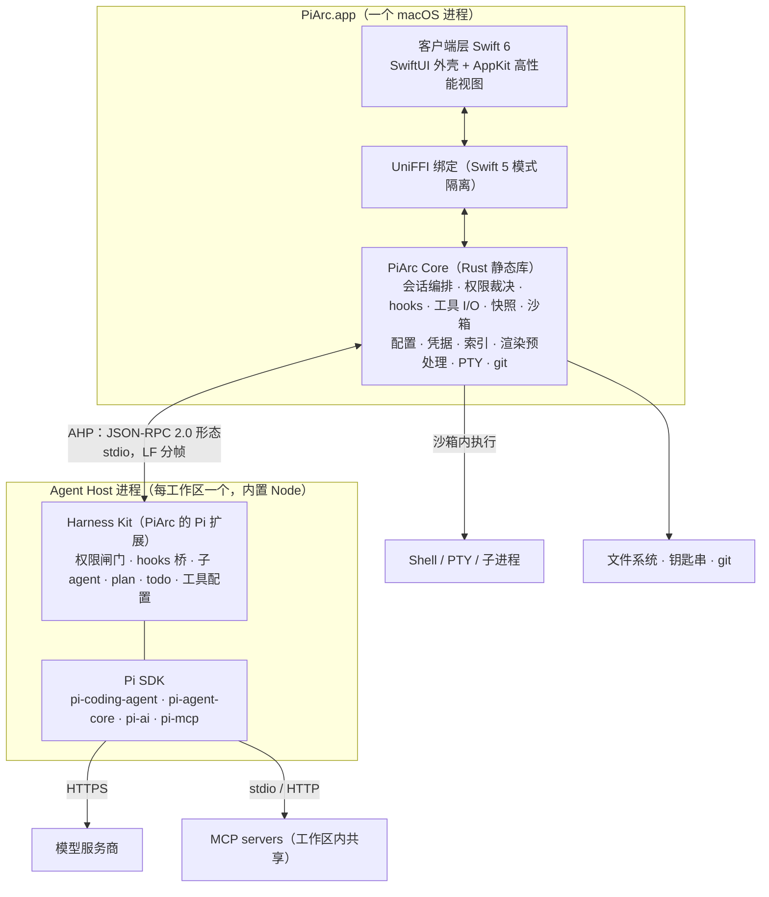
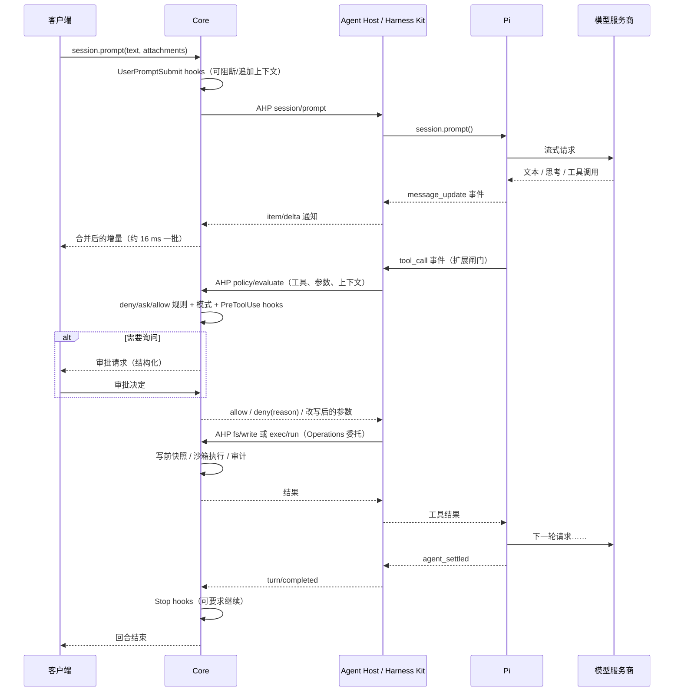

# PiArc 架构设计文档

| 项 | 内容 |
|---|---|
| 版本 | 1.0（首版，2026-11-14） |
| 状态 | 已接受。后续修改遵循第 18 章的维护规则 |
| 适用范围 | macOS 第一版全量设计；Windows 第二阶段的约束与路线 |
| 配套文档 | [需求规格](../product/REQUIREMENTS.md)、[架构决策记录](../adr/README.md)、[调研资料](../research/) |

PiArc 是一个专业的 AI 编码 Agent 桌面应用：以 [Pi](https://github.com/earendil-works/pi) 为 Agent 底座，提供 Claude Code 级别的 Harness 编排能力，客户端用各平台原生技术实现。第一版只做 macOS，Windows 在 macOS 落地后基于同一套核心实现。

本文是 PiArc 的设计北极星。任何与本文冲突的实现，要么修正实现，要么先通过 ADR 修改本文。

---

## 1. 目标、原则与边界

### 1.1 产品定位

一句话：**Claude Code 的 Harness 专业度 + Pi 的多模型能力 + 原生桌面体验。**

| 维度 | Claude Desktop（Code 标签页） | PiArc |
|---|---|---|
| 模型 | Anthropic 模型（可经云厂商或网关） | Pi 支持的全部服务商：Anthropic、OpenAI、Google、DeepSeek、Kimi、Qwen、GLM、OpenRouter、本地模型等 |
| Harness | Claude Code 引擎 | 在 Pi 之上实现同等能力，并兼容 Claude Code 配置格式 |
| 客户端技术 | Electron（官方未明说，见 `docs/research/claude-official-capabilities.md` B1） | macOS：SwiftUI + AppKit；Windows：第二阶段选定的原生框架 |
| 资源占用 | 社区大量报告内存增长、流式卡顿、每会话复制 MCP 进程 | 以可量化的性能预算作为发布门槛（第 11 章） |

### 1.2 设计目标

| 编号 | 目标 | 衡量方式 |
|---|---|---|
| G1 | Harness 能力对标 Claude Code：工具、权限、hooks、子 agent、plan、todo、上下文工程、checkpoint、skills、MCP、沙箱 | 第 6 章能力矩阵逐项达标；L3 行为对齐测试（第 12 章） |
| G2 | 多模型一等公民：Harness 能力不绑定某一家服务商，按模型能力自动降级 | 同一组场景测试在至少 3 家服务商上通过 |
| G3 | 原生体验：启动快、内存稳、长会话流畅、系统集成完整 | 第 11 章性能预算进入 CI |
| G4 | 安全默认：默认询问、项目信任、可选 OS 沙箱、凭据只进钥匙串 | 第 10 章威胁模型逐条有对策和测试 |
| G5 | 平台可移植：Windows 阶段只重写客户端层 | Core 与 Agent Host 在 CI 中同时构建 macOS 和 Windows 目标 |
| G6 | 跟随上游：Pi 升级成本可控 | 每次 Pi 升级的改动量与回归结果有记录（第 5.7 节） |

### 1.3 架构原则

这些原则用于裁决设计分歧。排在前面的优先。

1. **合规与安全优先于功能。** 不做 Claude 订阅登录，不复制专有代码与提示词，权限检查失败即拒绝（ADR-0006、ADR-0004）。
2. **厚核心、薄客户端。** Windows 也需要的逻辑一律放进 Rust Core 或 Agent Host；Swift 只做呈现和输入（ADR-0001）。
3. **控制面与执行面分离。** 权限、hooks、沙箱、快照、凭据由 Core 裁决；agent 循环、模型调用、上下文组装在 Pi（ADR-0004）。
4. **不 fork Pi。** 通过 SDK 和扩展集成，只依赖公开导出；必须修改时先找上游（ADR-0002）。
5. **兼容优先于发明。** 能沿用 Claude Code 配置格式、Agent Skills 标准、MCP 规范的地方不自造格式（ADR-0005）。
6. **协议先行、可测试。** 每条跨进程、跨语言边界都有版本化 schema、契约测试和可录制回放的事件流（ADR-0009）。
7. **性能是功能。** 性能预算与功能验收同等对待，超预算不发布。
8. **如实呈现。** UI 不猜测语义（成败、状态都由 Core 给出），不支持的能力明确告知，不静默降级。

### 1.4 非目标（第一版）

- 不做 Chat/Cowork 式的通用知识工作助手，聚焦编码场景；
- 不做云端托管会话、Remote Control、手机端；
- 不做 IDE 插件与行内代码补全；
- 不做插件市场的托管服务（支持安装已有的 Claude Code 插件和 Pi 包，不自建市场后端）；
- 不上 Mac App Store（ADR-0012）；
- 不在第一版支持 Windows，但 Core 与 Agent Host 从第一天起保持可移植。

---

## 2. 调研结论摘要

完整资料见 [`docs/research/`](../research/)。这里只列直接影响架构的结论。

### 2.1 Claude Code / Claude Desktop（官方文档，2026-11-14 快照）

- Claude Code 2.1.325 是一个"多表面、同一引擎"的 Harness，Desktop 的 Code 标签页内嵌同版本引擎。
- 权限 6 种模式（default/Manual、acceptEdits、plan、auto、dontAsk、bypassPermissions），规则按 deny → ask → allow 求值；auto 模式由分类器模型代替人审批，自 2.1.283 起为终端默认。
- Hooks 33 个事件、5 种 handler（command / http / mcp_tool / prompt / agent），exit code 2 与 JSON 输出两套决策协议。
- 子 agent 默认后台运行，最多嵌套 3 层、并发 20；fork 模式共享父会话缓存。
- Skills 遵循 Agent Skills 开放标准，三层渐进加载；自定义命令已并入 skills。
- MCP 工具默认延迟加载（tool search）。
- checkpoint 只跟踪编辑工具的改动，保留最近 100 个，30 天清理。
- **合规红线**：第三方应用不得提供 Claude.ai 登录或使用订阅凭证。
- **API 约束**：preserved thinking 要求历史只追加、system 与工具集稳定；prompt cache 要求稳定前缀；切换模型会让缓存全部失效。

### 2.2 Pi v1.4.0（源码，带文件:行号证据）

- 主链路是 pi-ai → pi-agent-core → pi-coding-agent，加 pi-mcp、pi-codemode。chord、durable、env 是另一套实验栈，不进 PiArc 主路径。
- SDK 能直接托管会话；`ModelRuntime` 支持注入凭据存储和交互式登录回调。
- 扩展 API 覆盖 Harness 所需的挂载点：`tool_call` 可阻断/改写（handler 抛异常即阻断）、`tool_result` 可改写、`before_agent_start` 可改 prompt 段、`turn_end`/`agent_before_settle` 可续跑、`session_before_compact` 可接管压缩、工具支持 `direct/deferred/codemode/hidden` 暴露方式。
- 内置工具的 I/O 都通过可替换的 `*Operations` 接口执行。
- 会话是 append-only JSONL 树，天然支持分支与回退。
- 缺口：无权限系统、无配置式 hooks、无子 agent/plan/todo（官方示例有原型）、无文件快照、无沙箱、凭据明文、RPC 单会话且无版本握手。
- 发布很快：2026-06 以来 coding-agent 51 个版本中 9 个带不兼容变更。
- pi-ai 的 Claude 订阅 OAuth 会伪装成 Claude Code，PiArc 必须屏蔽。

### 2.3 参考实现的启示

- **claw-code**（Rust 复刻）：窄 trait 隔离 I/O、显式权限阶梯、中断时补齐工具结果、invocation 对账、parity 场景测试值得借鉴；它的问题（上帝文件、定义了却没接线、mock 不校验请求、文档与代码漂移）要主动规避。
- **OpenClaudeDesktop**（Claude Desktop 界面复刻）：UI 与内核之间用 Codex app-server v2 风格的 thread/turn/item 协议；主进程维护带 epoch/revision 的审批账本；任务清单和"下一步"框由宿主注入的工具驱动，而不是内核原生能力；按能力声明降级而不是按内核名字分支。
- **open-claude-ui**（设计系统还原）：六层令牌模型；流式贴底、拖拽死区、输入法守卫、思考块在生成中强制展开等交互阈值可以迁移；品牌视觉不能迁移。

### 2.4 原生技术栈

- macOS 27 已发布且只支持 Apple silicon；Liquid Glass API 要求 macOS 26+。
- SwiftUI 长列表 + 流式文本有已知问题，业界做法是 AppKit `NSTableView` + TextKit 2。
- Rust ⇄ Swift 用 UniFFI 0.32.x（生产案例多，但 Swift 6 支持不完整，需要隔离层）；第二阶段 C# 用 uniffi-bindgen-cs。
- 终端：libghostty-vt 1.0（MIT，2026-11-06）+ portable-pty。
- Mac App Store 与 Agent 能力冲突，只能 Developer ID 直发。
- 同类产品（Raycast v2、Codex App）多已转向 Web UI，原生路线是少数派选择，最大技术风险是原生流式长文本渲染。

---

## 3. 总体架构

### 3.1 分层



| 层 | 进程 | 语言 | 状态归属 |
|---|---|---|---|
| 客户端 | App 主进程 | Swift 6 | 只持有呈现状态（窗口布局、滚动位置、展开/折叠）。业务状态都是 Core 推送来的快照或增量。 |
| Core | App 主进程（静态库） | Rust | 应用级事实来源：工作区、会话索引、审批账本、权限规则、hooks 配置、后台任务、快照、凭据。 |
| Agent Host | 子进程，每工作区一个 | TypeScript（Node） | 运行中会话的内存状态（Pi `AgentSession`）。持久化由 Pi 写 JSONL。 |

### 3.2 一次用户输入的完整流程



要点：

- 回合是否结束以 Pi 的 `agent_settled` 为准；`agent_end` 之后仍可能有重试、溢出恢复、排队消息。
- 工具调用的预检在 Pi 中是串行的，所以审批请求不会并发弹出；通过预检的只读工具可以并发执行。
- Core 的任何一步失败（超时、不可达、解析失败），Harness Kit 都按拒绝处理。

### 3.3 进程模型

| 进程 | 数量 | 生命周期 | 说明 |
|---|---|---|---|
| PiArc.app | 1 | 用户启动/退出 | 关闭最后一个窗口时应用不退出（菜单栏常驻），后台会话继续运行。 |
| Agent Host | 每个已打开工作区 1 个 | Core 按需启动与预热；工作区内全部会话空闲超过阈值（默认 30 分钟）后回收；崩溃自动重启并恢复会话 | 一个进程承载该工作区的所有会话；子 agent 在进程内运行（ADR-0010）。 |
| MCP server | 每工作区每 server 1 个 | Agent Host 中的共享连接池按需启动、空闲回收 | 不随会话数复制。 |
| Shell / PTY | 按需 | Core 的任务管理器负责，进程组/Job Object 级别终止 | 前台命令、后台命令、终端面板都由 Core 统一管理。 |
| hooks 命令 | 按需 | Core 执行，带超时，杀整棵进程树 | 在沙箱外运行（与 Claude Code 一致），受项目信任约束。 |

AHP 从第一天起按会话多路复用，退回"每会话一个进程"不需要改协议。

### 3.4 仓库结构

```
PiArc/
├── apps/
│   ├── macos/                 # Xcode 工程 + SwiftPM 包（PiArc.app）
│   └── windows/               # 第二阶段
├── crates/                    # Rust workspace（第 7 章）
├── agent-host/                # TypeScript：Agent Host 与 Harness Kit（第 5、6 章）
├── design/tokens/             # 设计令牌单一来源（JSON），生成各平台资源
├── docs/
│   ├── architecture/          # 本文
│   ├── adr/                   # 架构决策记录
│   ├── product/               # 需求规格
│   └── research/              # 调研资料与参考源清单
├── scripts/                   # 跨平台脚本（Node 或 Python）
├── tests/scenarios/           # 数据驱动的 Harness 场景（第 12 章）
└── reference/                 # 本地参考仓库副本（gitignore）
```

---

## 4. 关键决策一览

| ADR | 决策 | 一句话理由 |
|---|---|---|
| [0001](../adr/0001-three-tier-native-architecture.md) | 原生客户端 + Rust Core + Pi Agent Host 三层 | Pi 只能跑在 JS 运行时里；厚核心让 Windows 只重写客户端 |
| [0002](../adr/0002-pi-integration-via-sdk-host.md) | 基于 Pi SDK 自研 Agent Host | 官方 RPC 缺多会话、版本握手、结构化审批；SDK 让上游不兼容变更在编译期暴露 |
| [0003](../adr/0003-embedded-node-runtime.md) | 内置 Node LTS | MCP 的 npx 与 Pi 插件包依赖 Node；Bun 作为对照备选 |
| [0004](../adr/0004-harness-control-plane-in-core.md) | 策略在 Core、循环在 Pi、I/O 下沉 Core | 安全边界不能落在无隔离的扩展上；快照与沙箱需要统一入口 |
| [0005](../adr/0005-claude-code-config-compatibility.md) | 只读兼容 Claude Code 配置 | 用户零成本迁移，又不污染其 Claude Code 配置 |
| [0006](../adr/0006-compliance-and-clean-room.md) | 禁用 Claude 订阅登录、clean-room、自有品牌 | 不把商业模式建在违反条款的基础上 |
| [0007](../adr/0007-macos-ui-swiftui-appkit.md) | SwiftUI 外壳 + AppKit 高性能视图，最低 macOS 26 | 兼顾开发效率与长会话性能 |
| [0008](../adr/0008-ffi-uniffi.md) | UniFFI | 一份接口定义服务 Swift 与 C# |
| [0009](../adr/0009-agent-host-protocol.md) | 自有协议 AHP | 双向请求、版本握手、事件回放、调用对账 |
| [0010](../adr/0010-process-model.md) | 每工作区一个 Agent Host | 控制多会话内存，MCP 按工作区共享 |
| [0011](../adr/0011-session-storage.md) | Pi JSONL 为事实来源 + SQLite 索引 + 内容寻址快照 | 跟随上游格式，索引可重建 |
| [0012](../adr/0012-distribution-developer-id.md) | Developer ID + 公证 + Sparkle | App Store 沙盒与 Agent 能力冲突 |

---

## 5. Agent Host 设计（Pi 集成）

### 5.1 职责

Agent Host（`agent-host/`，包名 `@piarc/agent-host`）是一个 Node 程序，做三件事：

1. 用 Pi SDK 托管一个工作区内的多个会话；
2. 加载 Harness Kit（PiArc 的 Pi 扩展集合）；
3. 通过 AHP 与 Core 通信：接收会话命令、上报事件、向 Core 发起权限/hooks/I-O/凭据请求。

它**不**负责：权限规则存储与裁决、hooks 进程执行、文件快照、沙箱、PTY、凭据持久化、会话索引。这些都在 Core。

### 5.2 内部结构

```
agent-host/
├── src/
│   ├── main.ts                # 入口：stdio 接管、握手、信号处理
│   ├── protocol/              # AHP 编解码；类型由 piarc-protocol 的 JSON Schema 生成，不手写
│   ├── runtime/
│   │   ├── workspace.ts       # 工作区级共享：ModelRuntime、凭据存储、MCP 连接池、资源加载
│   │   ├── session-registry.ts# sessionId → AgentSession；创建/恢复/fork/回收
│   │   ├── projector.ts       # Pi 事件 → AHP thread/turn/item 事件投影
│   │   └── core-bridge.ts     # 向 Core 发请求（policy、hooks、fs、exec、secrets），统一超时与失败即拒绝
│   ├── harness/               # Harness Kit：每个能力一个扩展工厂（第 6 章）
│   ├── tools/                 # 工具配置（Tool Profile）与 Operations 委托实现
│   └── providers/             # 服务商策略：屏蔽 Claude 订阅 OAuth、模型能力表
├── patches/                   # 对 Pi 的临时补丁（目标为零），每个补丁附上游 issue 链接
└── test/
```

### 5.3 会话托管与事件投影

- 每个会话对应一个 Pi `AgentSession`，由 `createAgentSession()` 创建，传入：工作区共享的 `ModelRuntime`、文件型 `SessionManager`（会话目录在 PiArc 应用支持目录下）、`DefaultResourceLoader`（`extensionFactories` 注入 Harness Kit，`agentDir` 指向 PiArc 自己的目录），以及第 6.1 节的工具配置。
- 会话替换类操作（新建、切换、fork）用 `AgentSessionRuntime`，替换后重新绑定事件订阅。
- **投影规则**：Pi 的 `AgentSessionEvent` 投影成 AHP 的 `turn/*` 与 `item/*`：

| Pi 事件 | AHP 事件 | 说明 |
|---|---|---|
| `agent_start`（一次 prompt 的首个） | `turn/started` | 一个用户输入对应一个 turn |
| `agent_settled` | `turn/completed` | 不用 `agent_end`；附带用量汇总 |
| `message_update`（`text_delta` / `thinking_delta`） | `item/agentMessage/delta`、`item/reasoning/delta` | itemId = `messageId#contentIndex`，保证稳定 |
| `tool_execution_start/update/end` | `item/started`、`item/updated`、`item/completed` | 按工具映射到 item 类型：`commandExecution`、`fileChange`（带结构化 diff）、`mcpToolCall`、`subagent`、`webFetch`、`dynamicToolCall` |
| `compaction_start/end` | `item/contextCompaction` | 带原因与压缩前后 token 数 |
| `auto_retry_*` | `turn/retrying` | 带 attempt / maxAttempts / delayMs |
| `queue_update` | `session/queueChanged` | Agent Host 给每个排队项分配 id，支持编辑、删除、重排 |
| `entry_appended`（Harness Kit 写入的自定义 entry） | 对应的 Harness 事件 | 例如 todo 更新、plan 提交 |

- 所有 item 的状态统一为 `inProgress / completed / failed / declined / interrupted`。成败由 Agent Host 按语义判断（例如 `grep` 无匹配、`diff` 有差异时退出码为 1，仍算成功），UI 不自行推断。

### 5.4 凭据与登录

- `ModelRuntime.create({ credentials })` 注入 PiArc 的 `CredentialStore`：读取来自 Core（钥匙串），写入经 AHP 交给 Core 持久化。Pi 的 `AuthStorageBackend.withLock` 是同步接口，Agent Host 启动时向 Core 一次性取回凭据放在内存中，写操作异步回写 Core。这个方案在 M0 验证；若 Pi 的接口无法满足，补丁或上游 issue 处理。
- 凭据只经 AHP 传递，不放进环境变量（Agent Host 启动的子进程会继承环境变量）。
- OAuth 与设备码登录调用 `ModelRuntime.login(provider, type, interaction)`，`interaction` 的回调（授权 URL、设备码、输入提示）转成 AHP 请求，由客户端用原生界面呈现（`ASWebAuthenticationSession` 或系统浏览器）。
- **Anthropic 的订阅 OAuth 登录方式在 Agent Host 中被屏蔽**（ADR-0006）；CI 中有测试断言可用登录方式列表不包含它。

### 5.5 Pi 配置隔离

- Pi 的 agent 目录指向 `~/Library/Application Support/PiArc/pi/`（经 SDK `agentDir`），与用户本机 `~/.pi/agent` 隔离；设置界面提供一次性导入（模型配置、skills、prompts）。
- 关闭 Pi 的版本检查与自更新；`PI_OFFLINE` 只在需要时开启（它也会关闭模型目录刷新）。模型目录刷新是否走网络由 PiArc 设置控制。
- Pi 的项目信任（`project_trust`）由 Harness Kit 接管：信任决定来自 Core（第 10.2 节），不使用 Pi 的 `trust.json`。

### 5.6 运行时与打包

- 构建：esbuild 把 Agent Host 打成单个 bundle（目标与 Pi 一致：node22.19+），外部依赖只保留 Pi 要求的原生/wasm 资源（photon、quickjs wasm 等）。
- 应用内布局：

```
PiArc.app/Contents/
├── MacOS/PiArc
├── Frameworks/                 # Rust Core 已静态链接；Sparkle.framework
└── Resources/
    ├── agent-host/
    │   ├── node                # 重签的 Node LTS
    │   ├── npm/ npx            # 供 MCP 与插件包安装使用
    │   ├── agent-host.mjs      # bundle
    │   ├── pi-assets/          # Pi 运行时需要的资源（经 PI_PACKAGE_DIR 指定）
    │   └── bin/ rg fd          # 预置，避免 Pi 运行时下载
    └── …
```

- 启动：Core 用固定参数启动 `node agent-host.mjs`，设置最小化的环境变量（PATH 前置内置 Node 目录；`PI_PACKAGE_DIR`；关闭遥测与更新），工作目录为工作区根。

### 5.7 跟随上游

| 环节 | 做法 |
|---|---|
| 版本 | `@earendil-works/*` 全部锁定同一精确版本；lockfile 入库 |
| 依赖面 | 只用包入口公开导出的 SDK、ExtensionAPI 与类型；ESLint 规则禁止深度 import |
| 升级节奏 | 按月评估，安全修复随时；不追每个版本 |
| 升级流程 | 读各包 CHANGELOG 的 Breaking Changes → 升级 → `tsc` → L1 契约测试 → L2 场景回放 → L3 对齐测试抽样 → 更新 `docs/research/pi-v1.4.0-baseline.md` 的基线版本与差异 |
| 补丁 | `agent-host/patches/` 目标为零；每个补丁记录原因、上游 issue、移除条件；超过 10 个触发 ADR-0002 复审 |

---

## 6. Harness 能力设计

本章定义 PiArc 要实现的 Harness 行为。行为目标参照 Claude Code 官方文档（`docs/research/claude-official-capabilities.md`），实现完全自行编写（ADR-0006）。

### 6.0 能力矩阵

"位置"列：**C** = Core（Rust），**K** = Harness Kit（Agent Host 内的 Pi 扩展），**U** = 客户端。"里程碑"见第 16 章。

| 能力 | 目标行为（摘要） | 位置 | 依托的 Pi 能力 | 里程碑 |
|---|---|---|---|---|
| 工具体系 | Claude Code 兼容的工具名与语义；编辑安全不变量；输出截断与落盘 | K + C | `create*Tool` + `*Operations`、`registerTool` | M1 |
| 权限 | 6 种模式中的 5 种（dontAsk 仅无头）；deny → ask → allow 规则；复合命令感知；结构化审批 | C + K + U | `tool_call` 闸门 | M1 基础、M2 完整 |
| Hooks | Claude Code 兼容的事件、配置格式、exit code 与 JSON 协议 | C + K | 各生命周期事件 | M2 |
| 子 agent | `.claude/agents` 定义；进程内子会话；工具子集；任意服务商模型；后台运行；最多 3 层 | K + C + U | SDK 子会话 | M3 |
| Plan 模式 | 只读探索 → 提交计划 → 用户批准并选择后续模式 | K + C + U | `setActiveTools`、`tool_call` | M2 |
| 任务清单 / 下一步 | 宿主工具驱动，UI 原生渲染，压缩后重新注入 | K + U | `registerTool`、工具 details | M2 |
| 上下文工程 | 分段 system prompt；memory 层级与 `@import`；system-reminder；压缩；缓存友好布局 | K | `before_agent_start`、`context`、`session_before_compact` | M1–M3 |
| Skills / 命令 | Agent Skills 标准；`.claude/skills`、`.claude/commands`；渐进加载 | K | Pi skills、prompt templates、`resources_discover` | M3 |
| 插件 | 加载 Claude Code 插件目录与 Pi 包 | C + K | packages、扩展 | M4 |
| MCP | stdio / Streamable HTTP；OAuth；工作区共享连接池；延迟加载 | K + C + U | pi-mcp、`tool_search` | M3 |
| Checkpoint / Rewind | 写前快照；回退代码 / 对话 / 两者 | C + K | 会话树 fork/leaf | M2 |
| 沙箱 | Bash 在 Seatbelt 中执行；文件与网络白名单 | C | BashOperations 委托 | M4 |
| 后台任务 / 终端 | 后台命令、超时转后台、Monitor、终端面板 | C + K + U | BashOperations、`registerTool` | M3 |
| Worktree | 每会话可选独立 worktree；子 agent 隔离 | C + K | cwd 按会话 | M3 |
| 多模型适配 | 模型能力表；effort 映射；切换代价提示；按能力降级 | K + C | pi-ai 模型目录 | M1–M3 |
| Auto 模式（分类器） | 可配置的审查模型代替人审批，决策可审计 | C + K | 辅助模型调用 | M5 |

### 6.1 工具体系

#### 6.1.1 规范名与 Tool Profile

- **规范名采用 Claude Code 的工具名**：`Read`、`Write`、`Edit`、`Bash`、`Glob`、`Grep`、`WebFetch`、`WebSearch`、`Agent`、`TodoWrite`、`AskUserQuestion`、`EnterPlanMode`、`ExitPlanMode`、`Skill`、`ToolSearch`、`NotebookEdit`、`KillShell`、`Monitor`，MCP 工具为 `mcp__<server>__<tool>`。权限规则、hooks matcher、子 agent 的 `tools` 列表一律使用规范名，这样用户现有的 Claude Code 配置可以直接生效。
- **Tool Profile** 决定某个模型看到的工具名、描述和参数风格。默认 Profile 直接使用规范名；针对特定模型家族可以调整描述文字或参数命名，但规则与 hooks 始终按规范名匹配。Agent Host 维护"模型可见名 ↔ 规范名"映射表。
- 实现方式：用 Pi 的 `createReadTool/createEditTool/createWriteTool/createBashTool/...` 加 Operations 委托（6.1.3）创建内置工具，再包装成规范名与 PiArc 自写的描述。Pi 内置工具重命名的可行性在 M0 验证。

#### 6.1.2 工具语义不变量

这些不变量由 Core 和 Harness Kit 共同保证，并有场景测试覆盖：

| 不变量 | 规则 |
|---|---|
| 先读后改 | 对已存在文件执行 `Edit`/`Write` 前，本会话必须读过它，且读取后文件未被外部修改。Core 维护每会话的文件状态表（路径 → 内容 hash、mtime）。 |
| 外部修改检测 | 读取后文件被外部修改，`Edit` 返回明确错误，要求重新读取。 |
| 唯一匹配 | `Edit` 的旧文本必须在文件中唯一，或显式要求替换全部；多处匹配时报错，不替换第一处。 |
| 保真写入 | 保留原文件的换行符风格（LF/CRLF）、编码与 BOM；写入采用临时文件 + 原子 rename。 |
| 结构化 diff | 每次文件变更产生真实的 unified diff 和 hunk 结构，供 UI 审阅和快照索引。 |
| 输出截断 | 超长输出写入会话临时目录，模型收到头尾预览和文件路径（阈值见 6.11）。 |
| 路径边界 | 默认只允许读写工作区与已添加目录；越界访问走权限询问。受保护路径（`.git/`、`.piarc/`、`.claude/`、`.pi/`、shell 配置文件）的写入在 Manual 与 Accept edits 模式下始终询问。 |
| 并发 | 只读工具可以并发；写同一文件的操作经 Pi 的 `withFileMutationQueue` 串行；预检（含审批）串行。 |
| 中断 | 中断时为所有未完成的工具调用补齐"已中断"结果，保证 tool_use / tool_result 配对完整。 |

#### 6.1.3 Operations 委托

| Pi 接口 | 委托到 Core 的 AHP 方法 | Core 额外做的事 |
|---|---|---|
| `ReadOperations.readFile/access` | `fs/read`、`fs/stat` | 路径边界检查、更新文件状态表、图片与 PDF 预处理 |
| `WriteOperations.writeFile/mkdir` | `fs/write`、`fs/mkdir` | 写前快照、原子写、生成 diff、审计 |
| `EditOperations` | `fs/read` + `fs/write` | 同上，并校验先读后改 |
| `BashOperations.exec` | `exec/run`（流式输出经通知回传） | 沙箱、进程组管理、超时转后台、语义退出码、审计 |
| `GrepOperations` / `FindOperations` / `LsOperations` | `fs/grep`、`fs/glob`、`fs/list` | 在 Core 中用 ripgrep 的 Rust 库（`grep-searcher`、`ignore`）实现，遵守 .gitignore |

#### 6.1.4 第一版工具清单

| 工具 | 说明 | 默认需审批（Manual） | 里程碑 |
|---|---|---|---|
| Read | 文本带行号分页；图片；PDF 分页；ipynb | 否 | M1 |
| Write / Edit | 见不变量 | 是 | M1 |
| Bash | 见 6.11 | 是（只读命令白名单除外） | M1 |
| Glob / Grep | Core 实现 | 否 | M1 |
| WebFetch | 本地抓取 → Markdown → 辅助模型按提示提取；域名规则 | 是 | M2 |
| WebSearch | 可配置后端（服务商原生搜索工具优先，其次第三方搜索 API） | 是 | M3 |
| TodoWrite | 任务清单（6.5） | 否 | M2 |
| AskUserQuestion | 结构化多选/输入，UI 原生表单 | 否 | M2 |
| EnterPlanMode / ExitPlanMode | 6.5 | 否 / 是 | M2 |
| Agent | 子 agent（6.4） | 否 | M3 |
| Skill | 6.7 | 视 skill | M3 |
| ToolSearch | 延迟加载工具检索（复用 Pi `tool_search`） | 否 | M3 |
| KillShell / Monitor | 后台任务（6.11） | 否 / 是 | M3 |
| NotebookEdit | Jupyter cell 编辑 | 是 | M4 |

### 6.2 权限系统

#### 6.2.1 模式

| 模式（配置值） | UI 名 | 无需询问即可执行 | 第一版 |
|---|---|---|---|
| `default` | 手动 | 只读工具 | ✓ |
| `acceptEdits` | 自动接受编辑 | 只读 + 工作区内文件编辑 + 常见文件系统命令（mkdir/touch/mv/cp） | ✓ |
| `plan` | 计划 | 只读；计划批准前禁止编辑 | ✓ |
| `bypassPermissions` | 跳过权限 | 全部（deny 规则仍生效） | ✓，需在设置中显式开启并二次确认 |
| `auto` | 自动审查 | 由审查模型逐项判定 | M5 |
| `dontAsk` | — | 只允许预批准的工具，其余拒绝 | 仅无头模式（P2） |

- 起始模式解析：会话显式指定 → 设置中的 `permissions.defaultMode` → 内置默认 `default`。项目级配置中的 `bypassPermissions` 与 `auto` 不生效，防止仓库提权。
- 所选模式按工作区记忆；切换模式是一条会话事件，写入转录。

#### 6.2.2 规则

- 语法与 Claude Code 一致：`Tool` 或 `Tool(specifier)`。支持的 specifier：`Bash(命令模式)`、`Read/Edit(路径 glob)`、`WebFetch(domain:…)`、`Agent(类型)`、`Skill(名称)`、`mcp__server__tool` 与 `mcp__server__*`。
- 求值顺序：**deny → ask → allow**，首个命中即决定；allow 无法覆盖 deny。不带 specifier 的 deny 会把工具从模型可见的工具集中移除。
- 规则来源与优先级见 ADR-0005：企业策略 > 会话 > `.piarc/settings.local.json` > `.piarc/settings.json` > `.claude/settings.local.json` > `.claude/settings.json` > 用户级 PiArc 设置 > `~/.claude/settings.json`；列表合并。
- **Bash 命令分析在 Core 中完成**：用 tree-sitter-bash 解析，拆分 `&& || ; | |& &` 与换行、子 shell、命令替换；剥离 `timeout`、`time`、`nice`、`nohup`、`env` 赋值等包装；逐个子命令匹配。deny/ask 只要任一子命令命中即生效，allow 要求所有子命令都被允许。解析失败按"需要询问"处理。
- 内置只读命令白名单（如 `ls`、`cat`、`git status`、`git diff`、`rg`）在 Manual 模式下免审批；白名单维护在 Core，带测试。
- 关键路径删除（`rm -rf` 指向工作区根、家目录、`/` 等）与 `requiresUserInteraction` 类工具在任何模式下都询问。

#### 6.2.3 裁决流程

```
Harness Kit tool_call ──► Core policy/evaluate
  1. 企业策略 deny ─────────────────────────────► 拒绝
  2. PreToolUse hooks（exit 2 / deny 立即拒绝；allow 不能绕过后续 deny/ask）
  3. deny 规则 ─────────────────────────────────► 拒绝
  4. ask 规则 ──────────────────────────────────► 询问
  5. 模式（plan 下的写操作 → 拒绝并提示；bypass → 允许）
  6. allow 规则 ────────────────────────────────► 允许
  7. 模式默认（只读 → 允许；acceptEdits 下工作区内编辑 → 允许）
  8. 其余 ─────► PermissionRequest hooks ─► 审批请求（客户端）
```

- **审批账本**（Core）：每个审批请求有 `requestId`、所属会话/子 agent、`revision`、`connectionEpoch`。多窗口同时显示时只接受第一个有效答复；Agent Host 重连后旧请求全部作废。
- **审批选项**：仅本次允许 / 本会话允许 / 总是允许（写入 `.piarc/settings.local.json`，Bash 按子命令前缀生成规则，用户可在保存前编辑）/ 拒绝（可附反馈，作为拒绝理由回给模型）。
- 审批结果、规则命中、hooks 决定都写入审计表（SQLite），设置界面可查。

### 6.3 Hooks

#### 6.3.1 配置与执行

- 配置格式兼容 Claude Code：事件 → matcher 组 → handler 列表；从 6.2.2 所列的同一组 settings 文件读取并**合并**；插件 `hooks/hooks.json`、skill 与子 agent frontmatter 中的 hooks 在其作用期间生效。
- **执行全部在 Core**：command 类型通过 stdin 传入 JSON、读取 exit code 与 stdout；默认超时 600 秒（UserPromptSubmit 30 秒）；超时或取消时杀整棵进程树；同一事件命中的多个 handler 并行执行。
- 项目级 hooks 在项目被信任之前不执行；企业策略可设置"只允许托管 hooks"。
- 决策协议兼容：exit 0 + JSON（`decision`、`hookSpecificOutput.permissionDecision`、`updatedInput`、`additionalContext`、`continue`、`systemMessage` 等），exit 2 阻断并把 stderr 作为理由，其他退出码视为非阻断错误。

#### 6.3.2 事件映射与分期

| 事件 | 挂载点 | 里程碑 |
|---|---|---|
| SessionStart / SessionEnd | Core 会话生命周期；Pi `session_start` / `session_shutdown` | M2 |
| UserPromptSubmit | Core 在发送给 Agent Host 之前 | M2 |
| PreToolUse | 6.2.3 第 2 步 | M2 |
| PermissionRequest | 6.2.3 第 8 步 | M2 |
| PostToolUse / PostToolUseFailure | Pi `tool_result`（可改写输出、追加上下文） | M2 |
| Stop | Pi `agent_before_settle`（block 时以 reason 续跑一轮，带防循环计数） | M2 |
| SubagentStart / SubagentStop | Harness Kit 子 agent 工具 | M3 |
| PreCompact / PostCompact | Pi `session_before_compact` / `session_compact` | M2 |
| Notification | Core 发出通知时 | M2 |
| PostToolBatch | Pi `turn_end` | M3 |
| UserPromptExpansion、InstructionsLoaded、CwdChanged、FileChanged、ConfigChange、StopFailure | 对应 Core / Harness Kit 时机 | M4 |
| WorktreeCreate / WorktreeRemove、PreModelSwitch / PostModelSwitch、Elicitation / ElicitationResult、PermissionDenied | 对应时机 | M5 |
| TaskCreated / TaskCompleted、MessageDisplay、Setup、DirectoryAdded、TeammateIdle | 视需求 | 未排期 |

handler 类型：`command`（M2）→ `http`、`prompt`（M3）→ `mcp_tool`（M4）→ `agent`（未排期）。

### 6.4 子 agent

- **定义来源**：`.claude/agents/*.md`、`.piarc/agents/*.md`（项目，从 cwd 向上查找）、`~/.claude/agents/`、PiArc 用户目录、插件。frontmatter 支持 `name`、`description`、`tools`、`disallowedTools`、`model`、`permissionMode`、`maxTurns`、`skills`、`mcpServers`、`hooks`、`isolation: worktree`、`background`、`effort`、`color`；不支持的字段在 UI 中提示。
- **内置类型**：`general-purpose`（全部工具）、`Explore`（只读，不加载 memory 文件与 git 状态，适合用便宜快速的模型）、`Plan`（只读，计划模式下收集上下文）。
- **执行**：在同一 Agent Host 中创建子 `AgentSession`，独立上下文、独立压缩；工具集按定义过滤，并移除 `AskUserQuestion`、`EnterPlanMode`/`ExitPlanMode`；达到深度上限（默认 3）时移除 `Agent`。并发上限默认 8（多服务商的速率限制差异大，比 Claude Code 的 20 保守），可配置。
- **模型**：`model` 可以是别名（PiArc 的模型别名表把 `fast`/`balanced`/`strong` 以及 `haiku`/`sonnet`/`opus` 映射到用户选定的任意服务商模型）、`provider/model` 全名或 `inherit`。这是 PiArc 相对 Claude Code 的差异点：探索类子 agent 可以跑在便宜的模型上。
- **权限**：子 agent 的工具调用经同一套裁决流程；需要询问时，审批请求在主会话中显示并标明来自哪个子 agent。
- **结果**：前台子 agent 的最终报告作为 `Agent` 工具结果返回；后台子 agent 完成后以通知消息注入主会话下一回合。子会话转录存为独立 JSONL，并在 Core 索引中记录父子关系。
- 子 agent 的文件编辑同样进入快照（Core 统一入口），这一点比 Claude Code 更完整。

### 6.5 Plan 模式、任务清单、下一步、提问

- **Plan 模式**：进入后 Harness Kit 用 `setActiveTools` 收起写工具，`tool_call` 闸门拦截非只读命令；模型用 `ExitPlanMode` 提交计划（Markdown）。客户端显示计划卡与计划面板，用户可行内评论；批准时选择后续模式（自动接受编辑 / 手动审批 / 继续规划）。计划文本保存为会话 entry，压缩后重新注入。
- **任务清单**：`TodoWrite` 工具的状态存在工具结果的 `details` 中（随分支正确回溯，参照 Pi 官方 `todo.ts` 示例）；Core 从 `item/completed` 中取出状态，客户端渲染任务卡和侧栏任务面板。长时间未更新时，Harness Kit 以 system-reminder 形式提醒模型。
- **下一步框**：Harness Kit 注册宿主工具（例如 `SuggestNextSteps`），模型在回合结束时调用，客户端渲染为可点击的建议（开始新会话 / 在此执行）。这类"宿主注入的工具"对所有服务商一致生效，借鉴自 OpenClaudeDesktop 的做法。
- **AskUserQuestion**：结构化问题（单选、多选、自由输入）经 AHP 到客户端原生表单；可设置超时后按默认继续。

### 6.6 上下文工程

#### 6.6.1 System prompt 组装

Harness Kit 在 `before_agent_start` 中通过 Pi 的结构化 prompt 段（`systemPromptOptions`）组装，**不使用 Pi 默认的 preamble**（其中写死了 "pi" 和 Pi 文档路径）。各段按"越稳定越靠前"排列，以利于 prompt cache：

| 顺序 | 段 | 内容 | 变化频率 |
|---|---|---|---|
| 1 | 身份与基础准则 | PiArc 自写的编码 agent 行为准则（按 Tool Profile 可有变体） | 随版本 |
| 2 | 工具使用准则 | 各工具的使用约束 | 随工具集 |
| 3 | 输出风格 | 当前 output style 的指令 | 用户切换时 |
| 4 | 项目上下文 | memory 文件（6.6.2）、rules 索引 | 会话内基本不变 |
| 5 | skills 索引 | 名称 + 描述（截断到固定长度） | 会话内基本不变 |
| 6 | MCP server 说明 | 已连接 server 的 instructions | 连接变化时 |
| 7 | 环境 | 工作目录、平台、日期、git 状态快照（会话开始时） | 会话开始时 |

会话中途的变化（切换 output style、加载 skill、进入 plan 模式、工具集变化）以追加消息的形式送达，不改写已发送的 system prompt。这同时满足 Claude 的 preserved thinking 约束：历史只追加，system 与工具定义保持稳定（`docs/research/claude-official-capabilities.md` C 节）。

#### 6.6.2 Memory 文件

- 读取 `CLAUDE.md`、`AGENTS.md`、`CLAUDE.local.md`，从工作区根向上逐级拼接（越靠近 cwd 越靠后），加上用户级 `~/.claude/CLAUDE.md` 与 PiArc 用户级 memory。两者同时存在时的取舍与 Claude Code 一致（默认只读 `CLAUDE.md`，可配置为两者都读）。
- 支持 `@path` 导入（相对于所在文件，最多 4 层，代码块内不解析；指向工作区外的导入首次需确认）。
- `.claude/rules/**/*.md` 支持 `paths:` frontmatter：只有处理匹配文件时才注入。
- 子目录中的 memory 文件在 agent 首次读写该目录文件时懒加载（以 system-reminder 注入）。
- Pi 自带的上下文文件加载被关闭（SDK 选项），统一由 Harness Kit 处理，避免重复。
- 自动记忆（agent 自己维护的跨会话笔记，`MEMORY.md` 索引 + 主题文件）列为 M5。

#### 6.6.3 System reminder

Harness Kit 以带标记的自定义消息（Pi `sendMessage` 的 custom message）注入运行时提示：任务清单长期未更新、文件被外部修改、plan 模式约束、后台任务完成、懒加载的 memory、hooks 追加的上下文。客户端默认不显示这些消息，详细视图下可见。

#### 6.6.4 压缩

- 使用 Pi 的压缩机制（manual / threshold / overflow 三种触发），通过 `session_before_compact` 替换为 PiArc 自写的摘要提示，并支持用户在 `/compact` 时附加重点说明。
- 阈值按模型上下文窗口计算，默认在剩余空间低于"预留输出 + 安全余量"时触发（初始公式见 6.15）；用户可设置自动压缩窗口上限（例如对 1M 窗口的模型限定在 300K 以控制成本）。
- PreCompact hook 可阻断压缩或提供摘要指令；PostCompact 通知。
- 压缩后重新注入：memory 文件、当前计划、任务清单状态、最近调用的 skill 正文（单个与合计都有 token 上限）、最近读写过的少量文件路径提示。
- 连续多次压缩后上下文立即又满（例如单个超大工具输出）时停止自动压缩并报告，避免空转。
- 对 Anthropic 模型，服务端 context editing / compaction 作为可选策略（M5），与客户端压缩统一抽象。

#### 6.6.5 上下文用量

Agent Host 按类别统计上下文构成（system prompt、工具定义、MCP 工具、memory、skills、对话、工具结果），经 AHP 上报；客户端显示用量环与分类明细。

### 6.7 Skills、命令、插件、输出风格

- **Skills**：遵循 Agent Skills 标准。发现路径在 Pi 默认路径之外增加 `.claude/skills`、`~/.claude/skills`、`.piarc/skills`、插件 skills（经 `resources_discover`）。system prompt 只列索引，模型用 `Skill` 工具或读取 SKILL.md 加载正文。支持 frontmatter 的 `allowed-tools`（本回合免审批，由 Core 裁决时参考）、`disable-model-invocation`、`user-invocable`、`arguments`、`paths`；`context: fork` 列为 M5。
- **斜杠命令**：来源合并为一个列表：内置命令（Core 实现，如 `/compact`、`/clear`、`/model`、`/rewind`、`/context`）、`.claude/commands` 与 Pi prompt templates、skills、MCP prompts。客户端的命令面板按来源分组、支持模糊搜索。
- **插件**：识别 Claude Code 插件目录结构（`.claude-plugin/plugin.json` + commands/agents/skills/hooks/`.mcp.json`）与 Pi 包（npm/git）。安装、启用、作用域（用户/项目）由 Core 管理；插件内的可执行代码（Pi 扩展、hooks、MCP server）在启用前展示来源与权限并要求确认。Claude Code 插件中的 JS "mods"（直接改 Claude Code UI 的函数式 hook）不支持。
- **输出风格**：内置若干风格（默认、简洁、讲解等），支持 Markdown + frontmatter 自定义；切换以消息形式送达。

### 6.8 MCP

- 配置来源：`.mcp.json`（项目，需信任）、`~/.claude.json` 中的 user/local 级 server、PiArc 自己的配置、插件、企业策略；同名按"企业 > 本地 > 项目 > 用户 > 插件"取整条定义。
- 传输：stdio、Streamable HTTP（pi-mcp 支持）；旧 SSE 传输不支持（pi-mcp 不支持，Claude Code 也已标记弃用），UI 中明确提示。
- **连接池**：PiArc 的 MCP 扩展替换 Pi 内置 MCP 扩展，在 Agent Host 内按工作区维护共享连接池，同一 server 只启动一份，按需连接、空闲断开（ADR-0010）。stdio server 的进程由 Agent Host 启动，PATH 中前置内置 Node，使 `npx` 类 server 开箱即用。
- OAuth：使用 pi-mcp 的 OAuth 流程；浏览器授权由客户端发起；token 存钥匙串（经 Core），不写明文文件。
- 工具暴露：工具总数较少时直接暴露；超过阈值（默认 30 个）时改为延迟加载，经 `ToolSearch` 检索。
- 缺口：elicitation、sampling、prompts、resources/subscribe（pi-mcp 不支持）。prompts 可以在扩展层基于通用请求实现为斜杠命令（M4）；elicitation 需要扩展 pi-mcp 的 handler，先提上游 issue（M5）。

### 6.9 Checkpoint 与 Rewind

- **快照**：每个用户回合开始时 Core 建立检查点；回合内经 Core 的每次写操作前保存原文件内容（内容寻址、去重），新建文件记录为"回退时删除"。
- **Rewind 选项**：恢复代码与对话 / 只恢复对话 / 只恢复代码 / 从此处摘要。对话恢复使用 Pi 会话树：在目标用户消息处分支（原分支保留，可在历史中切换回去）。
- 代码恢复前检查目标文件当前内容与快照记录的"之后"状态是否一致；不一致（被外部或 Bash 修改过）时列出冲突让用户选择。
- 限制与 Claude Code 一致：只被 Bash 改动的文件不在快照内；UI 明确说明，并在会话面板提示配合 git 使用。
- Changes 面板支持按文件、按 hunk 丢弃改动（基于快照的确定性回退，而不是让 agent "请撤销"）。

### 6.10 沙箱

- 范围：Bash 命令及其子进程。文件工具经 Core 执行，受路径边界与权限规则约束；hooks、MCP server、LSP 在沙箱外（与 Claude Code 一致），受项目信任与权限约束。
- macOS：Core 为每次命令生成 Seatbelt 配置（参照 `@anthropic-ai/sandbox-runtime` 的模型，Rust 自行实现），默认写入限于工作区、会话临时目录和附加目录，受保护路径禁写；读取默认放开，可配置 `denyRead`（如 `~/.ssh`、`~/.aws`）。
- 网络：沙箱内无直连，经 Core 内置的本地代理按域名白名单放行；白名单初始为空，由用户或企业策略配置。
- 两种模式：沙箱内命令自动批准 / 沙箱内仍走正常审批（默认）。命令因沙箱失败时，模型可请求在沙箱外重试，这一请求总是需要审批。
- Agent Host 进程本身也运行在一个较宽松的 Seatbelt 配置中，作为第二道防线（ADR-0004）。
- Windows：Job Object 管理进程树；隔离方案在第二阶段评估（候选：AppContainer、MXC），另写 ADR。

### 6.11 后台任务、终端、Monitor

- **Bash 行为**：每条命令独立进程；`cd` 在工作区内跨命令保留（越界则重置并提示）；默认超时 2 分钟、上限 10 分钟；前台命令超时后转为后台任务而不是直接杀掉；成功输出内联约 30,000 字符，超出则写文件并给出约 2,000 字符预览；失败输出给出头尾。数值可配置。
- **后台任务**：`run_in_background` 启动；输出写入会话目录下的文件，模型用 `Read` 查看；`KillShell` 停止；任务完成以通知注入下一回合。Core 的任务管理器统一管理后台命令、后台子 agent、Monitor，客户端的后台任务面板展示与控制它们。
- **Monitor**：后台运行命令并把新增输出逐行回灌给模型（日志跟踪、CI 轮询）。
- **终端面板**：Core 用 portable-pty 创建 PTY，客户端用 libghostty-vt 渲染；与会话共享工作目录与环境；支持 OSC 133 shell integration。终端内容不自动进入模型上下文，用户可以把选中内容附加到对话。

### 6.12 Worktree 与并行会话

- 新建会话时可选"在独立 worktree 中运行"：Core 在 `.piarc/worktrees/<name>/` 创建 worktree 与分支，支持选择基础分支、`.worktreeinclude` 复制被忽略的文件（如 `.env`）。
- 子 agent 的 `isolation: worktree` 创建临时 worktree，无改动时自动清理。
- 会话归档时若 worktree 有未提交改动，先询问；归档 worktree 默认 30 天后清理。
- 权限"总是允许"规则、项目信任按主 checkout 解析，worktree 之间共享。

### 6.13 多模型适配

- **模型能力表**（Agent Host 维护，来源为 pi-ai 模型目录 + PiArc 覆盖配置）：上下文窗口、最大输出、视觉、工具调用可靠性等级、thinking/effort 档位、prompt cache 支持、服务端工具支持。
- **effort 统一**：UI 提供 off / low / medium / high / xhigh / max，映射到 Pi 的 thinking level，再由 pi-ai 映射到各服务商参数；模型不支持的档位不显示。
- **按能力降级**：不支持视觉的模型不接收图片附件（UI 提示）；工具调用可靠性低的模型使用更保守的 Tool Profile（更少工具、更明确的描述、启用任务清单）。
- **切换代价提示**：会话中途切换模型会导致 prompt cache 失效、部分服务商的 thinking 块被丢弃；切换前显示预计影响（上下文 token 数、估算的缓存写入成本）。PreModelSwitch hook 可介入（M5）。
- **消息保真**：会话历史保留各服务商返回的原始 thinking 块与签名（由 Pi 负责），不按模型维护多份历史。

### 6.14 Claude Code 配置兼容矩阵

| 配置 | 兼容程度（第一版目标） | 说明 |
|---|---|---|
| `CLAUDE.md` / `CLAUDE.local.md` / `AGENTS.md` 层级 | 完整 | 含 `@import`、懒加载 |
| `.claude/rules/` | 完整 | 含 `paths:` |
| `.claude/settings*.json` → `permissions` | 完整 | 规则语法、defaultMode（项目级不能设 bypass/auto）、additionalDirectories |
| `.claude/settings*.json` → `hooks` | 部分 | 事件按 6.3.2 分期；handler 类型分期 |
| `.claude/settings*.json` 其他键 | 部分 | 只读取与 PiArc 功能对应的键，其余在设置诊断页列为"已忽略" |
| `.claude/agents/` | 完整（字段子集） | 见 6.4 |
| `.claude/skills/` | 完整 | `context: fork` 在 M5 |
| `.claude/commands/` | 完整 | |
| `.mcp.json`、`~/.claude.json` 的 MCP 段 | 部分 | 不支持 SSE、WebSocket 传输 |
| 插件（`.claude-plugin/`） | 部分 | 不支持 mods、LSP、Channels、Monitors |
| 输出风格 | 完整 | |
| 企业托管配置（`managed-settings.json`） | M5 | PiArc 自有托管配置格式另行设计，兼容读取 Claude Code 的托管文件 |

设置界面提供"配置诊断"：列出每个配置文件的加载状态、生效的键、被覆盖的键、被忽略的键（借鉴 claw-code 的 ConfigInspection）。


### 6.15 工程不变量与初始校准值

下表来自对 Claude Code 原版行为的研读（`docs/research/harness-reference-notes.md`），以及 claw-code 的反面教训。PiArc 自行实现，数值作为初始校准值，经 L2/L3 测试调整后写回本表。

| 主题 | 规则 / 初始值 |
|---|---|
| 回合继续条件 | 助手消息中出现工具调用是继续下一轮的唯一信号；输出被截断（stop reason 为 length）时，本条消息中的工具调用一律判为失败，不执行（Pi 已实现） |
| 工具并发 | 连续的只读/并发安全调用成批并行，单批上限 10；遇到写操作即切回串行 |
| 中断与降级 | 为未完成的工具调用补齐合成结果；可恢复错误（限流、过载、5xx）先重试，重试期间不向模型暴露中间错误 |
| 自动压缩触发 | 当前上下文 ≥ 窗口 − min(最大输出, 20K) − 13K（token） |
| 压缩熔断 | 连续 3 次自动压缩失败或无效后停止自动压缩，提示用户 |
| 压缩摘要结构 | 固定分节（任务目标、关键决策、已改文件、错误与修复、待办、当前进展等），便于压缩后续接 |
| 压缩后恢复 | 最多重新附带 5 个最近读写的文件，合计不超过 50K token；已调用 skill 正文单个 5K、合计 25K token |
| 工具结果截断 | 单个结果超过 50K 字符落盘，模型收到约 2KB 预览与路径；单条消息内工具结果合计上限 200K 字符 |
| 重复读取 | 文件自上次读取后未变化时，`Read` 返回简短存根而非全文 |
| 缓存断点 | system prompt 分为静态段与动态段并分别缓存；动态信息走 system-reminder；每个请求只放一个消息级缓存断点（Anthropic）；其他服务商按 pi-ai 的缓存策略 |
| 子 agent 隔离 | 默认不继承父会话对话历史，只接收任务描述；fork 模式（继承历史、共享缓存）列为 M5 |
| plan 模式 | 硬拦截：写工具不可见、非只读命令在闸门处拒绝；不能只靠提示词约束 |

---

## 7. PiArc Core 设计（Rust）

### 7.1 Crate 划分

```
crates/
├── piarc-protocol     # AHP 与 Core API 的数据类型、版本号、JSON Schema 导出（schemars）
├── piarc-core         # 运行时门面：工作区与会话编排、事件总线、增量合并、后台任务注册
├── piarc-host         # Agent Host 监管：启动、握手、分帧、背压、重启、调用对账
├── piarc-policy       # 权限模式与规则、Bash 命令分析（tree-sitter-bash）、审批账本
├── piarc-hooks        # hooks 配置解析、匹配、执行器、决策合并
├── piarc-config       # 设置分层加载与合并（PiArc + Claude Code 兼容）、项目信任、配置诊断
├── piarc-fs           # 文件读写、文件状态表、glob/grep（ignore、grep-searcher）、文件监听（notify）
├── piarc-checkpoint   # 内容寻址快照存储、检查点索引、回退与冲突检测
├── piarc-exec         # 进程管理（进程组 / Job Object）、PTY（portable-pty）、输出落盘、超时转后台
├── piarc-sandbox      # Seatbelt 配置生成、本地网络代理；Windows 实现第二阶段
├── piarc-store        # SQLite（rusqlite）：索引、FTS5、审计；Pi JSONL 流式只读解析
├── piarc-render       # Markdown 块解析（pulldown-cmark）、高亮（tree-sitter-highlight）、diff（similar）、UTF-16 偏移
├── piarc-git          # 状态、diff、worktree、分支
├── piarc-secrets      # 凭据存取（keyring-core + 平台 store）
├── piarc-telemetry    # tracing、日志轮转、本地指标、诊断包导出
├── piarc-ffi          # UniFFI 导出层（薄），产出 staticlib / XCFramework
├── piarc-testkit      # 严格校验的 mock provider、场景运行器、事件断言（仅测试）
└── piarc-devcli       # 开发用无头驱动：不经 UI 运行 Core + Agent Host（不随应用发布）
```

依赖规则：

- 有向无环：`piarc-ffi → piarc-core → {host, policy, hooks, config, fs, checkpoint, exec, sandbox, store, render, git, secrets, telemetry} → piarc-protocol`。功能 crate 之间需要协作时经 `piarc-core` 编排，不互相依赖（`fs → checkpoint` 这类明确的单向依赖除外，需在 crate README 中说明）。
- 平台相关代码收敛在 trait 后面，按 `cfg(target_os)` 提供实现；新增平台假设必须经 CI 的 Windows 构建检查。
- I/O 边界用窄 trait 隔离（`ProcessSpawner`、`FileSystem`、`Clock`、`SecretStore`、`AgentHostTransport`），测试用内存实现驱动。
- 错误类型化：每个 crate 定义 `thiserror` 枚举，带可机读的 `kind` 与 `retryable`；跨 FFI 和 AHP 时映射为结构化错误，不传裸字符串。
- 单文件超过 1,000 行、单函数超过 80 行需要在评审中说明理由（规避 claw-code 的上帝文件问题）。

### 7.2 运行时与并发

- Core 内部运行一个 tokio 多线程运行时，`CoreRuntime` 创建时启动、应用退出时有序关闭（先停止接受新请求，再通知 Agent Host 退出，等待写入完成）。
- 每个工作区一个 actor（`WorkspaceActor`），每个会话一个 actor（`SessionActor`），通过消息通道交互，避免共享可变状态加锁。
- 所有长任务可取消（`CancellationToken`），取消沿会话 → 回合 → 工具调用 → 子进程传播。
- FFI 调用不阻塞调用线程：同步方法只做参数校验与入队，结果经事件或 async 返回。

### 7.3 状态归属

| 状态 | 归属 | 持久化 |
|---|---|---|
| 工作区列表、会话元数据、归档、置顶、未读 | Core | SQLite |
| 对话内容 | Pi（Agent Host） | Pi JSONL（Core 只读） |
| 审批账本（进行中的审批） | Core | 内存；结果写审计表 |
| 权限规则、hooks 配置、设置 | 配置文件 | 文件（Core 读写 `.piarc/` 与用户目录，只读 `.claude/`） |
| 文件快照 | Core | 内容寻址目录 + SQLite 索引 |
| 后台任务、PTY | Core | 内存；输出文件在会话目录 |
| 凭据 | Core | 钥匙串 |
| 窗口布局、滚动位置、展开状态 | 客户端 | `UserDefaults` / 场景恢复 |

### 7.4 Agent Host Protocol（AHP）

协议决策见 ADR-0009，这里列方法族。完整 schema 以 `piarc-protocol` 为准。

**握手**

```json
// Agent Host → Core
{"jsonrpc":"2.0","id":1,"method":"host/hello","params":{"protocol":"1.0","pi":"1.4.0","capabilities":["subagents","planMode","todo","mcpPool"]}}
// Core → Agent Host
{"jsonrpc":"2.0","id":1,"result":{"protocol":"1.0","enabled":["subagents","planMode","todo","mcpPool"],"workspace":"/path/to/repo","connectionEpoch":3}}
```

**Core → Agent Host 请求**

| 方法族 | 方法 |
|---|---|
| `session/*` | `create`、`resume`、`fork`、`close`、`prompt`、`steer`、`followUp`、`abort`、`queue/clear`、`queue/edit`、`compact`、`setModel`、`setEffort`、`setMode`、`setName`、`getContextUsage`、`getEntries(since)` |
| `models/*` | `list`、`login/start`、`login/cancel`、`logout` |
| `resources/*` | `listCommands`、`listSkills`、`listAgents`、`reload` |
| `mcp/*` | `status`、`reconnect`、`setEnabled` |
| `host/*` | `shutdown`、`ping` |

**Agent Host → Core 请求**

| 方法族 | 方法 | 超时与失败语义 |
|---|---|---|
| `policy/evaluate` | 工具调用裁决（含审批等待） | 无固定超时（等待用户），会话中断时取消；失败即拒绝 |
| `hooks/run` | 在指定事件点执行 hooks，返回合并后的决策 | 按 handler 超时；失败按事件语义处理 |
| `fs/*` | `read`、`stat`、`write`、`mkdir`、`grep`、`glob`、`list` | 本地操作，p95 < 5 ms（小文件） |
| `exec/*` | `run`（流式）、`kill`、`background/list`、`background/read` | 按命令超时 |
| `secrets/*` | `get`、`set`、`delete` | 失败时会话报错，不回退到明文 |
| `ui/*` | `ask`（AskUserQuestion）、`loginInteraction`、`notify` | 等待用户 |
| `trust/get` | 查询项目信任状态 | 失败按"不信任" |

**Agent Host → Core 通知**

`turn/started`、`turn/retrying`、`turn/completed`、`item/started`、`item/delta`、`item/updated`、`item/completed`、`session/queueChanged`、`session/usage`、`session/stateChanged`、`harness/todo`、`harness/plan`、`subagent/*`、`mcp/statusChanged`、`log`。

每条会话通知带 `{sessionId, seq, ts}`；Core 发现 `seq` 缺口时用 `session/getEntries(since)` 补齐。

### 7.5 Agent Host 监管

- 启动：Core 用内置 Node 启动 Agent Host，等待 `host/hello`（超时 10 秒）；预热策略：打开工作区时启动，不等用户第一次输入。
- 健康：`host/ping` 心跳（30 秒）；stdout 读取持续进行，背压时暂停写入新请求。
- 重启：异常退出后指数退避重启（最多 5 次/10 分钟），重启后恢复打开中的会话；进行中的 `prompt` 等请求标记为 `uncertain`，客户端显示"连接中断，回合状态未知"并提供重试。
- 日志：Agent Host 的 stderr 进入 Core 的日志系统，按会话打标签。

### 7.6 Core API（UniFFI 导出面）

保持粗粒度（ADR-0008）：

```rust
// 示意，非最终签名
#[uniffi::export]
impl CoreRuntime {
    #[uniffi::constructor] fn new(config: CoreConfig) -> Result<Arc<Self>, CoreError>;
    fn set_listener(&self, listener: Arc<dyn CoreEventListener>);
    async fn open_workspace(&self, path: String) -> Result<Arc<Workspace>, CoreError>;
    fn settings(&self) -> Arc<SettingsStore>;
}

#[uniffi::export]
impl Session {
    async fn prompt(&self, input: UserInput) -> Result<TurnHandle, CoreError>;
    fn steer(&self, input: UserInput) -> Result<(), CoreError>;
    fn abort(&self) -> Result<(), CoreError>;
    fn respond_approval(&self, request_id: String, revision: u64, decision: ApprovalDecision) -> Result<(), CoreError>;
    async fn rewind(&self, target: RewindTarget, scope: RewindScope) -> Result<RewindReport, CoreError>;
    fn transcript_window(&self, range: ItemRange) -> Result<TranscriptWindow, CoreError>;
}

#[uniffi::export(with_foreign)]
pub trait CoreEventListener: Send + Sync {
    fn on_events(&self, batch: EventBatch);   // Core 侧约 16 ms 合并一批
}
```

事件分两类：

1. **实体快照**（带 `revision`）：工作区列表、会话列表、审批账本、后台任务、会话侧栏元数据。客户端丢弃旧 revision。
2. **条目增量**：transcript 的 `item started → delta* → completed`，身份为 `sessionId / turnId / itemId`，子 agent 附带 `parentSessionId`。

渲染数据（Markdown 块、高亮 span、diff hunk）以扁平 buffer 形式随条目增量下发，客户端不重复解析。

### 7.7 渲染预处理

- Markdown：pulldown-cmark 增量解析，只重排最后一个未完成的块；流式中自动闭合未完成的标记（代码围栏、强调）以免闪烁。
- 代码高亮：tree-sitter-highlight，语法包按需加载；流式代码块先输出纯文本 span，块完成后补高亮。
- Diff：similar 计算行级与词级 diff；超过阈值（例如 5,000 行或 300 个文件）时降级为折叠与纯文本。
- 所有偏移在 Core 中转换为 UTF-16，直接对应 `NSString` / `NSTextStorage` 的索引。

---

## 8. macOS 客户端设计

### 8.1 技术与模块

| 模块（SwiftPM target） | 语言模式 | 职责 |
|---|---|---|
| `PiArcCoreBindings` | Swift 5 | UniFFI 生成代码，不手改 |
| `PiArcKit` | Swift 6 | Core 适配层：把事件批次归约成 `@Observable` 存储（会话列表、transcript、审批、任务、设置）；`@MainActor` 隔离 |
| `PiArcAppKit` | Swift 6 | AppKit 高性能视图：transcript 表格、TextKit 2 文本、diff、文件查看器、终端、composer |
| `PiArcUI` | Swift 6 | SwiftUI 视图：窗口骨架、侧栏、会话右栏、设置、表单、命令面板 |
| `PiArc`（App target） | Swift 6 | 场景、菜单、快捷键、通知、Sparkle、URL scheme、菜单栏常驻 |

最低系统 macOS 26，arm64 为主（ADR-0007）。

### 8.2 信息架构

```
┌──────────────┬──────────────────────────────────────┬─────────────────┐
│ 侧栏          │ 会话主区                               │ 会话右栏（rail） │
│ · 工作区分组   │ · transcript                          │ · 运行环境       │
│ · 会话列表     │   用户消息 / 回复 / 思考 / 工具组       │ · 上下文用量     │
│   状态徽标     │   bash 卡 / diff 卡 / 审批卡 / 子 agent │ · 改动（+/− 行） │
│   置顶 / 归档  │ · working 行（当前工具、计时、重试）     │ · 任务清单       │
│ · 新建会话     │ · composer + 环境栏                    │ · 后台任务       │
│               │   目录·分支·worktree│模式│模型·effort│用量环 │                 │
├──────────────┴──────────────────────────────────────┴─────────────────┤
│ 可停靠面板（tile）：Changes · 文件 · 终端 · 计划 · 后台任务 · 预览（P2）     │
└──────────────────────────────────────────────────────────────────────┘
```

- **侧栏**：按工作区分组；会话状态徽标优先级：错误 > 等待审批 > 运行中 > 未读 > 空闲；支持过滤、置顶、归档、重命名；宽度 200–420 pt，可折叠。
- **新建会话**：选择工作区与分支（可选独立 worktree）→ 先显示乐观的用户消息 → 创建会话 → 发送首条输入；首条消息失败时回滚并保留输入内容。
- **composer**：多行输入；`@` 文件提及（Core 提供模糊匹配）；`/` 命令面板；图片与 PDF 拖放/粘贴；运行中 Enter 为 steer、⌘↩ 为排队、Esc 停止；排队项可编辑、删除。
- **环境栏**：权限模式菜单（⌘⇧M，数字键快选）、模型菜单与 effort 子菜单、上下文用量环（75%、90% 两级提示）。
- **transcript 行类型**：用户消息、回复正文（Markdown）、思考块（生成中强制展开，结束后折叠为"思考了 N 秒"）、工具组摘要（动词 + 对象 + 增删计数）、bash 卡（语义状态，超过 10 秒显示计时）、文件改动卡、审批卡、子 agent 卡、压缩提示、错误卡（分类 + 重试）、计划卡、任务卡、下一步建议。三档视图：普通（工具折叠为摘要）/ 思考（加思考摘要）/ 详细（全部展开）。
- **审批卡**：四类——命令、文件改动（带 diff 预览）、权限扩展（越界目录、网络域名）、提问表单。按钮：拒绝（可附反馈）、仅本次允许、本会话允许、总是允许（可编辑规则）。
- **右栏卡片**：运行环境、上下文（百分比 + 分类明细 + 压缩按钮）、改动、任务、后台任务；空间不足时变为浮层。
- **设置**（`Settings` 场景）：通用、模型与服务商（每模型显示名、上下文窗口、图片输入、默认 effort；密钥存钥匙串）、权限（规则可视化管理、审计记录）、hooks、MCP、skills 与插件、memory 文件、沙箱、外观、快捷键、配置诊断、关于与更新。
- **系统集成**：菜单栏常驻图标（运行中/等待审批计数）；会话完成或等待审批且窗口不在前台时发系统通知（可直接在通知中允许/拒绝，M4）；Dock 角标；`piarc://` URL scheme；从 Finder 打开文件夹；多窗口与原生标签页；App Intents / 快捷指令（M5）。

### 8.3 状态与数据流

```
Core 事件批次 ──► PiArcKit 归约器（MainActor）──► @Observable 存储 ──► SwiftUI / AppKit 视图
                                                         ▲
用户操作 ──► 视图 ──► PiArcKit 命令 ──► Core API ─────────┘（结果以事件回来）
```

规则：

1. 业务状态只来自 Core 事件。视图不在本地修改业务状态；唯一例外是乐观回显（带 `clientId`，收到 Core 确认后对账替换）。
2. 呈现状态（展开、滚动、选择、面板布局）由客户端持有，不回传 Core。
3. 存储按粒度拆分（每个会话、每个 item 独立可观察），流式增量只使最后一行失效，不触发整棵视图树刷新。
4. 实体快照按 `revision` 门控，旧数据丢弃。

### 8.4 Transcript 渲染管线

- 容器：view-based `NSTableView`，行高按 `itemId + 宽度` 缓存；已完成的行作为不可变快照；更新按回合分段做差量应用。
- 正文：只读 `NSTextView`（TextKit 2），从 Core 下发的块与 span 直接构建 `NSAttributedString`；已完成的块缓存。
- 流式节奏：Core 合并 delta（约 16 ms）；客户端在 `CADisplayLink`（macOS 14+ 的 `NSView.displayLink`）驱动下以平滑节奏输出字符，保持"打字感"但不落后实际进度太多。参数在 M0 调校。
- 滚动跟随：在底部时内容增长自动贴底（无动画）；用户主动向上滚动即解除跟随；回到距底很小的范围内恢复；离底超过一屏显示"回到底部"按钮。阈值作为常量集中定义，M0 调校（参考实现中的取值：解除 2 px、恢复 1–40 px、按钮 120–200 px）。
- 跨块选择与复制：提供"复制本条消息（Markdown / 纯文本）"与"选中本回合"操作，弥补表格行之间无法连续选择的问题。

### 8.5 交互规范

| 规范 | 规则 |
|---|---|
| 输入法守卫 | composer 与所有快捷键处理先检查 `hasMarkedText()`；输入法合成期间 Enter、Esc、`/`、`@` 都不触发业务 |
| 审批热键 | ⌘↩ 允许、⇧⌘↩ 本会话允许、Esc 拒绝（仅当 composer 为空或焦点在卡片上）；新卡出现后 400 ms 内不响应热键，防误触；多张卡时只有第一张可见卡响应 |
| 长参数阅读闸门 | 审批卡中被折叠的长命令或长 diff，未展开查看时"总是允许"按钮不可用 |
| 拖拽 | 4 pt 死区后才开始拖拽 |
| 动效 | 弹簧参数集中定义；遵循系统"减少动态效果"设置并提供应用内开关 |
| 重试 | 自动重试显示次数（n / max），用尽后转为手动重试按钮 |
| 快捷键 | ⌘N 新会话、⌘W 关闭、⌃Tab 切换、⌘K 命令面板、⌘/ 快捷键列表、⌘⇧D Changes、⌃` 终端、⌘⇧M 权限模式、⌘⇧I 模型、⌘⇧E effort；全部可在设置中修改 |

### 8.6 设计语言

- PiArc 使用**自有视觉品牌**（ADR-0006）：主色避开橙色/陶土色系；不用"暖奶油底 + 衬线大标题"组合；字体使用系统 SF Pro / SF Mono；图标、插画、提示音自行设计。
- **令牌分层**：原始色板 → 明暗阶梯 → 语义层（surface / text / border / accent / state / agent-status / diff / code）→ 组件层；四种模式（明、暗，各自含高对比度）× 两档密度。
- **单一来源**：`design/tokens/*.json`，由脚本生成 macOS Asset Catalog 与动态 `NSColor`、Windows XAML 资源字典；CI 检查文本对比度（WCAG AA）。
- 平台惯例：侧栏、工具栏、菜单交给系统控件（macOS 26 自动获得 Liquid Glass 材质）；正文、代码、diff 使用不透明背景保证可读性。

### 8.7 无障碍与本地化

- VoiceOver：transcript 每行提供语义化描述（"工具调用：编辑 3 个文件，成功"）；审批卡的按钮有明确标签。
- 键盘：所有功能可以只用键盘完成；焦点顺序经过设计和测试。
- 本地化：第一版提供简体中文与英文；字符串集中管理（String Catalog），不在代码中硬编码。

---

## 9. 数据与存储

### 9.1 目录布局

```
~/Library/Application Support/PiArc/
├── core.sqlite                # 索引、审计、应用状态（schema 带版本与迁移）
├── settings.json              # 用户级 PiArc 设置
├── agents/ skills/ commands/  # 用户级资源（PiArc 自有）
├── pi/                        # Pi 的 agent 目录（经 SDK agentDir 指定）
│   ├── settings.json          # 由 Core 生成，Pi 读取
│   ├── models.json            # 自定义端点与模型覆盖
│   └── sessions/              # Pi 会话 JSONL（对话事实来源）
├── checkpoints/objects/       # 内容寻址的文件快照（sha256 分桶）
├── sessions/<sessionId>/      # 工具输出落盘、后台任务输出、会话临时目录
└── logs/                      # Core 与 Agent Host 日志（按天轮转，默认保留 7 天）

~/Library/Caches/PiArc/        # 可丢弃：渲染缓存、模型目录缓存

<工作区>/.piarc/
├── settings.json              # 项目共享设置（建议入库）
├── settings.local.json        # 个人设置、"总是允许"规则（应加入 .gitignore）
├── agents/ skills/ commands/  # 项目级 PiArc 资源
└── worktrees/                 # 会话 worktree（应加入 .gitignore）
```

- 凭据只存钥匙串（服务名使用应用 bundle id 前缀），`pi/` 下不出现 `auth.json`、`mcp-auth.json`。
- 首次在某个工作区创建 `.piarc/` 时，提示把 `settings.local.json` 与 `worktrees/` 加入该仓库的 `.gitignore`。

### 9.2 SQLite 模型（概要）

| 表 | 内容 |
|---|---|
| `workspaces` | 路径、显示名、信任状态、最近打开时间、默认模式与模型 |
| `sessions` | id、工作区、Pi 会话文件路径、标题、状态、模型、用量累计、父会话（子 agent）、worktree、置顶、归档、未读 |
| `session_fts` | FTS5：用户消息与助手正文（从 JSONL 增量同步） |
| `checkpoints` | 会话、回合 entry id、文件路径、前后内容 hash、操作类型 |
| `audit_events` | 权限裁决、审批结果、hooks 执行结果、沙箱拒绝 |
| `background_tasks` | 后台命令与子 agent 的元数据与输出文件路径 |
| `schema_migrations` | 迁移记录 |

索引可以从 Pi JSONL 完整重建；应用提供"重建索引"诊断操作。

### 9.3 保留与清理

| 数据 | 默认策略 |
|---|---|
| 会话 JSONL | 永久保留，用户删除会话时删除 |
| 文件快照 | 每会话最近 100 个检查点；会话 30 天未访问后清理快照 |
| 会话临时目录 | 会话归档时清理 |
| 归档会话的 worktree | 30 天后清理（有未提交改动时先询问） |
| 日志 | 7 天 |

所有数据都在本机。除用户选择的模型服务商、MCP server 与 hooks 自身的网络行为外，PiArc 不向任何地方发送会话内容。

---

## 10. 安全与合规

### 10.1 威胁模型

| 威胁 | 场景 | 对策 |
|---|---|---|
| 提示注入导致破坏性操作 | 仓库文件、网页、MCP 返回内容诱导 agent 执行 `rm -rf`、泄露密钥 | 默认询问；deny 规则；Bash 子命令分析；关键路径删除总是询问；沙箱；审批卡展示完整命令 |
| 恶意项目配置 | 克隆的仓库带 hooks、MCP、allow 规则、插件，打开即执行 | 项目信任闸门（10.2）：信任前不执行任何项目级可执行配置 |
| 恶意插件 / MCP server / Pi 包 | 安装后获得进程权限 | 安装前展示来源与能力；启用需确认；Agent Host 的 Seatbelt 配置限制进程级写入范围 |
| 凭据泄露 | 明文文件、环境变量继承、日志 | 只存钥匙串；不经环境变量传递；日志与诊断包自动脱敏 |
| 沙箱逃逸 | 命令通过未代理的网络通道外传 | 沙箱默认无直连网络；沙箱外重试必须审批 |
| 审批疲劳与误点 | 连续弹窗导致误允许 | 400 ms 防误触；长参数阅读闸门；"总是允许"规则可预览、可编辑、可撤销；审计可查 |
| 多窗口审批错乱 | 两个窗口回答同一请求或过期请求 | 审批账本的 revision 与 connectionEpoch 校验 |
| 供应链 | npm / crates 依赖被投毒 | 精确版本锁定；`npm ci --ignore-scripts`；`cargo-deny`、`cargo-audit`、`npm audit`；新增依赖需评审 |
| 更新通道被劫持 | 恶意更新包 | Sparkle EdDSA 签名 + Developer ID 签名校验 |
| Agent Host 被篡改 | 替换应用内的 bundle 或 node | 启动前校验内嵌可执行文件的代码签名 |

### 10.2 项目信任

- 第一次在某个工作区创建会话前，客户端显示信任对话框，列出将被启用的项目级配置（hooks、MCP server、权限 allow 规则、插件、扩展）。
- 信任前：memory 文件照常加载（它们是指令而非代码，但 UI 会标注来源）；不执行项目 hooks；不连接项目 MCP；不应用项目 allow 规则（deny 与 ask 照常生效）；不加载项目插件与 Pi 扩展。
- 信任决定存在 Core（按仓库主 checkout 解析，worktree 共享），可在设置中撤销。项目配置文件发生变化时，新增的可执行项需要再次确认。

### 10.3 进程加固

- Hardened runtime；entitlements 最小化，每项在 `apps/macos/Entitlements.md` 中写明用途。
- 内嵌的 node、rg、fd 与原生 addon 用 PiArc 的 Developer ID 重签。
- Agent Host 运行在 Seatbelt 配置下：允许读取广泛路径；写入限于工作区、PiArc 数据目录、会话临时目录；网络允许（模型请求需要）。具体配置在 M4 确定并写入测试。

### 10.4 合规

- 遵守 ADR-0006：不提供 Claude 订阅登录；clean-room；自有品牌。
- 第三方许可证：构建时生成 `THIRD_PARTY_NOTICES`（Rust crates、npm 依赖、Pi、libghostty 等），在"关于"中可查看。
- PR 模板包含"来源与许可证"检查项：新增代码若参考了外部项目，写明来源与许可证。

### 10.5 隐私与遥测

- 遥测默认关闭；开启后只上报匿名的性能与崩溃指标，不含会话内容、文件路径、命令文本。
- 诊断包由用户手动导出，导出前展示内容清单并脱敏。

---

## 11. 性能预算与非功能需求

基准机型：Apple silicon（M1 Pro / 16 GB）与 macOS 26。预算进入 CI，回归超过 10% 视为失败。

| 指标 | 预算 | 测量方式 |
|---|---|---|
| 冷启动到可交互窗口（侧栏已加载） | ≤ 400 ms | 启动到首帧 + 侧栏数据就绪的打点 |
| 打开工作区到 Agent Host 就绪 | ≤ 1.0 s | 预热计时（含 Pi 会话恢复） |
| PiArc 引入的首 token 额外延迟 | ≤ 50 ms | 与直接调用 Pi SDK 对比 |
| 客户端 + Core 空闲内存（1 窗口、侧栏 100 个会话） | ≤ 150 MB | RSS |
| Agent Host 内存（1 个活动会话） | ≤ 150 MB | RSS |
| 每增加一个活动会话的 Agent Host 内存增量 | ≤ 40 MB | M0 实测后校准 |
| 8 小时长会话内存增长（稳态后） | ≤ 10% | 长跑测试 |
| 流式渲染（100 token/s） | 主线程帧时间 p99 ≤ 16 ms | Instruments / signpost |
| 万条 item 的 transcript 滚动 | 60 fps | 自动化滚动测试 |
| 会话切换 | 已缓存 ≤ 100 ms；冷加载 1,000 条 item ≤ 300 ms | 打点 |
| AHP 往返（小文件 fs 操作） | p95 ≤ 5 ms | 契约测试中计时 |
| 无需用户参与的权限裁决 | p95 ≤ 2 ms | Core 基准测试 |
| arm64 DMG 体积 | ≤ 80 MB（估算 40–60 MB） | 构建产物 |
| 安装后体积 | ≤ 250 MB | 构建产物 |
| 空闲 CPU | 接近 0%，无轮询；支持 App Nap | Activity Monitor / powermetrics |
| Agent Host 崩溃后恢复 | ≤ 3 s | 故障注入测试 |
| Beta 期无崩溃会话率 | ≥ 99.5% | 崩溃统计（用户同意后） |

---

## 12. 质量保障与测试

### 12.1 测试分层

| 层 | 内容 | 运行时机 |
|---|---|---|
| L0 单元 | Rust（权限、Bash 分析、hooks 决策、快照、渲染）、TS（投影、工具包装、Harness Kit）、Swift（归约器、交互规则纯函数，如热键判定与滚动跟随） | 每次提交 |
| L1 契约 | AHP schema 往返；录制的事件样本反序列化 → 再序列化一致；Pi 事件 → AHP 投影的 golden 测试；UniFFI 接口快照 | 每次提交 |
| L2 场景回放 | 无头运行 Core + 真实 Agent Host（`piarc-devcli`），模型侧接**严格校验请求的 mock provider**，按场景数据文件驱动 | 每次提交 |
| L3 行为对齐 | 对真实 Claude Code 录制同一批场景的请求结构与事件序列，与 PiArc 做结构化 diff | 每晚 / 手动 |
| L4 客户端 | XCTest 单元与 UI 流程测试；关键视图快照测试；用录制事件流驱动客户端（假 Core）做回归 | 每次提交（快照）/ 每晚（UI 流程） |
| 性能 | 第 11 章预算 | 每次提交（冒烟）/ 每晚（完整） |
| 多服务商 | 部分 L2 场景对真实服务商运行（需密钥与预算） | 每晚，可选 |

### 12.2 严格 mock provider

放在 Pi 的 provider 边界（配置一个本地 base URL，或使用 Pi 的 faux provider 扩展点），模拟 Anthropic 与 OpenAI 兼容两种线格式。它必须：

1. 按场景 ID 返回脚本化的流式响应（工具参数故意切成多段，覆盖增量解析）；
2. **校验每个请求**：tool_use 与 tool_result 配对、角色交替、工具 schema 合法、system prompt 必要段落存在、缓存断点位置；不合规时返回 400，让问题暴露在测试里，而不是像 claw-code 那样被宽松的 mock 掩盖。

### 12.3 场景数据文件

场景放在 `tests/scenarios/*.yaml`，每个场景是一个独立测试，描述：

- 工作区 fixture（初始文件）；
- provider 每一步的响应脚本；
- 审批应答序列；
- 期望的事件序列（部分匹配）；
- 期望的文件副作用；
- 期望的请求断言（例如第 3 个请求必须包含某个 tool_result）。

### 12.4 能力清单与覆盖

- 每项 Harness 能力有稳定 ID（如 `CAP-PERM-RULE-001`、`CAP-HOOK-PRE-001`），登记在 `tests/capabilities.yaml`。
- 每个能力至少被一个场景覆盖，否则 CI 报 MISSING。
- 能力完成状态由测试结果自动生成到 `docs/product/capabilities.md`，不手工勾选，避免文档与代码漂移。

### 12.5 L3 行为对齐的做法

- 用同一个严格 mock，把 Claude Code 的 `ANTHROPIC_BASE_URL` 指向它，以 `claude -p --output-format stream-json` 运行同一批场景，记录它发出的请求结构（工具集、参数风格、调用顺序）和输出的事件序列。
- 把两边的请求与事件归一化（去掉 id、时间戳、路径）后做结构化 diff。每个差异要么修正，要么在 `tests/l3-allowlist.yaml` 中写明"有意偏离"的理由。
- 只比对结构，不复制 Claude Code 的提示词原文（ADR-0006）。

### 12.6 测试纪律

- 禁止"找不到 fixture 就直接 return"式的静默通过：要么 skip 并说明原因，要么失败。
- 场景名必须与断言内容一致。
- 修 bug 先写能复现的失败测试。
- 不通过删除、跳过、放宽测试来让 CI 变绿。

---

## 13. 工程结构、构建与发布

### 13.1 工具链

| 组件 | 版本策略 |
|---|---|
| Rust | `rust-toolchain.toml` 锁定 stable 版本 |
| Node（构建 Agent Host 用） | 与内置运行时同一 LTS 版本，`.nvmrc` 锁定 |
| Xcode / Swift | Xcode 26.x，Swift 6.x；生成的绑定代码以 Swift 5 模式编译 |
| UniFFI | 精确版本锁定（ADR-0008） |
| Pi | `@earendil-works/*` 精确版本锁定（第 5.7 节） |
| 脚本 | Node 或 Python，跨平台，不写死路径分隔符 |

### 13.2 构建流水线

```
piarc-protocol ──► JSON Schema ──► agent-host/src/protocol（生成 TS 类型，CI 检查无漂移）
crates/*  ──cargo──► staticlib ──uniffi-bindgen──► Swift 绑定 ──xcodebuild──► XCFramework
agent-host ──esbuild──► agent-host.mjs
design/tokens ──脚本──► Asset Catalog / NSColor 扩展（Windows：XAML 资源字典）
Xcode 构建 PiArc.app ──► 嵌入 Node、rg、fd、agent-host ──► 重签 ──► 公证 ──► DMG（ULMO）──► Sparkle appcast
```

### 13.3 CI

| 流水线 | 内容 |
|---|---|
| PR | rustfmt、clippy（`-D warnings`）、TS lint 与 `tsc`、Swift lint；L0–L2、L4 快照；schema 漂移检查；Rust crates 在 Windows runner 上构建；性能冒烟 |
| Nightly | L3 对齐、完整性能测试、长跑内存测试、多服务商场景（有密钥时） |
| Release | 构建、签名、公证、DMG、appcast、发布说明；签名凭据只存在于 CI 密钥管理中 |

### 13.4 版本与提交

- 应用版本 SemVer；AHP 协议版本独立维护；"关于"页显示应用、协议、Pi、Node 版本。
- 提交信息遵循 Conventional Commits。
- `main` 始终可构建；功能分支短生命周期；发布打 tag。

---

## 14. 风险与对策

| 编号 | 风险 | 等级 | 对策 | 触发后的决策 |
|---|---|---|---|---|
| R1 | 原生流式长文本渲染达不到性能预算 | 高 | M0 用 1–2 周 spike：10 万 token 流式、万条消息滚动、跨块选择、中文输入法 | 退路是只把消息区换成 WKWebView。这触碰"不用 Web 技术"的产品前提，**必须由产品负责人决定**，不由工程团队自行切换 |
| R2 | Pi 接口变化快 | 高 | 精确版本锁定；SDK 让不兼容变更在编译期暴露；L1/L2 回归；按月升级 | 连续两次升级成本超过 3 人日，复审升级节奏 |
| R3 | 上游贡献门槛高，补丁积累 | 中 | 补丁登记与移除条件；优先用扩展点绕开 | 补丁超过 10 个时复审 ADR-0002 |
| R4 | 内置 Node 抵消部分"原生轻量"优势 | 中 | 如实定位：优势在 UI 进程、启动、多会话增量与 MCP 共享；Bun 作对照 | 见 ADR-0003 触发条件 |
| R5 | 同进程多会话存在串扰 | 中 | M0 验证；协议按会话多路复用 | 退回每会话一个进程 |
| R6 | UniFFI 的 Swift 6 支持不完整 | 中 | 生成代码隔离为 Swift 5 模式；锁版本 | 见 ADR-0008 触发条件 |
| R7 | Claude Code 迭代极快，对标目标持续移动 | 中 | 以能力清单定义范围，按用户价值排序，不追求全量 | 每个里程碑评审时更新能力清单 |
| R8 | 合规风险（服务商条款、clean-room、品牌） | 高 | ADR-0006；PR 检查项；P2 外部内核需法务评审 | 条款变化时复审 |
| R9 | 不同服务商的工具调用质量差异大 | 中 | Tool Profile；模型能力表；多服务商场景矩阵 | 对低可靠性模型默认收紧工具集 |
| R10 | Seatbelt 接口被 Apple 标记为废弃 | 低 | 抽象沙箱层；跟踪 Codex、Claude Code 的做法 | 不可用时降级为"仅权限控制"模式并明确提示 |
| R11 | Pi 凭据存储的同步接口与 Keychain 异步访问不匹配 | 中 | M0 验证内存缓存 + 异步回写方案 | 补丁或上游 issue |
| R12 | 项目 hooks 执行任意命令 | 高 | 项目信任闸门；hooks 执行审计 | — |

---

## 15. Windows 落地路线

### 15.1 现在就要遵守的约束

- Core 与 Agent Host 不引入 macOS 专属假设：路径用 `std::path` / Node `path`，不拼接分隔符；shell 抽象同时支持 zsh/bash 与 PowerShell / Git Bash（Pi 已有 PowerShell 工具）；进程管理抽象覆盖进程组与 Job Object；PTY 抽象覆盖 ConPTY；凭据抽象覆盖 Credential Manager（单条上限 2,560 字节，大凭据需拆分）。
- CI 从 M1 开始在 Windows runner 上构建并运行 Rust 单元测试。
- 设计令牌单一来源，同时生成 XAML 资源字典。
- 客户端交互规范（第 8 章）用平台中立的语言描述，Windows 版按 Fluent 惯例映射。

### 15.2 阶段

| 阶段 | 内容 | 产出 |
|---|---|---|
| W0 | UI 框架 PoC：WinUI 3（Windows App SDK）、WPF、GPUI 三选一；用 uniffi-bindgen-cs 接同一个 Core；验证流式 transcript 性能与输入法 | ADR：Windows UI 框架 |
| W1 | 窗口骨架、侧栏、transcript、composer、审批卡 | 可行走骨架 |
| W2 | Harness 对齐：PowerShell 工具、ConPTY 终端、Job Object、Credential Manager、沙箱方案（AppContainer / MXC 评估） | ADR：Windows 沙箱 |
| W3 | 分发：Velopack + WinGet；代码签名（Azure Artifact Signing 不覆盖中国大陆主体时改用 OV 证书） | 公测 |

---

## 16. 路线图与里程碑

| 里程碑 | 目标 | 退出标准 |
|---|---|---|
| **M0 技术验证**（2–4 周） | 验证高风险假设 | 每个 spike 的结论（通过 / 失败 / 有条件通过）记录在 `docs/spikes/`；失败项触发对应 ADR 复审 |
| **M1 可行走骨架** | 单工作区、多会话列表、流式对话；Read/Write/Edit/Bash/Glob/Grep 经 Core 执行；Manual 与 Accept edits 模式的基础审批；模型与凭据设置（钥匙串）；会话持久化与恢复；transcript P0 行类型 | 能用至少 2 家服务商完成"读代码 → 改代码 → 跑测试"的完整任务；L2 场景 ≥ 20 个通过 |
| **M2 Harness 核心** | 完整权限规则与 Bash 分析；plan 模式；任务清单；AskUserQuestion；hooks（M2 事件集，command 类型）；checkpoint 与 rewind；压缩与上下文用量；WebFetch；Changes 面板；memory 文件兼容 | 第 6 章 M2 能力全部有场景覆盖；L3 对齐在权限与 hooks 上无未解释差异 |
| **M3 多会话与生态** | 子 agent；后台任务与 Monitor；终端面板；worktree；MCP 共享连接池；skills 与命令；WebSearch；ToolSearch；hooks 的 http/prompt 类型 | 3 个并行会话 + 子 agent 场景满足第 11 章内存预算 |
| **M4 安全与打磨** | 沙箱；插件；NotebookEdit；可操作的系统通知；配置诊断；无障碍；本地化；性能预算全部进 CI | 安全威胁表逐条有测试；性能预算全部达标 |
| **M5 Beta** | Auto 模式（可配置审查模型）；自动记忆；企业托管配置；Anthropic 服务端压缩；fork 子 agent；App Intents；完整发布流水线 | 公开 Beta |
| W0–W3 | Windows（第 15 章） | — |

**M0 spike 清单**

| # | 验证项 | 通过标准 |
|---|---|---|
| S1 | 原生 transcript 渲染（R1） | 第 11 章流式与滚动预算；跨块复制；中文输入法正常 |
| S2 | UniFFI async + 事件回调 + XCFramework + Xcode 26 默认 MainActor 隔离 | 编译通过；10 万事件/分钟下无丢失、无卡顿 |
| S3 | 基于 Pi SDK 的 Agent Host：同进程两个不同 cwd 的会话并发 | 工具、压缩、中断、MCP 互不串扰 |
| S4 | Operations 委托 + 内置工具重命名为规范名 | Read/Edit/Write/Bash 全部经 Core；行为与 Pi 原生一致 |
| S5 | 凭据存储：钥匙串 + Pi `CredentialStore` 适配 | 登录、刷新 token、多会话读取正常；磁盘上无明文 |
| S6 | 内嵌 Node 重签与公证 | 公证通过；V8 JIT 正常；entitlements 最小集确定 |
| S7 | libghostty-vt 嵌入 + portable-pty | 常见 TUI 程序（vim、htop）渲染正确 |
| S8 | Seatbelt 执行 + 网络代理 | 写入与网络限制生效；常见构建命令可运行 |
| S9 | AHP 握手、背压、崩溃重启与对账 | 故障注入下行为符合 ADR-0009 |

---

## 17. 术语表

| 术语 | 含义 |
|---|---|
| Harness | 包裹模型的运行框架：工具、权限、hooks、上下文管理、子 agent 等，决定 agent 的行为质量 |
| Core / PiArc Core | Rust 编写、链接进应用的平台无关核心 |
| Agent Host | 基于 Pi SDK 的 Node 子进程，每个工作区一个 |
| Harness Kit | Agent Host 中 PiArc 编写的一组 Pi 扩展 |
| AHP | Agent Host Protocol，Core 与 Agent Host 之间的协议 |
| 工作区（Workspace） | 一个项目根目录及其设置、信任状态和会话集合 |
| 会话（Session）/ 回合（Turn）/ 条目（Item） | 一段对话 / 一次用户输入引发的完整处理 / 回合中的一个可显示单元（消息、思考、工具调用等） |
| 规范名 | 权限规则与 hooks 使用的工具名（采用 Claude Code 的命名） |
| Tool Profile | 决定某个模型看到的工具名、描述与参数风格的配置 |
| 审批账本 | Core 中管理进行中审批请求的结构，带 revision 与 connectionEpoch |
| 检查点（Checkpoint） | 每个用户回合开始时建立的文件快照集合 |
| 项目信任 | 用户对工作区可执行配置（hooks、MCP、插件等）的授权 |
| clean-room | 只研读外部实现的行为，不复制其代码与文本的开发方式 |

---

## 18. 文档维护

1. **本文是设计的事实来源。** 实现与本文不一致时，要么改实现，要么先改本文；涉及第 4 章决策的修改必须先写 ADR。
2. **必须更新本文的时机**：ADR 被接受或取代；里程碑结束（更新第 16 章状态与第 6 章能力矩阵）；Pi 升级（更新第 2.2 节与第 5.7 节的版本信息）；性能预算校准（第 11 章）；M0 spike 得出结论。
3. **评审清单**：改动是否违反第 1.3 节原则？是否影响 Windows 可移植性？是否引入新的跨进程接口但没有 schema 与契约测试？是否涉及第三方代码或文本的来源与许可证？
4. 调研资料（`docs/research/`）是带日期的快照，引用时注意时效；重要事实在使用前重新核对官方来源。

### 修订记录

| 版本 | 日期 | 说明 |
|---|---|---|
| 1.0 | 2026-11-14 | 首版：基于对 Claude 官方文档、Pi v1.4.0 源码、claude-code / claw-code / OpenClaudeDesktop / open-claude-ui 参考实现与原生技术栈的调研 |
